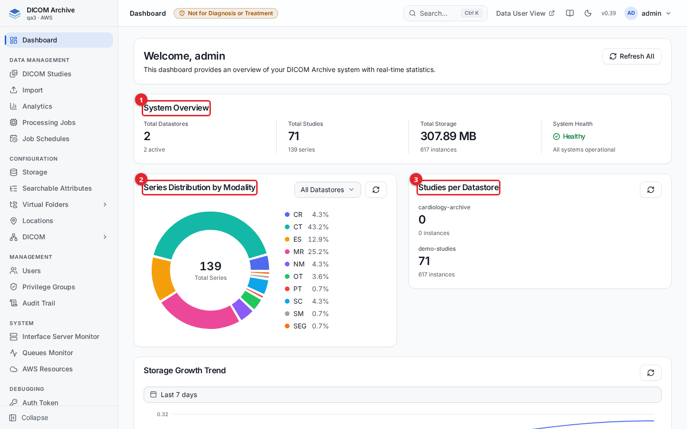
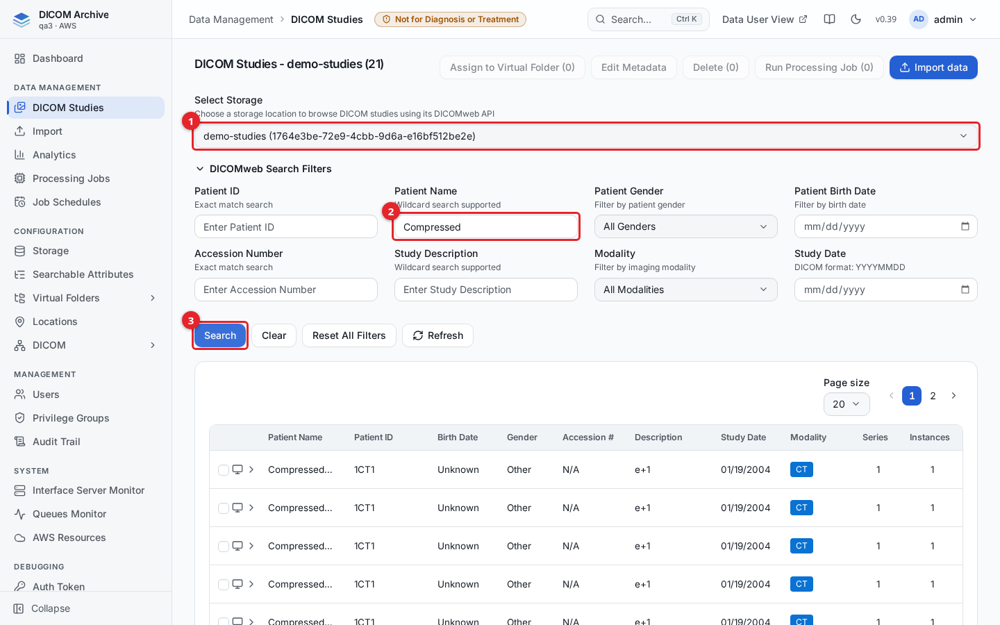
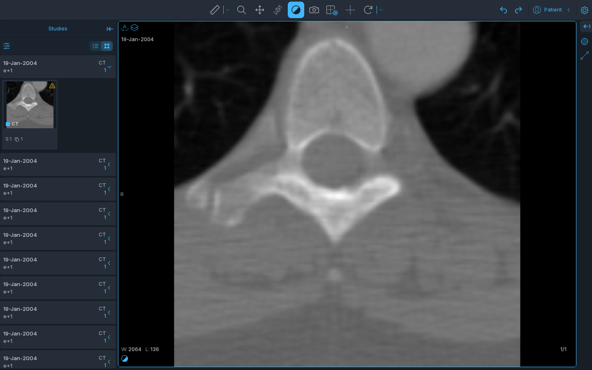
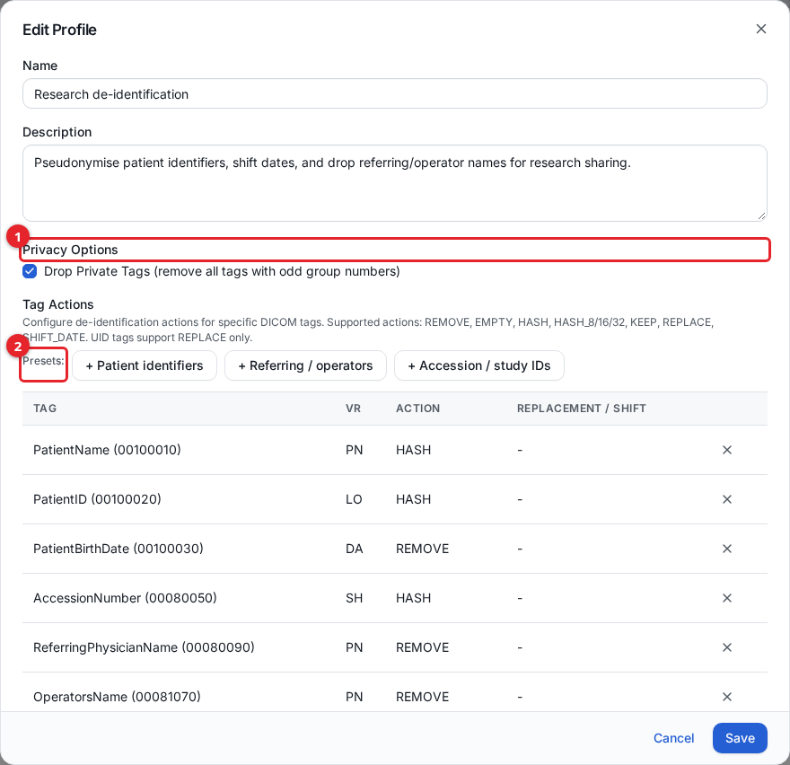
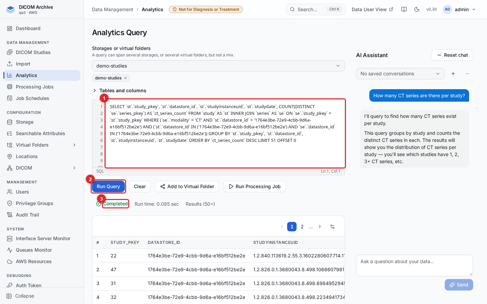
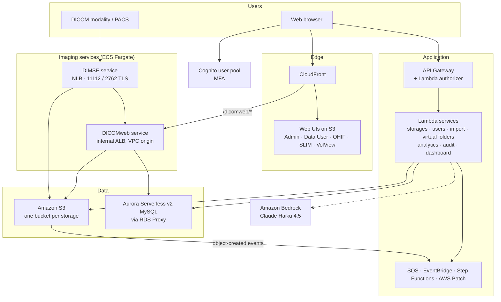
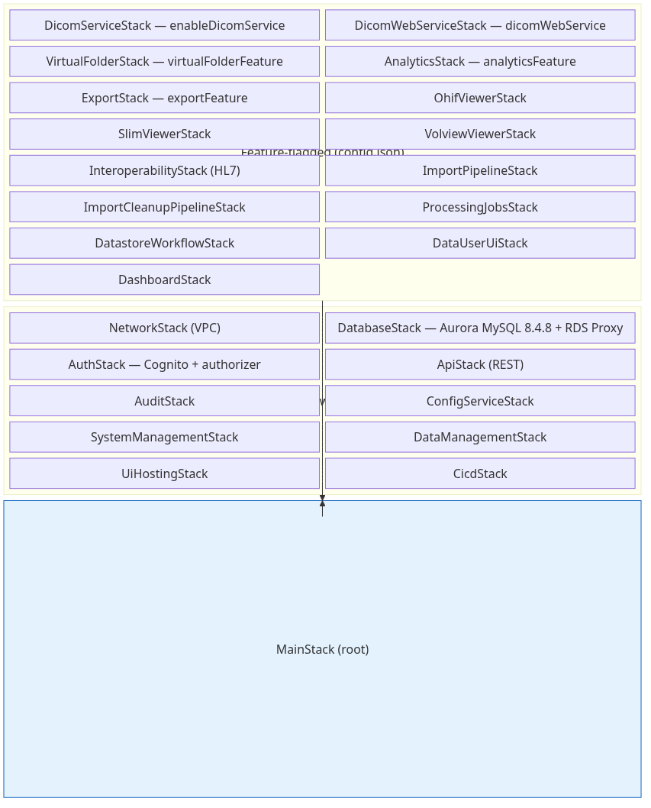

<p align="center">
  
  
  
  
</p>

<h1 align="center">DICOM Archive</h1>

<p align="center">
  <strong>A research-oriented DICOM archive on Amazon S3, deployed into your own AWS account as one CDK stack</strong>
</p>

> **NOT FOR DIAGNOSTIC USE.** This software is intended for research, development and archival purposes only. It is **not** a certified medical device, has not been cleared or approved by the FDA or any regulatory body, and must **not** be used for clinical diagnosis or any primary diagnostic decision-making. Use in a clinical setting is at the sole risk of the deploying organization.

> **SAMPLE CODE: HARDENING REQUIRED BEFORE USE.** This is sample code for demonstration purposes. Don't deploy it without additional security hardening, testing and review by your security team. The security guidance in the documentation applies to every deployment, whether test, evaluation or live.

> **TLS INSIDE THE DICOMWEB PATH (public mode).** So that the stack can be deployed without a domain you own, the two internal hops behind CloudFront use HTTP inside the AWS private network: CloudFront → the internal DICOMweb load balancer (port 80), and the load balancer → the DICOMweb containers (port 8080). Clients still connect to CloudFront over HTTPS. This is acceptable only for demonstration. Before any use beyond the demo scope, you **must** install a certificate for a domain you control and switch these hops to HTTPS. See [docs/installation.md](docs/installation.md#network-path-for-dicomweb).

<p align="center">
  <a href="#what-it-does">What it does</a> •
  <a href="#quick-start">Quick start</a> •
  <a href="#documentation">Documentation</a> •
  <a href="#architecture">Architecture</a> •
  <a href="website/public/CHANGELOG.md">Changelog</a>
</p>



## What it does

DICOM Archive stores medical images as plain objects in Amazon S3 buckets you own, and keeps a searchable index of them in Aurora MySQL. Files arrive through the browser, DICOMweb, DICOM network transfers or a plain `aws s3 cp`, and are indexed automatically. Administrators manage storages, access and DICOM networking from a web UI. Researchers and clinicians browse, view and share the studies they've been granted.

> **PHI / HIPAA:** This solution stores and processes Protected Health Information. It is a building block, not a certified compliance solution — deploying it in a HIPAA-compliant manner is the operator's responsibility. See [`PHI-HANDLING.md`](PHI-HANDLING.md).

| Area | What you can do | Guide |
|---|---|---|
| **Storage** | Create S3-backed storages, or import an existing bucket read-only. Any DICOM file written to a bucket is indexed, including files inside tar and ZIP archives. | [Storage](docs/storage.md) |
| **Import** | Upload DICOM files and folders from the browser. Encapsulate PDF, JPEG/PNG and MP4 files as DICOM. Ingest Aperio SVS and Ventana BIF whole-slide images without conversion. | [Importing data](docs/importing-data.md), [supported files](docs/importing-data.md#supported-files) |
| **Search and view** | Search studies by patient, study and custom attributes. Open them in the OHIF viewer, or the SLIM viewer for microscopy. Edit patient and study metadata, and delete studies or series. | [Studies](docs/studies.md), [Searchable attributes](docs/searchable-attributes.md) |
| **Data-user website** | A separate, simpler website at `/data-user/` for clinicians and researchers who only browse and view the data they've been granted. | [Data-user website](docs/data-user-view.md) |
| **Virtual folders** | Group studies from several storages into a folder without copying them, by hand or with assignment rules. Attach a de-identification profile so the folder only serves pseudonymised data. | [Virtual folders](docs/virtual-folders.md) |
| **DICOM networking** | Run a DIMSE service (C-ECHO, C-STORE, C-FIND, C-GET, C-MOVE) in AWS behind a Network Load Balancer, or on-premises. Supports TLS and mutual TLS, AE-title authorization, IP allowlists and routing rules. | [DICOM networking](docs/dicom-networking.md) |
| **DICOMweb and API** | QIDO-RS, WADO-RS and STOW-RS for each storage and each virtual folder, with 31 transfer syntaxes tested. Everything in the admin UI is also available as a REST API. | [DICOMweb and REST API](docs/dicomweb-api.md) |
| **Analytics** | Ask questions in plain English, which Amazon Bedrock (Claude Haiku 4.5) turns into SQL, or write the SQL yourself. Queries run through a read-only database user. Send the results to a virtual folder or a processing job. | [Analytics](docs/analytics.md) |
| **Processing jobs** | Run container plug-ins, such as the built-in DICOM to NIfTI converter, on studies, series or virtual folders. Run them once or on a schedule, on CPU or GPU. | [Processing jobs](docs/processing-jobs.md) |
| **Access control** | Cognito sign-in with MFA required by default. Privilege groups set permissions per storage, per virtual folder and per management area. | [Users and access](docs/users-and-access.md) |
| **Audit and monitoring** | Every change, every DICOMweb store, study and series reads, every DIMSE operation and every denied request is written to the audit trail. Queue, resource and DICOM-service monitors show system health. | [Audit trail](docs/audit-trail.md), [Monitoring](docs/monitoring.md) |

<table>
  <tr>
    <td></td>
    <td></td>
  </tr>
  <tr>
    <td align="center">Search studies in a storage</td>
    <td align="center">View them in OHIF</td>
  </tr>
  <tr>
    <td></td>
    <td></td>
  </tr>
  <tr>
    <td align="center">De-identify a virtual folder</td>
    <td align="center">Query the archive</td>
  </tr>
</table>

## Quick start

You need an AWS account, the AWS CLI v2, Node.js 20 or later, Docker (or Finch/Podman), and a CDK-bootstrapped target region. Deploying into a dedicated AWS account is recommended.

```bash
git clone <repository-url>
cd <repository-folder>/cdk-infrastructure
npm install
# Edit config.json: set at least stackPrefix, adminEmail and networkMode.dnsName,
# and turn features on or off.
npx cdk deploy --all --require-approval never -c environment=prod
```

The shipped `config.json` deploys the private, in-VPC posture (`networkMode.mode` `"vpc"`): no CloudFront, a private API and an internal load balancer, reachable only from your network. To deploy the CloudFront-fronted public posture instead, add `-c networkMode.mode=public`. See [network modes](docs/installation.md#networkmode).

A fresh deployment takes about an hour. When it finishes:

1. Check the `admin` user's temporary password in the email sent to `adminEmail`.
2. Open the admin UI and sign in: `https://<networkMode.dnsName>/admin/` in `vpc` mode (create the DNS record for that name pointing at the `FrontDoorAlbDns` output), or `https://<CloudFrontDistributionUrl>/admin/` in `public` mode. You set a new password and enrol a TOTP authenticator app.
3. Follow [Getting started](docs/getting-started.md) to create your first storage, load data, receive images over DICOM and give someone access.

Every `config.json` key and `-c` deploy flag, account limits worth checking, updating and teardown are in the [installation guide](docs/installation.md).

## Documentation

**Using the archive**

| Guide | Covers |
|---|---|
| [Installation](docs/installation.md) | Prerequisites, configuration reference, deploying, first sign-in, on-premises DIMSE install, updates, teardown |
| [Getting started](docs/getting-started.md) | First setup step by step: storage, upload, viewing, receiving DICOM, users; then a tour of the admin UI |
| [Storage](docs/storage.md) | Creating and importing storages, automatic indexing, storage classes, deletion |
| [Searchable attributes](docs/searchable-attributes.md) | Adding DICOM tags as search columns |
| [Importing data](docs/importing-data.md) | Supported file types and which import path takes each; browser upload, import jobs, non-DICOM import, AWS CLI, whole-slide images |
| [Studies](docs/studies.md) | Searching, viewing, editing metadata, deleting |
| [Data-user website](docs/data-user-view.md) | The website for clinicians and researchers: sign-in, browsing, viewers, de-identified folders |
| [Virtual folders](docs/virtual-folders.md) | Folders, de-identification profiles, assignment rules |
| [DICOM networking](docs/dicom-networking.md) | Locations, interfaces, entities, routing rules, TLS, on-premises gateway, testing with dcmtk |
| [Analytics](docs/analytics.md) | Natural-language and SQL queries over the index |
| [Processing jobs](docs/processing-jobs.md) | Plug-ins, running jobs, schedules |
| [Users and access](docs/users-and-access.md) | Users, privilege groups, MFA |
| [Audit trail](docs/audit-trail.md) | What is recorded, searching, exporting |
| [Monitoring](docs/monitoring.md) | Queues, AWS resources, exceptions, CloudWatch |
| [DICOMweb and REST API](docs/dicomweb-api.md) | Authentication, endpoints, curl examples, connecting viewers |

**Design and reference**: the index of design and reference documents is in [docs/README.md](docs/README.md).

## Architecture



The CloudFormation stack nests one stack per area, and `config.json` feature flags turn the optional ones on or off.

<p align="center">
  
</p>

See [docs/DESIGN.md](docs/DESIGN.md) for the full architecture (system, auth, ingest, DICOMweb and virtual-folder diagrams).

## Technology

| Component | Technology |
|---|---|
| Infrastructure | AWS CDK v2 (TypeScript) |
| Compute | AWS Lambda (Node.js 24, Python), ECS Fargate, AWS Batch for plug-ins |
| Database | Aurora Serverless v2 (MySQL 8) through RDS Proxy |
| Storage | Amazon S3 |
| Identity | Amazon Cognito (TOTP MFA), IAM Roles Anywhere for on-premises services |
| Messaging and workflows | Amazon SQS, SNS, EventBridge, AWS Step Functions |
| Network | VPC, CloudFront (with VPC origin), Network and Application Load Balancers |
| DICOM | pydicom, pynetdicom, highdicom, python-gdcm, pylibjpeg |
| Web UIs | React 19, Tailwind CSS, Radix UI, TanStack Table |
| Viewers | OHIF Viewer, SLIM microscopy viewer |
| AI | Amazon Bedrock (Anthropic Claude Haiku 4.5) for text-to-SQL |

Release builds run a license check, `interface-container/dicomweb-s3/build/license_check.py`, that fails on GPL-family dependencies.

## Security

See [CONTRIBUTING](CONTRIBUTING.md#security-issue-notifications) for more information.

## License

This project is licensed under the Apache-2.0 License.
