# DICOM Archive — Architecture

> Canonical architecture reference. Every diagram is authored as Mermaid **in this
> file** and also rendered to a PNG in `docs/diagrams/`, so the diagrams stay in
> version control and regenerate deterministically (see
> [§9 Regenerating the diagrams](#9-regenerating-the-diagrams)).
> Last verified against the code: 2026-10-17.

## Contents

1. [Overview](#1-overview)
2. [System architecture](#2-system-architecture)
3. [Stack composition](#3-stack-composition)
4. [Network topology](#4-network-topology)
5. [Data model](#5-data-model)
6. [Authentication & authorization](#6-authentication--authorization)
7. [Ingest pipeline](#7-ingest-pipeline)
8. [Serving: DICOMweb, DIMSE, HL7, viewers](#8-serving-dicomweb-dimse-hl7-viewers)
9. [Regenerating the diagrams](#9-regenerating-the-diagrams)

---

## 1. Overview

The DICOM Archive is a serverless medical-imaging platform on AWS. It ingests
imaging data over multiple protocols, indexes it in a relational database, keeps
pixel data in per-datastore object storage, and serves it back through standard
DICOMweb and several in-browser viewers. Every access is scoped to a single
*datastore* (the tenancy boundary) and enforced by a token-based authorizer.

**Design principles**

| Principle | How it shows up |
|---|---|
| Serverless-first | Lambda for APIs and ingest; Fargate only for the long-lived protocol listeners (DIMSE, HL7, DICOMweb). |
| Metadata and pixels separated | The database holds the searchable index; pixels never leave their datastore's S3 bucket — reads are ranged GETs. |
| Tenancy by datastore | The authorizer resolves one `datastore_id` from the caller's token; that id — never a path segment — is what reaches SQL. |
| Feature-flagged composition | One root stack nests 25 stacks; optional subsystems switch on/off via `cdk-infrastructure/config.json`. |
| Least privilege at the edges | Private-isolated subnets for data, TLS to the database via RDS Proxy, per-interface tokens for the protocol services. |

**Primary building blocks**

| Layer | Components |
|---|---|
| Edge & identity | CloudFront, Cognito (User Pool + MFA), API Gateway + Lambda authorizer |
| Protocol services (Fargate) | DIMSE (C-STORE/FIND/MOVE/GET), DICOMweb-S3 (QIDO/WADO/STOW), HL7 (MLLP) |
| Serverless compute | API Lambdas, the ingest pipeline, Step Functions datastore workflow |
| Data & storage | Aurora MySQL 8.4.8 via RDS Proxy, per-datastore S3 buckets, Secrets Manager |
| Viewers | OHIF, SLIM, VolView (static web apps on S3 behind CloudFront) |

---

## 2. System architecture

End-to-end: browsers reach the API and static viewers through CloudFront; DICOM
and HL7 clients reach the Fargate listeners directly over TLS; all three write
paths converge on the same ingest pipeline, which indexes into Aurora and stores
pixels in the datastore bucket.


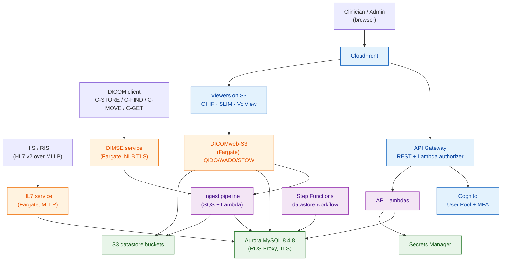

---

## 3. Stack composition

The platform deploys as one root `MainStack` that nests 25 stacks. The
**Foundation** tier is always deployed; the **Feature-flagged** tier is switched
per `config.json`. The diagram reads bottom-up: everything composes into the root.

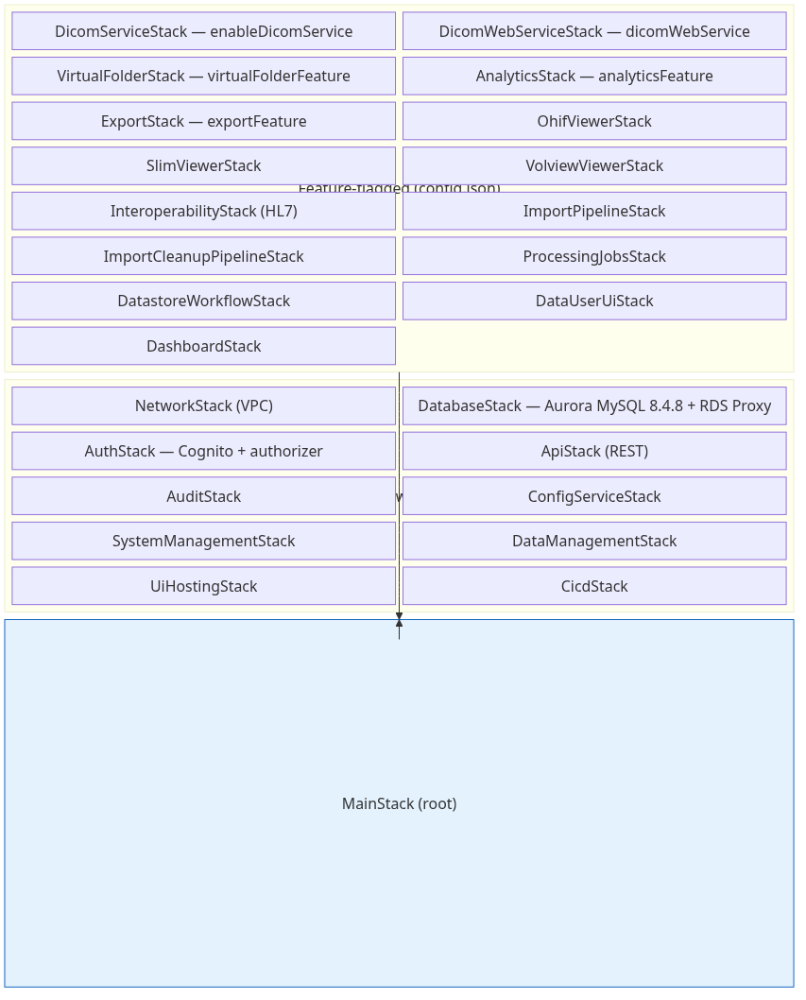

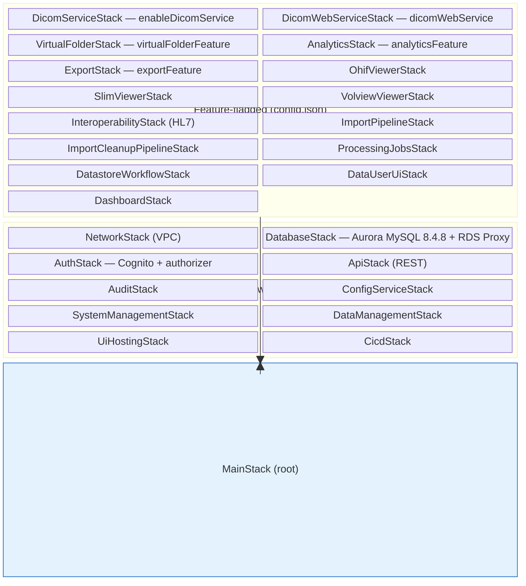

**Selected flags** (`cdk-infrastructure/config.json`)

| Flag | Enables |
|---|---|
| `enableDicomService` | DIMSE Fargate listener (C-STORE/FIND/MOVE/GET) |
| `dicomWebService` / `s3StorageFeature` | DICOMweb-S3 Fargate service (QIDO/WADO/STOW) |
| `virtualFolderFeature` | Virtual folders + de-identified per-folder databases |
| `analyticsFeature` | Analytics API (direct-SQL over the index) |
| `ohifViewer` / `slimViewer` / `volviewFeature` | The respective in-browser viewers |
| `exportFeature` | Study/series export |

---

## 4. Network topology

The VPC has three subnet tiers. Data (Aurora, RDS Proxy) sits in **private-isolated**
subnets with no internet route. Fargate tasks and Lambdas that need outbound access
run in **private-with-egress** subnets through a single NAT gateway. Gateway/interface
VPC endpoints (S3, ECR, …) keep most traffic off the NAT. Only the load balancers
live in **public** subnets.

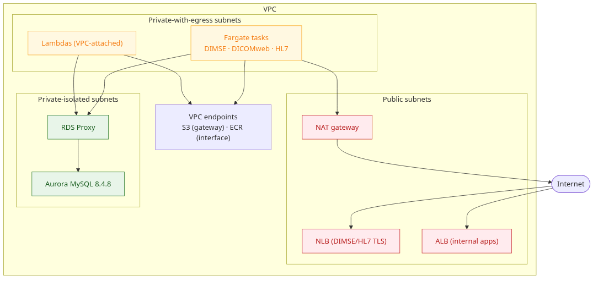

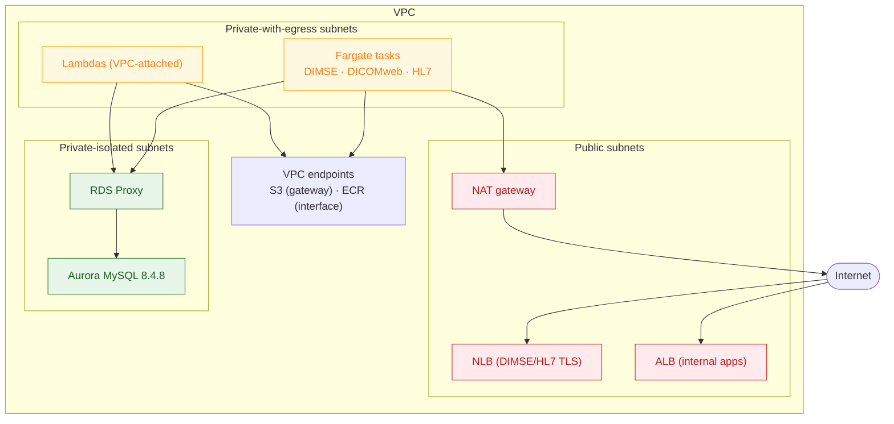

---

## 5. Data model

Indexing follows the DICOM information hierarchy — **patient → study → series →
instance** — with each instance pointing at its object in S3 via `storage_index`
and its DICOM header in `Instancemetadata`. Soft deletes cascade down the chain
(`deleted_at`), and per-study/per-datastore rollups (`study_stats`,
`datastore_statistics`) keep counts cheap without re-scanning.

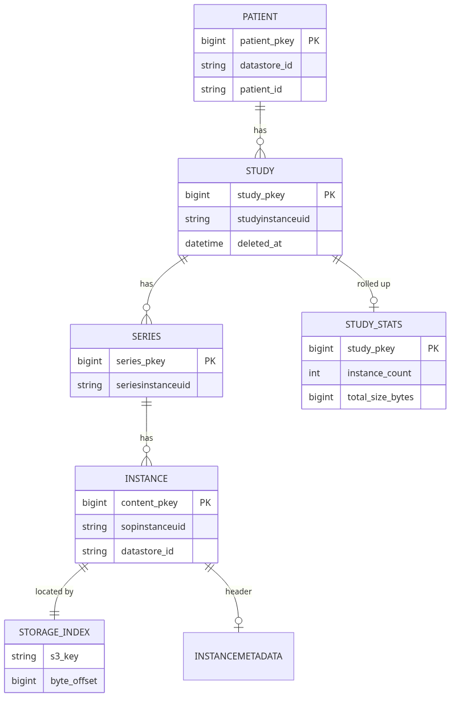

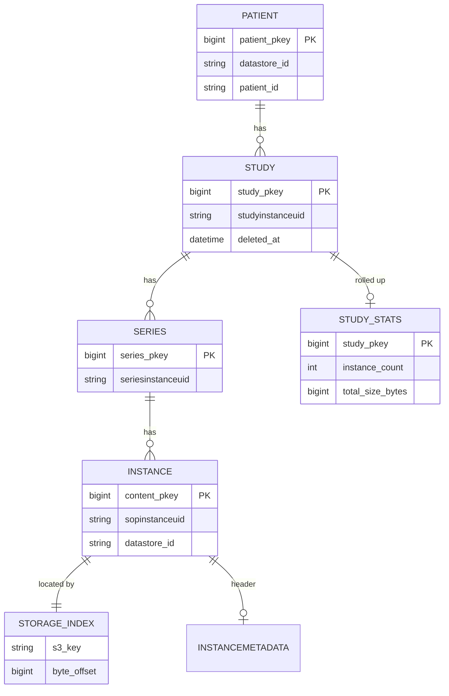

Virtual folders get their **own** database (`vf_` + the folder UUID, validated
against `^vf_[0-9a-f]{32}$`) so a de-identified view can carry rewritten metadata
without touching the source datastore's tables.

---

## 6. Authentication & authorization

Cognito issues a JWT (with MFA); API Gateway's Lambda authorizer resolves the
caller's privileges and injects a scoped context. The **tenancy rule** is absolute:
the only `datastore_id` that reaches SQL is the one the authorizer validated against
`datastore_privileges` — the path segment is treated as untrusted input.

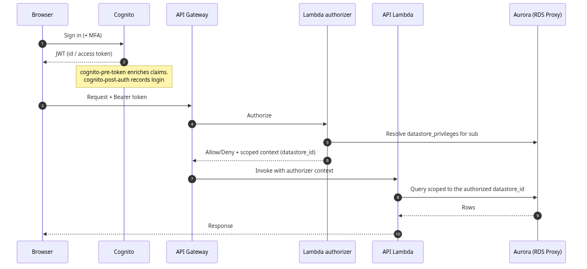

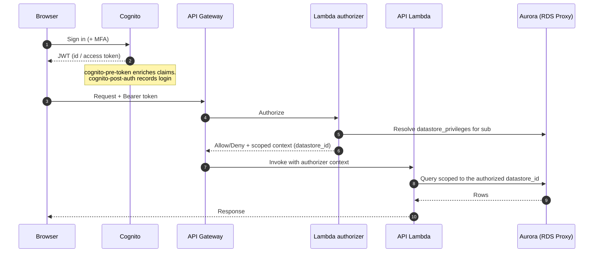

The DIMSE and DICOMweb services apply the same rule with **per-interface tokens**
(`dicom_service_token.py`): each protocol interface carries its own credential, and
writes are refused unless the target datastore's `access_level` is writable.

---

## 7. Ingest pipeline

All three write paths (DIMSE C-STORE, DICOMweb STOW, browser/bucket import) land an
object in the datastore bucket; an S3 event drives the ingest Lambda, which parses
the header, writes the index rows, and updates the incremental stats rollup. Object
removal soft-deletes the matching rows.

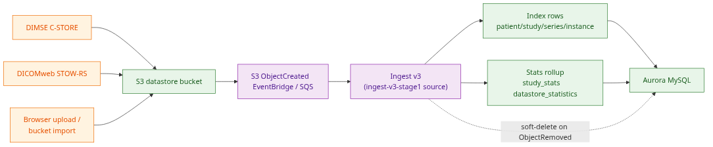

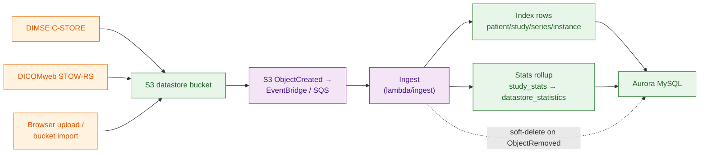

> All S3-event ingest is one code base in `lib/import/lambda/ingest/`:
> `handler.py` (SQS entry), `engine.py` (per-object indexing) and `aggregate.py`
> (series/study recompute). Statistics use an incremental three-tier rollup rather
> than a full re-scan of the index.

Pathology (SVS/BIF) imported through the Non-DICOM Import (V2) UI does not go
through the encapsulator: the V2 encapsulator copies the slide into the datastore
bucket and writes a `{slide}.json` sidecar (`{filepath, DICOM:{…}}`), then the
same `s3-ingest`/`path_ingest` whole-slide virtualization runs — so a slide
imported via the UI and one copied straight into a bucket share one ingest path.

---

## 8. Serving: DICOMweb, DIMSE, HL7, viewers

**DICOMweb-S3** is the browser-facing read/write service. Reads (QIDO search, WADO
retrieve, download) are the common path and stream ranged GETs straight from the
datastore bucket — pixels are never copied into the service. Writes (STOW store,
DELETE) are gated on a writable `access_level`.

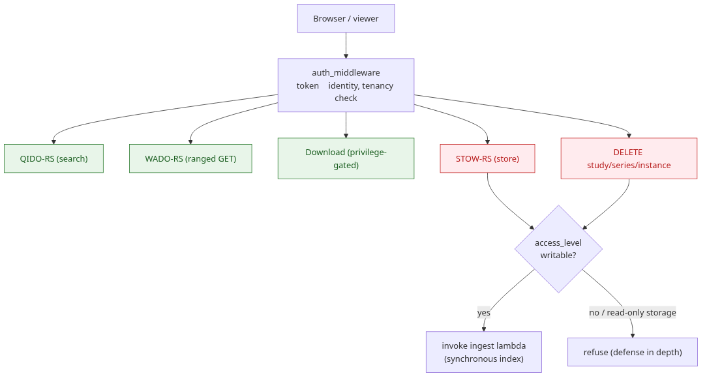

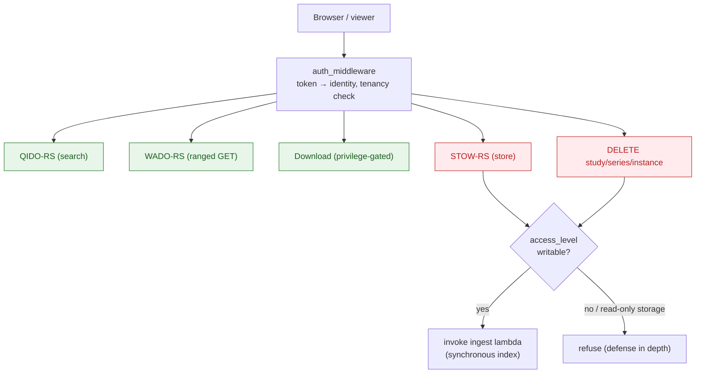

**DIMSE service** (Fargate behind a TLS NLB) implements C-STORE, C-FIND, C-MOVE
and C-GET. C-MOVE and C-GET share a single `RETRIEVE` privilege and reuse the same
WADO-RS retrieval internally. Routing rules decide which datastore bucket an
association's objects land in.

**HL7 service** (Fargate, MLLP) receives HL7 v2 messages one connection at a time,
validates them, synchronises patient demographics into the index, and stores the
raw message.

**Viewers** (OHIF, SLIM, VolView) are static web apps on S3 served through
CloudFront; each talks to DICOMweb-S3 for pixels and metadata using the signed-in
user's token.

**Virtual folders & de-identification** — assigning content to a virtual folder
runs it through the de-id consumer, which writes rewritten metadata into that
folder's own `vf_<hex>` database; viewers then read the folder through the same
DICOMweb service.

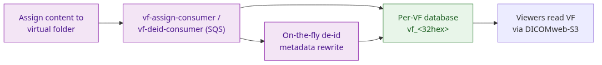

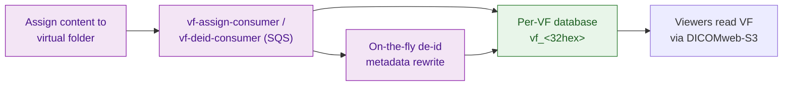

---

## 9. Regenerating the diagrams

Each diagram is a Mermaid fenced block in this file, mirrored by a `.mmd` source in
`docs/diagrams/`. To re-render the PNGs after editing:

```bash
# one-time: npm install @mermaid-js/mermaid-cli
# puppeteer.json: {"args":["--no-sandbox","--disable-setuid-sandbox"]}
for name in system-architecture stack-map network data-model auth-flow \
            ingest-flow dicomweb-paths vf-deid; do
  mmdc -p puppeteer.json -i docs/diagrams/$name.mmd -o docs/diagrams/$name.png -b white -w 1100
done
```

A Word export (`DESIGN.docx`) can be produced from this file with `python-docx`; it
is a generated artifact (gitignored), not a source of truth.
