# System Design — DICOM Archive

This document describes the detailed architecture of the DICOM Archive solution, covering all CDK stacks, Lambda functions, API endpoints, database schema, and service interactions.

---

## Table of Contents

1. [Deployment Overview](#deployment-overview)
2. [Stack Architecture](#stack-architecture)
3. [Network Stack](#network-stack)
4. [Database Stack](#database-stack)
5. [Auth Stack](#auth-stack)
6. [Datastore Authorizer Stack](#datastore-authorizer-stack)
7. [API Stack](#api-stack)
8. [Interoperability Stack](#interoperability-stack)
9. [DICOM Service Stack](#dicom-service-stack)
10. [Config Service Stack](#config-service-stack)
11. [Datastore Workflow Stack](#datastore-workflow-stack)
12. [Import Pipeline Stack](#import-pipeline-stack)
13. [Import Cleanup Pipeline Stack](#import-cleanup-pipeline-stack)
14. [Virtual Folder Stack](#virtual-folder-stack)
15. [System Management Stack](#system-management-stack)
16. [Dashboard Stack](#dashboard-stack)
17. [Data Management Stack](#data-management-stack)
18. [Audit Stack](#audit-stack)
19. [Analytics Stack](#analytics-stack)
20. [Processing Jobs Stack](#processing-jobs-stack)
21. [Export Stack](#export-stack)
22. [OHIF Viewer Stack](#ohif-viewer-stack)
23. [SLIM Viewer Stack](#slim-viewer-stack)
24. [Data User UI Stack](#data-user-ui-stack)
25. [CI/CD Stack](#cicd-stack)
26. [UI Hosting Stack](#ui-hosting-stack)
27. [Database Schema](#database-schema)
28. [DICOM Service Architecture](#dicom-service-architecture)
29. [Configuration Flow](#configuration-flow)
30. [Security Model](#security-model)

---

## Deployment Overview

The solution deploys as a single CloudFormation stack (`MainStack`) that nests **24 stacks** — 18 core stacks that always deploy, plus 6 optional stacks gated by `config.json` feature flags. All resources are tagged with a `Deployment` tag matching the `stackPrefix` from `config.json`.

Key shared resources created at the main stack level:
- **Shared Lambda Layer** — Common utilities (database helpers, audit, versioning) used by most Lambda functions
- **EventBridge Event Bus** — System-wide event routing for audit, config updates, and notifications
- **Build Bucket** — Shared S3 bucket for CodePipeline source and artifacts (versioned)

The DIMSE service container image is built by a `DimseServiceImageConstruct` (a construct, not a nested stack) created at the main stack level.

---

## Stack Architecture

```
MainStack
│
├── Shared resources (created directly in MainStack)
│     ├── Shared Lambda Layer
│     ├── EventBridge Event Bus
│     ├── Build Bucket (S3)
│     └── DimseServiceImageConstruct   DICOM service Docker image build
│
├── Core stacks (always deployed)
│     ├── NetworkStack              VPC, subnets, VPC endpoints, security groups
│     ├── DatabaseStack             Aurora Serverless v2, schema init
│     ├── AuthStack                 Cognito, Lambda authorizer, credentials
│     ├── DatastoreAuthorizerStack      S3 datastore access-control Lambda
│     ├── UiHostingStack            S3 bucket, CloudFront distribution
│     ├── ApiStack                  API Gateway, REST API, authorizer
│     ├── DatastoreWorkflowStack    Step Functions for create/delete datastores
│     ├── DataUserUiStack           Data User UI build and hosting
│     ├── InteroperabilityStack     Locations, interfaces, entities, routing
│     ├── SystemManagementStack     Users, privilege groups, audit/resources/tags APIs
│     ├── AuditStack                EventBridge → SQS → Lambda audit trail
│     ├── ImportCleanupPipelineStack  S3 cleanup after imports/deletes
│     ├── ImportPipelineStack       S3 import pipeline, non-DICOM import
│     ├── ConfigServiceStack        Configuration service for DICOM nodes
│     ├── DashboardStack            Dashboard and system monitor APIs
│     ├── DataManagementStack       Series deletion + metadata update
│     ├── ProcessingJobsStack       Processing-jobs framework API
│     └── CicdStack                 CI/CD pipeline for admin website
│
└── Optional stacks (gated by config.json feature flags)
      ├── VirtualFolderStack        virtualFolderFeature — virtual folders + DICOMweb proxy (ECS)
      ├── OhifViewerStack           ohifViewer — OHIF viewer build and hosting
      ├── SlimViewerStack           slimViewer — SLIM viewer build and hosting
      ├── AnalyticsStack            analyticsFeature — Glue/Athena/Iceberg analytics
      ├── ExportStack               exportFeature — DICOM export (Step Functions)
      └── DicomServiceStack         enableDicomService — ECS Fargate DICOM service with NLB
```

---

## Network Stack

Creates the VPC, subnets, VPC endpoints, and security groups for the solution.

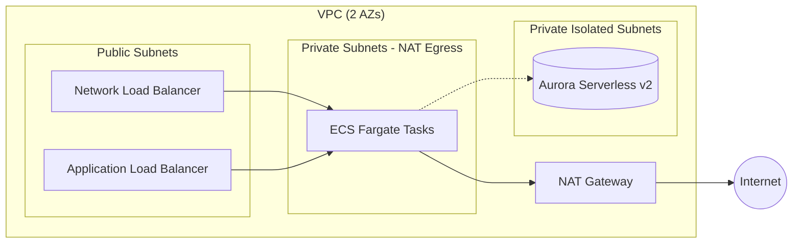

**Resources:**
- VPC with 2 AZs, 1 NAT Gateway
- Public subnets (for NLB, ALB — internet-facing load balancers only)
- Private subnets with NAT egress (for ECS Fargate tasks — no direct internet exposure)
- Private isolated subnets (for Aurora — no internet access)
- ECS security group (allows DICOM port 11112, 2762, health check 8080 from NLB)
- Lambda security group

**VPC Endpoints:**
| Endpoint | Type | Purpose |
|----------|------|---------|
| S3 | Gateway (free) | ECR image layers, S3 data access |
| ECR API | Interface | ECR API calls |
| ECR Docker | Interface | Docker image pull |
| CloudWatch Logs | Interface | Container log shipping |
| Secrets Manager | Interface | DB credentials, TLS certs |
| STS | Interface | IAM role assumption |
| S3 | Gateway | S3 archive access from private subnets |

---

## Database Stack

Provisions Aurora Serverless v2 (Aurora MySQL 8.4) behind an RDS Proxy. The Data API is off.

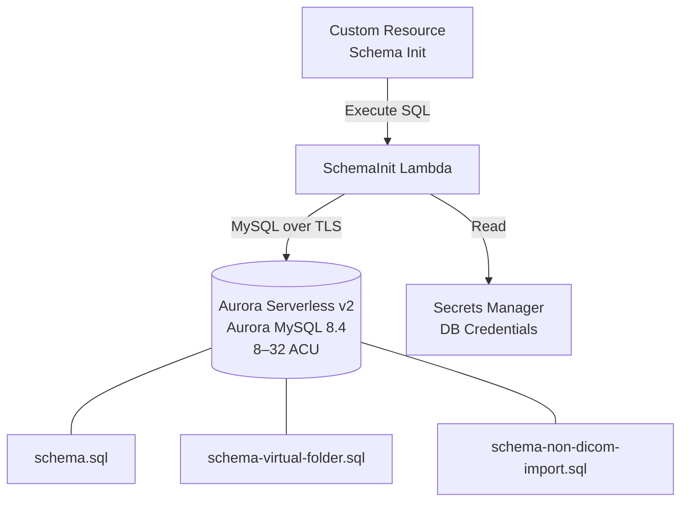

**Resources:**
- Aurora Serverless v2 cluster (8–32 ACU), engine `8.4.mysql_aurora.8.4.8`. The writer's parameter group sets `authentication_policy` to `*:mysql_native_password`, the plugin the RDS Proxy and every DB user use.
- Database: `dicomarchive`
- Schema initialization via custom resource Lambda (Node.js 24.x)

**Schema Init Lambda:** Executes SQL schema files on create/update:
- `schema.sql` — Core tables (20+ tables)
- `schema-virtual-folder.sql` — Virtual folder tables (conditional)
- `schema-non-dicom-import.sql` — Non-DICOM import table
- Inserts default admin user and privilege groups

Schema changes assume fresh deployments: the SQL files always describe the current end-state, and there is no in-place migration path for existing databases.

---

## Auth Stack

Manages authentication and authorization.

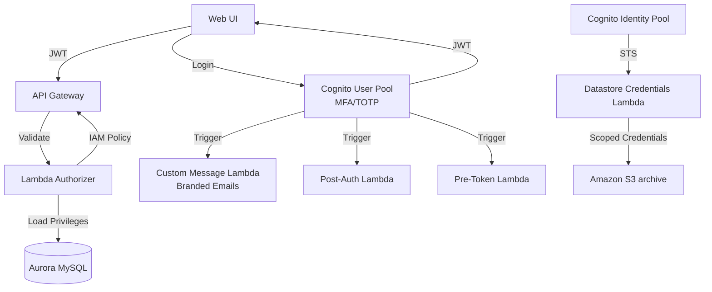

**Resources:**
- **Cognito User Pool** — TOTP MFA (required when `mfa` is enabled in `config.json`, otherwise optional), custom message Lambda trigger, email-only account recovery, strong password policy
- **Cognito User Pool Client** — For web UI authentication (no client secret; USER_PASSWORD + SRP auth flows)
- **Cognito Identity Pool** — For AWS credential vending; the authenticated role grants `execute-api:Invoke` and ECR pull for the DIMSE service installer
- **Lambda Authorizer** — Custom API Gateway token authorizer that validates JWT tokens and loads user privileges from the database
- **DICOMWeb Access Role** — IAM role (assumed by the Datastore Credentials Lambda) scoped to datastores tagged with this deployment, granting S3 QIDO/WADO read actions
- **Datastore Credentials Lambda** — Vends scoped STS credentials for S3 datastore access
- **Custom Message Lambda** — Branded emails for welcome, password reset, MFA reset

**Lambda Functions:**
| Function | Purpose |
|----------|---------|
| `ApiAuthorizer` | Validates JWT, loads user privileges, returns IAM policy |
| `DatastoreCredentials` | Returns scoped STS credentials for S3 datastore access |
| `CognitoPostAuth` | Post-authentication trigger for login tracking |
| `CognitoPreToken` | Pre-token generation trigger |
| `CognitoCustomMessage` | Custom branded email templates (welcome, password reset, MFA reset) |

The default `admin` user and `Admins` group are created directly in the user pool (via `CfnUserPoolUser`); Cognito emails a temporary password to the configured `adminEmail` on first deploy.

---

## Datastore Authorizer Stack

Provides an access-control Lambda that the DICOMweb service invokes to authorize DICOMweb requests against this deployment's datastores.

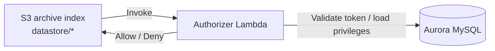

**Resources:**
- **Authorizer Lambda** (Node.js 24.x, 10s timeout) — Validates the caller's Cognito token/privileges and returns an allow/deny decision. Invoked by the DICOMweb service to authorize requests against this deployment's datastores.

**Environment:** `USER_POOL_ID`, `USER_POOL_CLIENT_ID`, `DB_CLUSTER_ARN`, `DB_SECRET_ARN`, `DB_NAME`.

---

## API Stack

Creates the central REST API Gateway.

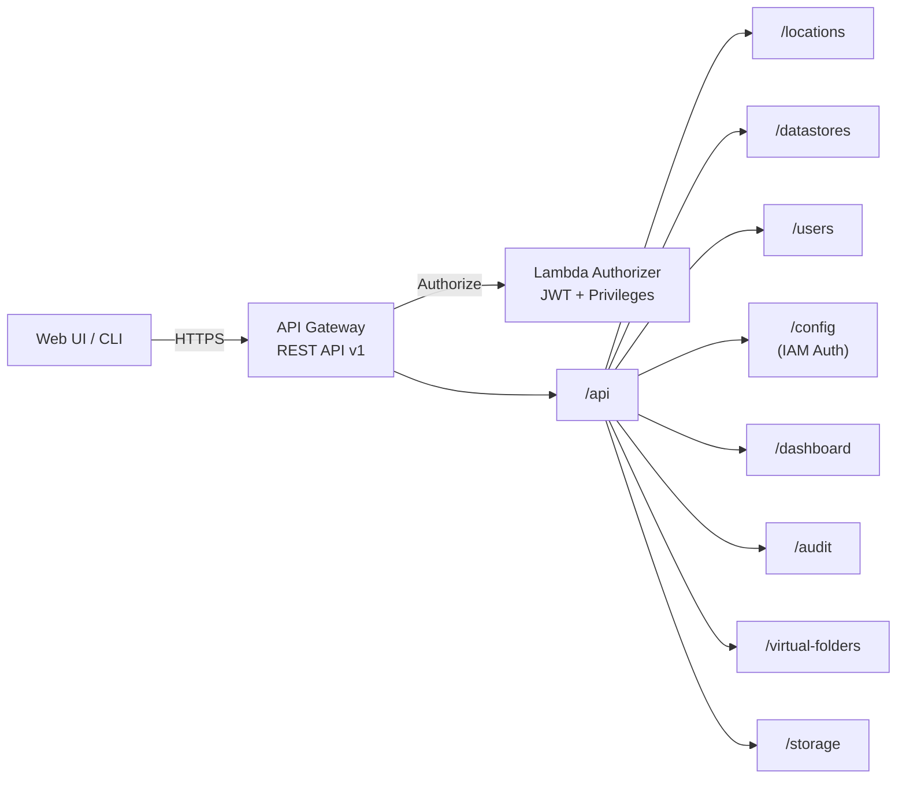

**Resources:**
- API Gateway REST API with stage `v1`
- CORS enabled for all origins
- Binary media types: `application/zip`, `application/octet-stream`
- Custom Lambda authorizer with 5-minute cache
- `/api` root resource shared by all stacks

**Lambda Functions:**
| Function | Purpose |
|----------|---------|
| `ApiResourceTracker` | Custom resource that stores API Gateway ID in database |

All other stacks add their API resources under the shared `/api` resource.

---

## Interoperability Stack

Manages DICOM network configuration — locations, interfaces, entities, and routing.

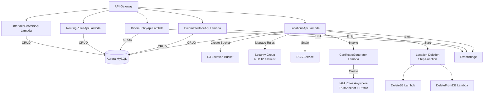

**Lambda Functions:**
| Function | API Resource | Purpose |
|----------|-------------|---------|
| `LocationsApi` | `/locations` | CRUD for locations, S3 bucket creation, security group management, ECS scaling, config package downloads |
| `DicomInterfaceApi` | `/dicom-interfaces` | CRUD for DICOM interfaces (AE titles), deletion impact preview |
| `DicomEntityApi` | `/dicom-entities` | CRUD for DICOM entities (remote systems), privilege management |
| `RoutingRulesApi` | `/routing-rules` | CRUD for routing rules, priority reordering |
| `InterfaceServersApi` | `/interface-servers` | Monitor active DICOM service instances |
| `CertificateGenerator` | (internal) | Generates IAM Roles Anywhere trust anchors and certificates |
| `LocationDeleteFromDB` | (Step Function) | Deletes location from database, cleans up IAM resources |
| `DeleteS3` | (Step Function) | Empties and deletes location S3 bucket |

**Step Functions:**
- **Location Deletion Workflow** — DeleteS3 → DeleteFromDB

**Key Behaviors:**
- Location creation auto-creates an S3 bucket with tag-based access policy
- Config package downloads generate AES-256 encrypted ZIP files
- Security group rules are managed per-IP with independent TLS/plain port selection
- Config updates emit `DICOM_CONFIG_UPDATED` events to EventBridge

---

## DICOM Service Stack

Deploys the ECS Fargate DICOM DIMSE service.

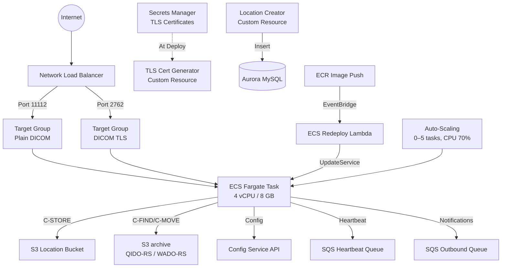

**Resources:**
- **Network Load Balancer** — Internet-facing, cross-zone, with security group
  - Listener port 11112 (plain DICOM) → target group port 11112
  - Listener port 2762 (DICOM TLS) → target group port 2762
- **ECS Fargate Service** — 4 vCPU, 8 GB RAM, private subnet (NAT egress), desired count 0
- **Auto-scaling** — 0–5 tasks, CPU-based (70% target)
- **TLS Certificates** — Custom resource generates self-signed CA + server cert, stored in Secrets Manager
- **Location S3 Bucket** — Per-location bucket with tag-based access policy
- **ECR Push Redeploy** — EventBridge rule triggers ECS redeployment on new image push

**Lambda Functions:**
| Function | Purpose |
|----------|---------|
| `TlsCertGenerator` | Custom resource that creates self-signed TLS CA and server certificates |
| `LocationCreator` | Custom resource that creates the default Fargate location in the database |
| `EcsRedeployOnPush` | Triggers ECS service update when new Docker image is pushed to ECR |

**Container Environment Variables:**
- `CONFIGURATION_API_ENDPOINT` — Config service URL (`{apiUrl}/config`)
- `LOCATION_ID` — Auto-created location ID
- `THREADCOUNT` — Worker thread count (20)
- `SCP_PORT` — 11112
- `DICOM_TLS_PORT` — 2762
- `STATUS_PORT` — 8080
- `LOGLEVEL` — INFO

---

## Config Service Stack

Provides configuration to DICOM service instances and manages dynamic config updates.

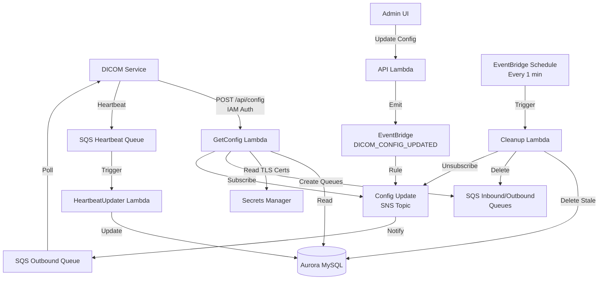

**Resources:**
- **SNS Topic** — Config update notifications
- **Heartbeat Queue** — SQS queue for service heartbeats
- **EventBridge Rule** — Routes `DICOM_CONFIG_UPDATED` events to SNS
- **Cleanup Schedule** — EventBridge rule runs every minute to clean up stale servers

**Lambda Functions:**
| Function | Purpose |
|----------|---------|
| `GetConfig` | POST `/api/config` (IAM auth) — Returns full configuration for a DICOM service instance. Creates SQS queues, SNS subscriptions, and event source mappings on first call. Returns location config, interfaces, entities, routing rules, TLS config, and queue URLs. |
| `HeartbeatUpdater` | Processes heartbeat messages from SQS, updates `interface_servers` table |
| `InterfaceServersCleanup` | Runs every minute, deletes stale servers (no heartbeat > 2 min), cleans up SQS queues and SNS subscriptions |

**Config Response Structure:**
```json
{
  "location": { "id", "name", "s3BucketName", ... },
  "interfaces": [{ "aeTitle", "dicomEntities", "routingRules", "accessibleDatastores" }],
  "tlsConfig": { "port", "verifyClient", "serverCert", "serverKey", "caCert", "clientCertificates" },
  "sqsConfig": { "inboundQueueUrl", "outboundQueueUrl", "heartbeatQueueUrl" }
}
```

---

## Datastore Workflow Stack

Manages S3 datastore lifecycle via Step Functions.

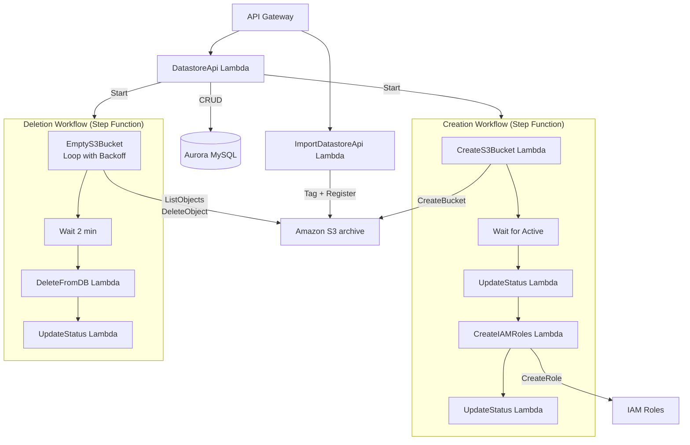

**Lambda Functions:**
| Function | Purpose |
|----------|---------|
| `CreateS3Bucket` | Creates the S3 archive bucket for the datastore |
| `CreateIAMRoles` | Creates read-only and store IAM roles for the datastore |
| `EmptyS3Bucket` | Empties the archive bucket (loop with backoff) |
| `DeleteFromDB` | Deletes the datastore record from the database |
| `UpdateStatus` | Updates datastore status in database |
| `DatastoreApi` | `/datastores` CRUD, `/datastores/import` for importing existing datastores |
| `ImportDatastoreApi` | Imports existing S3 datastores with tagging |

**Step Functions:**
- **Creation Workflow** — CreateS3Bucket → Wait → UpdateStatus → CreateIAMRoles → UpdateStatus
- **Deletion Workflow** — SetDeletingStatus → EmptyS3Bucket (loop) → Wait → DeleteFromDB → UpdateStatus

---

## Import Pipeline Stack

Handles DICOM import from S3.

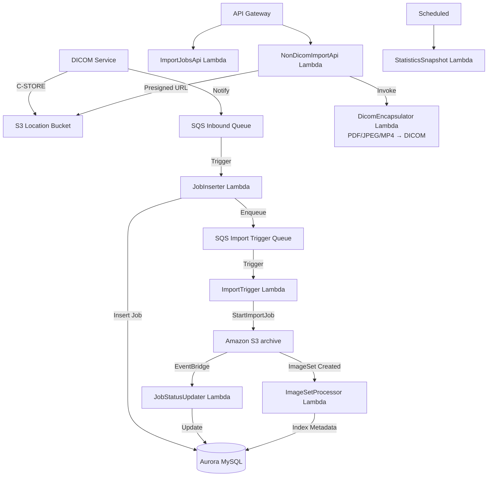

**Resources:**
- **Import Trigger Queue**, **Status Updater Queue**, **ImageSet Events Queue**, **Non-DICOM Encapsulation Queue** — SQS queues (each user-facing queue with a DLQ)
- **User Upload Bucket** — S3 bucket for presigned uploads (1-day lifecycle expiry)
- **System-wide Import Role** — IAM role used to read S3 during imports
- **EventBridge rules** — import job status changes and object lifecycle events routed to SQS; hourly statistics snapshot

**Lambda Functions:**
| Function | API Resource | Purpose |
|----------|-------------|---------|
| `ImportJobsApi` | `/import-jobs` (+ `/{proxy+}`) | CRUD for import jobs (cancel/retry dispatched in handler) |
| `UploadUrlGenerator` | `/import-jobs/upload-url`, `/non-dicom-import/upload-url` | Generates presigned S3 upload URLs |
| `NonDicomImportApi` | `/non-dicom-import` (+ `/{proxy+}`) | Non-DICOM file import management |
| `JobInserter` | (SQS trigger) | Processes inbound SQS messages from DICOM service, creates import jobs |
| `ImportTrigger` | (SQS trigger) | Triggers import jobs from S3 |
| `JobStatusUpdater` | (EventBridge → SQS) | Updates import job status from import events; enqueues S3 cleanup |
| `ImageSetProcessor` | (EventBridge → SQS) | Processes ImageSet create/update/delete events, extracts metadata, updates database |
| `DicomEncapsulator` | (SQS trigger, Python 3.14) | Encapsulates PDFs, images, videos as DICOM objects |
| `StatisticsSnapshot` | (hourly schedule) | Datastore statistics collection |
| `TrackDLQ` | (internal) | Records DLQ resources in `aws_resources` (custom-resource invocation currently disabled) |

---

## Import Cleanup Pipeline Stack

Removes S3 objects from location buckets after they have been imported (or after data is deleted), using a Step Functions loop driven by an SQS queue.

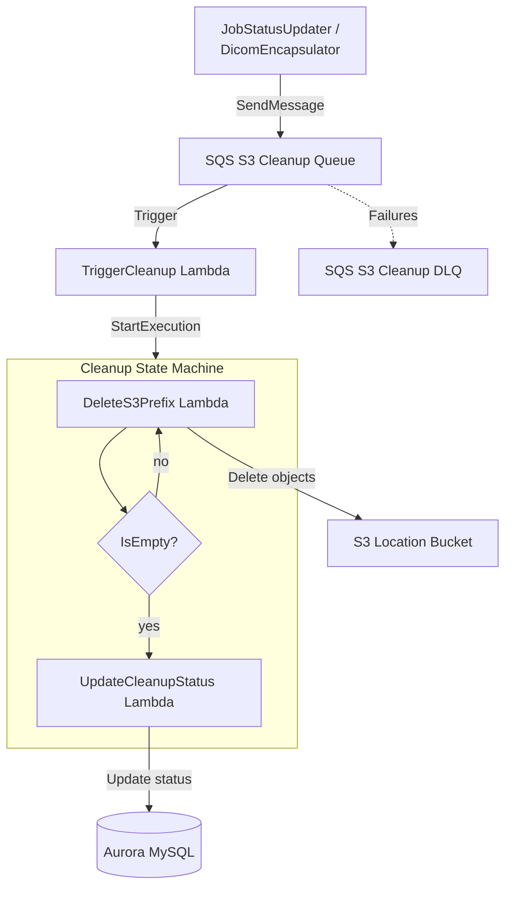

**Resources:**
- **S3 Cleanup Queue** — SQS queue (15-min visibility) with a DLQ (max 3 receives)
- **Cleanup State Machine** — Step Functions workflow that loops `DeleteS3Prefix` until the prefix is empty, then runs `UpdateCleanupStatus`

**Lambda Functions:**
| Function | Purpose |
|----------|---------|
| `DeleteS3PrefixFunction` | Deletes a batch of objects (and versions) under a `{stackName}-loc-*` location-bucket prefix; reports whether the prefix is now empty |
| `UpdateCleanupStatusFunction` | Marks the cleanup complete in the database |
| `TriggerCleanupFunction` | SQS-triggered; starts a Step Functions execution per cleanup request |

---

## Virtual Folder Stack

Provides virtual folder management and a DICOMweb proxy service.

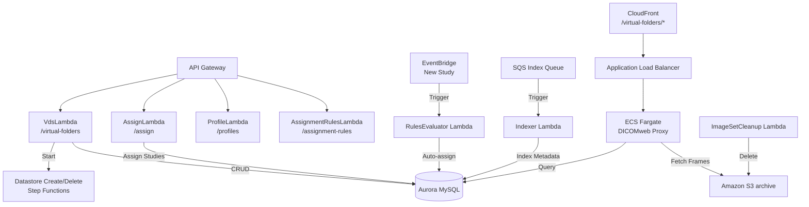

**Resources:**
- **ECS Fargate Service** — Virtual DICOMweb proxy (4 vCPU / 8 GB), private subnet (NAT egress), desired count 1
- **Application Load Balancer** — Internet-facing (public subnet), HTTP listener on port 80 → target port 8080 (`/health` health check), connected to CloudFront via the `/virtual-folders/*` behavior
- **Aurora MySQL** — Direct connection from ECS tasks on port 3306 (not Data API)
- **Indexer Queue** and **ImageSet Cleanup Queue** — SQS queues for metadata indexing and post-delete cleanup

**Lambda Functions:**
| Function | API Resource | Purpose |
|----------|-------------|---------|
| `VdsLambda` | `/virtual-folders`, `/virtual-folders/{id}`, `/virtual-folders/{id}/rules` | CRUD for virtual folders, write mode management |
| `AssignLambda` | `/virtual-folders/assign-study`, `/virtual-folders/assign-series`, `/virtual-folders/{id}/assignments`, `/virtual-folders/{id}/studies` | Assign/unassign studies and series; list assignments/studies |
| `ProfileLambda` | `/virtual-folders/indexing-profiles`, `/virtual-folders/deid-profiles`, `/virtual-folders/dicom-tags` | Indexing and de-identification profile management |
| `AssignmentRulesLambda` | `/virtual-folders/{id}/assignment-rules` | Auto-assignment rule management |
| `AssignmentRulesEvaluatorLambda` | (EventBridge) | Evaluates rules on `CreateImageSet`/`CopyImageSet` events |
| `IndexerLambda` | (SQS) | Indexes study metadata into virtual folder tables |
| `ImageSetCleanupLambda` | (EventBridge → SQS) | Cleans up indexed rows on object-deleted events |

---

## System Management Stack

User management, privilege groups, audit queries, and system resources.

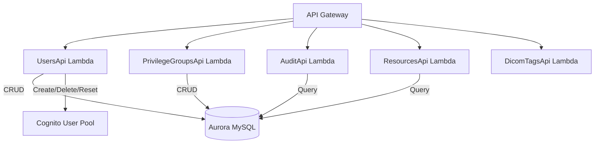

**Lambda Functions:**
| Function | API Resource | Purpose |
|----------|-------------|---------|
| `UsersApi` | `/users` | User CRUD, password reset, MFA reset, Cognito integration |
| `PrivilegeGroupsApi` | `/privilege-groups` | Privilege group CRUD with datastore/folder/management permissions |
| `AuditApi` | `/audit` | Query audit trail with filtering and pagination |
| `ResourcesApi` | `/aws-resources` | List tracked AWS resources |
| `DicomTagsApi` | `/dicom-tags` | DICOM tag dictionary lookup (no auth required) |

---

## Dashboard Stack

Storage analytics and system monitoring.

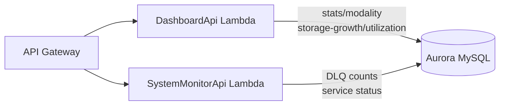

**Lambda Functions:**
| Function | API Resource | Purpose |
|----------|-------------|---------|
| `DashboardApi` | `/dashboard/stats`, `/dashboard/modality`, `/dashboard/storage-growth`, `/dashboard/utilization` | Storage statistics, modality breakdown, growth trends |
| `SystemMonitorApi` | `/system-monitor` | System health: DLQ counts, service status |

---

## Data Management Stack

Series deletion and metadata update operations on existing DICOM data.

> **Note:** This stack supports **series deletion** and **metadata update** (editing patient/study attributes). Merge and split operations (merge studies, split series, split instances) are planned but not yet implemented.

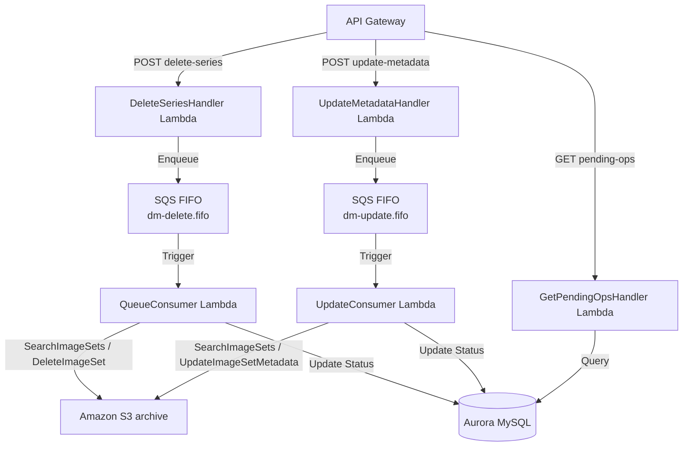

**Resources:**
- **`dm-delete.fifo` SQS FIFO Queue** — Serialized series deletion jobs
- **`dm-update.fifo` SQS FIFO Queue** — Serialized metadata update jobs

**Lambda Functions:**
| Function | API Resource | Purpose |
|----------|-------------|---------|
| `DeleteSeriesHandler` | `POST /storage/{storageId}/studies/{studyInstanceUID}/delete-series` | Enqueues a series deletion job |
| `UpdateMetadataHandler` | `POST /storage/{storageId}/studies/{studyInstanceUID}/update-metadata` | Enqueues a metadata update job |
| `GetPendingOpsHandler` | `GET /storage/{storageId}/pending-operations` | Lists pending operations |
| `QueueConsumer` | (SQS FIFO) | Identifies objects, deletes from S3, updates database |
| `UpdateConsumer` | (SQS FIFO) | Applies metadata updates via `UpdateImageSetMetadata`, updates database |

---

## Audit Stack

Audit trail processing for most user and system actions.

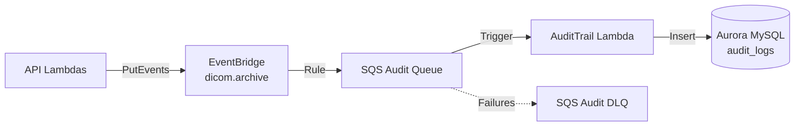

**Resources:**
- **Audit Queue** — SQS queue with DLQ (max 3 receives)
- **EventBridge Rule** — Routes `dicom.archive` events to the audit queue

**Lambda Functions:**
| Function | Purpose |
|----------|---------|
| `AuditTrail` | Processes audit events from SQS, writes to `audit_logs` table |
| `TrackDLQ` | Records the audit DLQ in the `aws_resources` table |

Most API Lambda functions emit audit events to EventBridge using the shared layer's audit helper.

---

## Analytics Stack

*Optional — deployed when `analyticsFeature` is enabled.* Indexes DICOM instance metadata into S3-backed Apache Iceberg tables queryable via Athena.

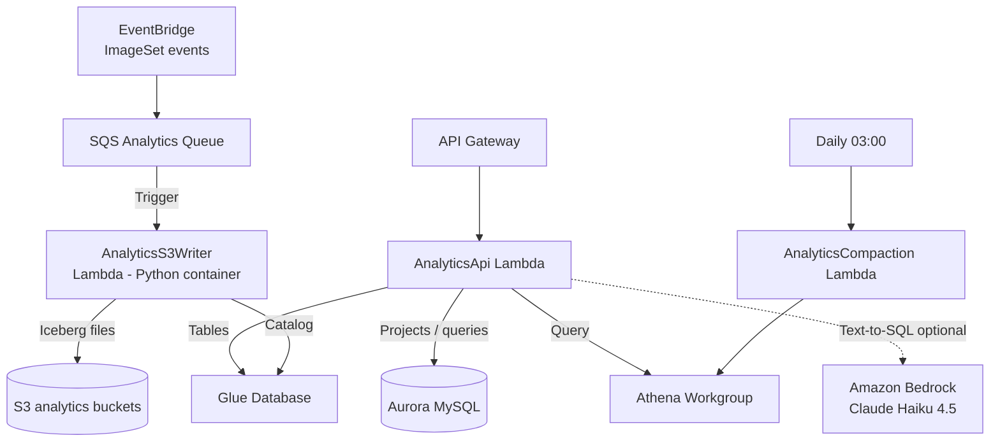

**Resources:**
- **Glue Database** (`{stackPrefix}_analytics`) and **Athena Workgroup** (engine v3) with a dedicated results bucket
- **Analytics Events Queue** — SQS queue fed by an EventBridge rule on object Created/Updated/Deleted events
- Per-project S3 buckets (`{stackPrefix}-analytics-*`) holding Iceberg data

**Lambda Functions:**
| Function | API Resource | Purpose |
|----------|-------------|---------|
| `AnalyticsApi` | `/analytics-projects` (+ `/{proxy+}`) | Project CRUD, attributes, SQL/natural-language query execution (8 GB) |
| `AnalyticsS3Writer` | (SQS trigger, Python container) | Writes ImageSet metadata to Iceberg tables |
| `AnalyticsCompaction` | (daily 03:00 schedule) | Iceberg compaction/maintenance |
| `VfAssignWorker` | (Step Functions, conditional) | Bulk-assigns query results to a virtual folder via the VF indexer queue |

> Natural-language (text-to-SQL) queries are gated by `analyticsFeatureTextToSQL` and use Amazon Bedrock (Anthropic Claude Haiku 4.5).

---

## Processing Jobs Stack

A lightweight framework (always deployed) that exposes a generic processing-jobs API. Job definitions are seeded by other stacks (e.g. Export) and executed via their own Step Functions.

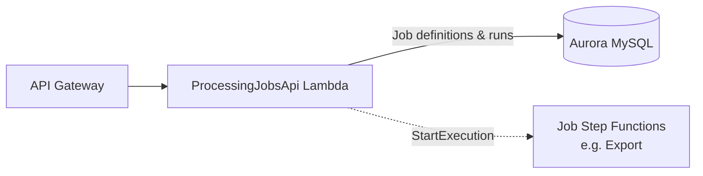

**Lambda Functions:**
| Function | API Resource | Purpose |
|----------|-------------|---------|
| `ProcessingJobsApi` | `/processing-jobs` (+ `/{proxy+}`) | Lists processing-job definitions, starts and tracks job runs |

The `ProcessingJobsApi` Lambda is passed to the Export stack, which grants it permission to start the export Step Functions workflow.

---

## Export Stack

*Optional — deployed when `exportFeature` is enabled.* Exports DICOM data from a virtual folder to S3 as ZIP files with a CSV manifest, applying de-identification.

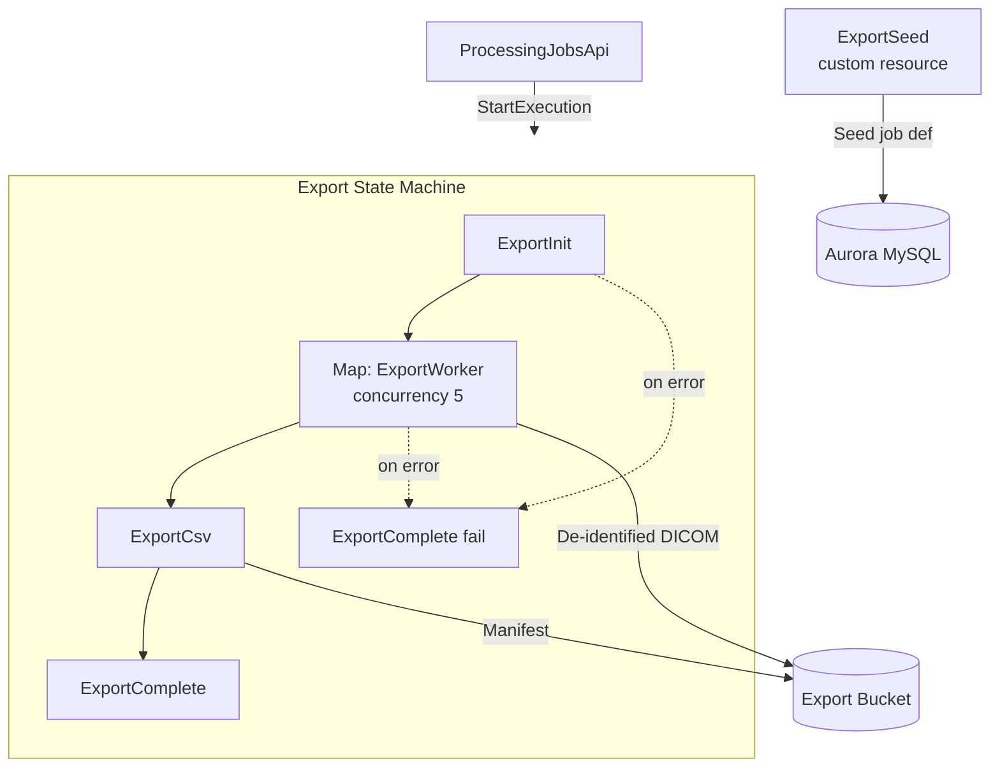

**Resources:**
- **Export Bucket** — S3 bucket (retained) for exported ZIPs and the CSV manifest
- **Export State Machine** — `ExportInit` → `Map(ExportWorker, concurrency 5)` → `ExportCsv` → `ExportComplete`, with failure routed to `ExportComplete`

**Lambda Functions:**
| Function | Purpose |
|----------|---------|
| `ExportInit` | Initializes the job, builds the list of imageset work items |
| `ExportWorker` | (Python 3.12, 10 GB) Retrieves DICOM, applies pydicom de-identification, writes ZIPs |
| `ExportCsv` | Generates the CSV manifest |
| `ExportComplete` | Finalizes (or fails) the job |
| `ExportSeed` | Custom resource that seeds the `dicom-vf-export` processing-job definition |

---

## OHIF Viewer Stack

Builds and deploys the OHIF zero-footprint DICOM viewer.

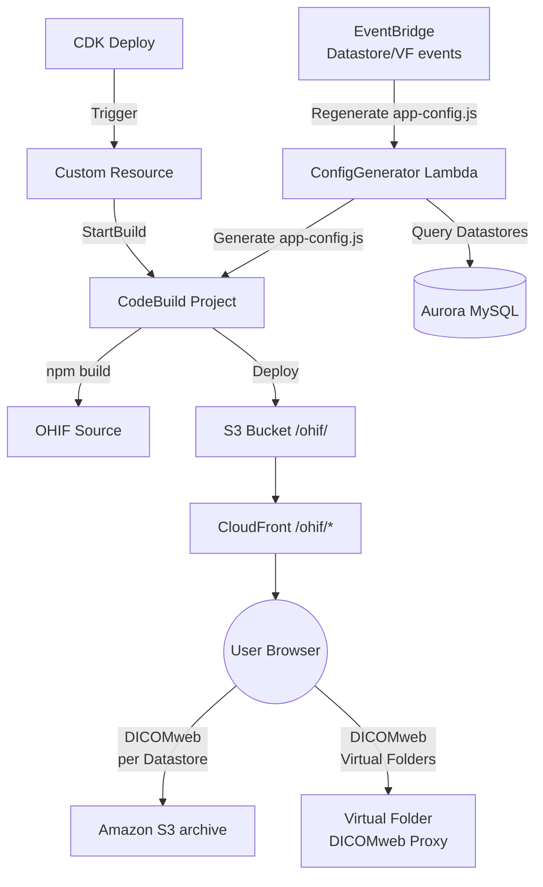

**Resources:**
- **CodeBuild Project** — Builds OHIF **v3.12.0** from source (Node.js 20), applying a DICOMweb Accept-header compatibility fix and a CloudScape dark theme, then deploys to the `/ohif/` prefix on the shared bucket
- **EventBridge Rule** — Regenerates `app-config.js` on `DatastoreCreated`/`DatastoreDeleted`/`VirtualFolderCreated`/`VirtualFolderDeleted` events

**Lambda Functions:**
| Function | Purpose |
|----------|---------|
| `ConfigGenerator` | Generates OHIF `app-config.js` with datastore endpoints and adaptive accept headers; re-run on datastore/VF events and after each build |
| `OhifBuildTrigger` | Custom resource that triggers CodeBuild on deploy |

---

## SLIM Viewer Stack

Builds and deploys the SLIM microscopy viewer for whole slide imaging.

```mermaid
graph TD
    Deploy[CDK Deploy] -->|Trigger| CR[Custom Resource]
    CR -->|StartBuild| CB[CodeBuild Project]
    ConfigGen[SlimConfigGenerator Lambda] -->|Generate config| CB
    CB -->|Deploy| S3[S3 Bucket /slim/]
    S3 --> CF[CloudFront /slim/*]
    CF --> User((User Browser))
    User -->|DICOMweb SM<br/>per Datastore| S3IDX[Amazon S3 archive]
    User -->|DICOMweb SM<br/>Virtual Folders| VF[Virtual Folder<br/>DICOMweb Proxy]
```

**Resources:**
- **CodeBuild Project** — Builds SLIM **v0.45.2** from source (Bun), applying source patches, injecting a token/server bootstrap script, then deploying to the `/slim/` prefix
- **EventBridge Rule** — Regenerates SLIM config on datastore/virtual-folder events

**Lambda Functions:**
| Function | Purpose |
|----------|---------|
| `SlimConfigGenerator` | Generates SLIM configuration with datastore/virtual-folder endpoints |
| `SlimBuildTrigger` | Custom resource that triggers the build |

---

## Data User UI Stack

Builds and deploys the Data User web UI (React + CloudScape) to the `/data-user/` path via a dedicated CodePipeline.

```mermaid
graph LR
    Src[S3 Build Bucket<br/>source/data-user] -->|S3 trigger| CP[CodePipeline]
    CP --> CB[CodeBuild<br/>Node.js 20 / Vite]
    CB -->|Generate config.json| Cfg[Runtime config]
    CB -->|s3 sync dist/| S3Deploy[S3 /data-user/]
    CB -->|Invalidate| CF[CloudFront]
```

**Resources:**
- **CodePipeline** — Source (build bucket) → Build (CodeBuild) → deploy to `/data-user/` on the shared bucket with CloudFront invalidation
- **CodeBuild Project** — Installs dependencies, writes a runtime `config.json` (API URL, Cognito, viewer URLs, feature flags), builds with Vite, and syncs `dist/`

---

## CI/CD Stack

Automated build and deployment pipeline for the admin website.

```mermaid
graph LR
    S3Src[S3 Build Bucket<br/>Source] -->|EventBridge| CP[CodePipeline]
    CP --> CB[CodeBuild]
    CB -->|npm build<br/>PUBLIC_URL=/admin/| Build[React Build]
    Build -->|s3 sync| S3Deploy[S3 /admin/]
    CB -->|Copy| S3Install[S3 /installers/]
    CB -->|Invalidate| CF[CloudFront]
```

**Resources:**
- **CodePipeline** — Source (S3) → Build (CodeBuild) → Deploy (S3 + CloudFront invalidation)
- **CodeBuild Project** — Builds React app with runtime configuration, deploys to `/admin/` path
- Post-build: copies installer scripts to `/installers/` at S3 root

---

## UI Hosting Stack

Shared static hosting infrastructure.

```mermaid
graph TD
    User((User)) --> CF[CloudFront Distribution]
    CF -->|/admin/*| S3_Admin[S3 /admin/]
    CF -->|/data-user/*| S3_DU[S3 /data-user/]
    CF -->|/ohif/*| S3_OHIF[S3 /ohif/]
    CF -->|/slim/*| S3_SLIM[S3 /slim/]
    CF -->|/virtual-folders/*| ALB[ALB → ECS Fargate<br/>DICOMweb Proxy]
    CF -->|/installers/*| S3_Install[S3 /installers/]
    CF --- CFF[CloudFront Function<br/>SPA Routing<br/>WASM Rewrite<br/>SLIM UID Routing]
```

**Resources:**
- **S3 Bucket** — Hosts all static web assets (admin/, data-user/, ohif/, slim/, installers/), private with CloudFront Origin Access Identity
- **CloudFront Distribution** — A single default behavior served from the S3 origin; a **CloudFront Function** performs request routing:
  - root `/` → redirect to `/admin/`
  - `/admin/*`, `/data-user/*`, `/ohif/*`, `/slim/*` → SPA fallback to each app's `index.html`
  - OHIF WASM/asset path rewrites and SLIM `/studies/*` UID routing
  - `/installers/*` and `/CHANGELOG*` served directly
- **`/virtual-folders/*` behavior** → ALB (virtual DICOMweb proxy) is added to this distribution by the main stack when the virtual folder feature is enabled (HTTP origin)

---

## Database Schema

The schema is initialized from three SQL files by the Database Stack's schema-init custom resource: `schema.sql` (core), `schema-virtual-folder.sql` (virtual folder tables, applied when the virtual folder feature is enabled), and `schema-non-dicom-import.sql`. Together they define ~41 tables. The files always describe the current end-state; schema changes assume a fresh deployment (no in-place migration path).

### Core Tables (`schema.sql`)

| Table | Purpose |
|-------|---------|
| `datastores` | S3-backed datastore records with status and configuration |
| `aws_resources` | Tracked AWS resources (queues, buckets, roles) |
| `audit_logs` | Audit trail with user context and change tracking |

### DICOM Interface Tables (`schema.sql`)

| Table | Purpose |
|-------|---------|
| `locations` | Physical/logical locations with network config, S3 bucket, IAM Anywhere certs |
| `dicom_interfaces` | DICOM network endpoints (AE titles) per location |
| `dicom_entities` | Remote DICOM systems (modalities, PACS, workstations) |
| `dicom_privileges` | Junction table: entity permissions per interface (store/query/retrieve) |
| `dicom_interface_datastores` | Maps which datastores each interface can access |
| `routing_rules` | Conditional routing rules with priority, AND/OR logic |

### Imaging Data Tables (`schema.sql`)

| Table | Purpose |
|-------|---------|
| `storage_index` | S3 object index records with DICOM hierarchy metadata |
| `instances` | Individual DICOM instance metadata. **Defined but currently unused** — no code writes to it; per-instance detail lives in S3-indexed metadata |

### Import Tables

| Table | Source | Purpose |
|-------|--------|---------|
| `import_jobs` | `schema.sql` | Import job tracking with status, progress, statistics |
| `non_dicom_imports` | `schema-non-dicom-import.sql` | Non-DICOM file import records |

### Analytics Tables (`schema.sql`)

| Table | Purpose |
|-------|---------|
| `analytics_projects` | Analytics project definitions (Glue/Athena/Iceberg targets) |
| `analytics_custom_attributes` | User-defined DICOM tag columns per analytics project |

### Processing & Job Tracking Tables (`schema.sql`)

| Table | Purpose |
|-------|---------|
| `processing_jobs` | Processing-job definitions (e.g. the seeded `dicom-vf-export` job) |
| `processing_job_steps` | Per-step tracking for processing-job runs |
| `study_modification_jobs` | Series-deletion and metadata-update job tracking |

### User Management Tables (`schema.sql`)

| Table | Purpose |
|-------|---------|
| `users` | Application users linked to Cognito |
| `privilege_groups` | Permission sets: datastore, virtual folder, management, deployment privileges |

### System Tables (`schema.sql`)

| Table | Purpose |
|-------|---------|
| `interface_servers` | Active DICOM service instances with heartbeat tracking |
| `datastore_statistics` | Aggregated storage statistics per datastore |

> **Residual tables (out of scope):** `schema.sql` also defines `hl7_entities` and `hl7_mappings`. HL7 has been removed from the project and these tables are not used by any deployed feature.

### Virtual Folder Tables (`schema-virtual-folder.sql`)

| Table | Purpose |
|-------|---------|
| `virtual_folder_indexing_profiles` | Indexing configuration profiles (which DICOM attributes to index) |
| `virtual_folder_deid_profiles` | De-identification profiles with per-tag actions |
| `virtual_folders` | Virtual folder definitions with write-mode config |
| `virtual_assignment_rules` | Auto-assignment rules per folder |
| `virtual_patient`, `virtual_study`, `virtual_series`, `virtual_imageset`, `virtual_instance` | Per-folder indexed DICOM hierarchy (with original + indexed attribute values; IssuerOfPatientID is a column on `virtual_patient`) |
| `virtual_folder_statistics` | Per-folder patient/study/series/instance counts |

### DICOMweb Reference Tables (removed)

The legacy `schema-dicomweb.sql` file (an `issuer/patient/study/series/instance/imageset` DICOMweb index plus `virtual_folder_*` de-identification mapping tables) was never executed by the schema-init Lambda; those tables do not exist in deployed databases. The file has been removed to avoid a naming collision with the planned S3-native index tables (see `plans/s3-storage-integration-assessment.md` §5).

---

## DICOM Service Architecture

The DICOM service runs as an ECS Fargate task (Python/pynetdicom) with the following components:

### Startup Flow
1. Fetch configuration from Config Service API (`POST /api/config`)
2. Register as interface server (creates SQS queues, SNS subscription)
3. Start plain DICOM SCP on port 11112
4. Start TLS DICOM SCP on port 2762 (if TLS config available)
5. Start health check HTTP server on port 8080
6. Start heartbeat service (sends heartbeats every 30s)
7. Start outbound event service (polls outbound SQS queue for config updates)

### Key Modules
| Module | Purpose |
|--------|---------|
| `main.py` | Application entry point, service orchestration |
| `config.py` | Configuration loading and parsing |
| `tls_context.py` | TLS SSL context builder, certificate matching |
| `authorized_dicom_handlers.py` | Association authorization, AE title validation, mTLS cert validation |
| `dicom_handlers.py` | C-STORE, C-FIND, C-ECHO handlers |
| `cmove_handler.py` | C-MOVE handler with QIDO-RS discovery and WADO-RS retrieval |
| `cmove_delivery_service.py` | C-STORE SCU delivery to destinations |
| `cfind_handler.py` | C-FIND with S3 QIDO-RS backend |
| `dicom_authorization.py` | Entity and privilege management |
| `association_tracker.py` | Association lifecycle tracking |
| `upload_tracker.py` | File upload tracking and S3 management |
| `outbound_event_service.py` | Polls outbound queue for config updates |
| `simple_heartbeat_service.py` | Heartbeat reporting |
| `credential_manager_service.py` | IAM Roles Anywhere credential management |
| `status_server.py` | HTTP health check endpoint |

### Dynamic TLS Context Reload
When a config update is received via the outbound queue:
1. `OutboundEventService` detects `config_update` signal
2. Calls `_reload_configuration()` on the main service
3. Config is reloaded from the Config Service API
4. `_reload_tls_context()` rebuilds the SSL context and swaps it on the running TLS server
5. New connections immediately use the updated TLS settings

### Association Authorization Flow
1. **TLS Handshake** — If `tls_verify_client` is enabled, SSL requires client certificate
2. **EVT_ACCEPTED** — After association is established:
   - Validate called AE title matches a configured interface
   - Validate calling AE title exists in the interface's entity list
   - If TLS + `tls_verify_client`: validate client certificate matches entity's configured certificate
   - Unauthorized associations are immediately aborted via `assoc.abort()`
3. **Per-operation** — C-STORE/C-FIND/C-MOVE handlers check specific privileges (store/query/retrieve)

---

## Configuration Flow

DICOM service instances running on ECS Fargate or on-premise do not connect directly to the database. Instead, they receive their configuration through a centralized Configuration Service, and are notified of changes via a messaging pipeline (typically within seconds).

### Initial Configuration

When a DICOM service instance starts, it calls the Config Service API (`POST /api/config`) using IAM authentication. The Config Service:

1. Looks up the location and its interfaces, entities, routing rules, and TLS certificates from Aurora MySQL
2. Creates dedicated SQS queues (inbound, outbound) for the service instance
3. Subscribes the outbound queue to the SNS config update topic
4. Returns the full configuration payload including network settings, TLS config, and queue URLs

### Near Real-Time Config Updates

When an administrator changes a setting through the Admin UI (e.g., toggles client certificate verification, adds a DICOM entity, or modifies routing rules):

1. The API Lambda writes the change to Aurora MySQL
2. The Lambda emits a `DICOM_CONFIG_UPDATED` event to EventBridge
3. An EventBridge rule forwards the event to the SNS Config Update Topic
4. SNS delivers the notification to each service instance's outbound SQS queue
5. The DICOM service's `OutboundEventService` polls the outbound queue and detects the `config_update` signal
6. The service calls the Config Service API to fetch the latest configuration
7. The service reloads its internal state — DICOM authorization, TLS context, routing rules — without restarting

```mermaid
sequenceDiagram
    participant Admin as Admin UI
    participant API as API Lambda
    participant DB as Aurora MySQL
    participant EB as EventBridge
    participant SNS as SNS Topic
    participant SQS as SQS Outbound Queue
    participant DICOM as DICOM Service
    participant Config as Config Service API

    Admin->>API: Update setting
    API->>DB: Write change
    API->>EB: Emit DICOM_CONFIG_UPDATED
    EB->>SNS: Forward event
    SNS->>SQS: Deliver notification
    DICOM->>SQS: Poll (every 5s)
    SQS-->>DICOM: config_update signal
    DICOM->>Config: POST /api/config
    Config->>DB: Read latest config
    Config-->>DICOM: Full configuration payload
    DICOM->>DICOM: Reload authorization + TLS context
```

This architecture ensures that configuration changes propagate to all running service instances within seconds, without requiring container restarts or redeployments.

---

## Security Model

### Authentication
- **Web UI** — Cognito User Pool with optional TOTP MFA
- **API** — JWT tokens validated by Lambda authorizer
- **Config API** — IAM authentication (SigV4) for DICOM service instances
- **Remote Services** — IAM Roles Anywhere with X.509 certificates

### Authorization Layers
1. **API Gateway** — Lambda authorizer checks JWT, loads user privileges from database
2. **Management Privileges** — Per-area permissions (interfaces, datastores, users, etc.)
3. **Datastore Privileges** — Per-datastore read/store/update/delete
4. **Virtual Folder Privileges** — Per-folder read/store
5. **DICOM Authorization** — Per-interface entity validation with AE title + certificate matching
6. **IP Allowlisting** — Security group rules per NLB port (plain/TLS independently)

### Data Protection
- Aurora encrypted at rest
- S3 buckets with S3-managed encryption
- Config packages AES-256 encrypted
- TLS certificates stored in Secrets Manager
- DICOM TLS with optional mutual authentication
