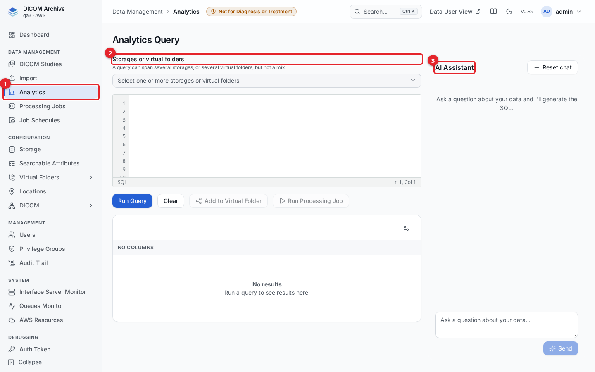
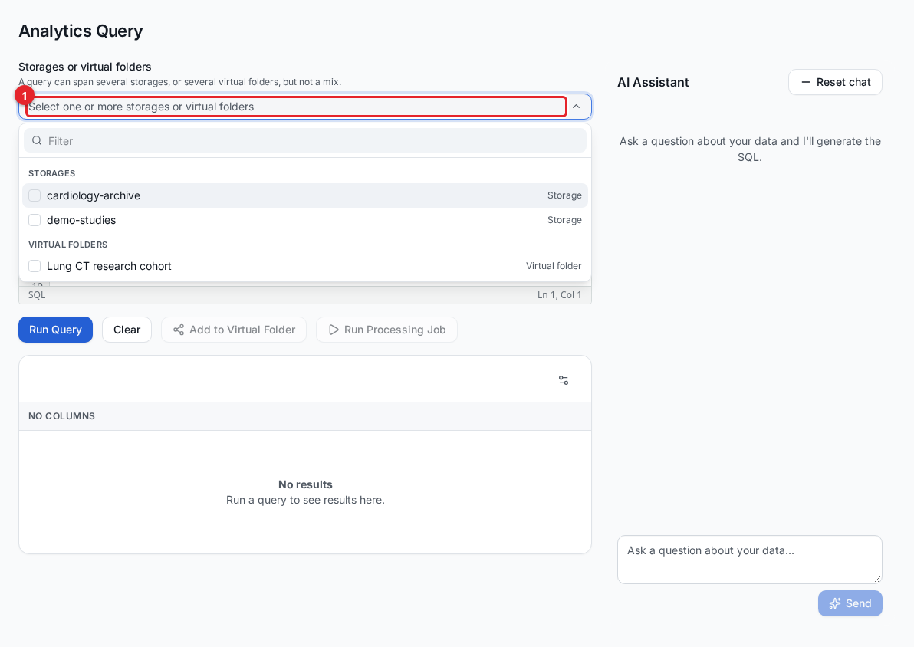
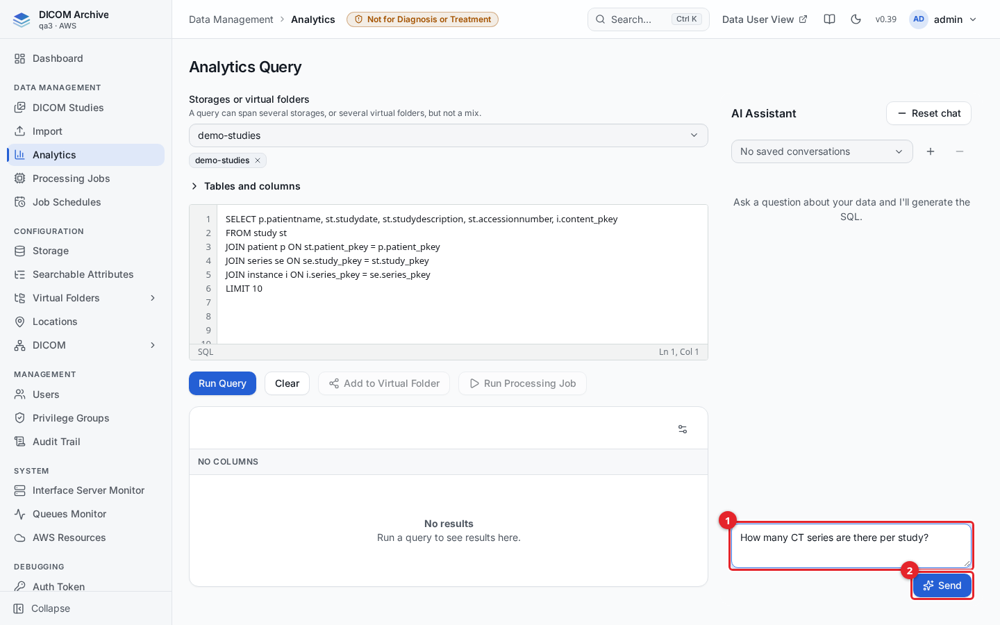
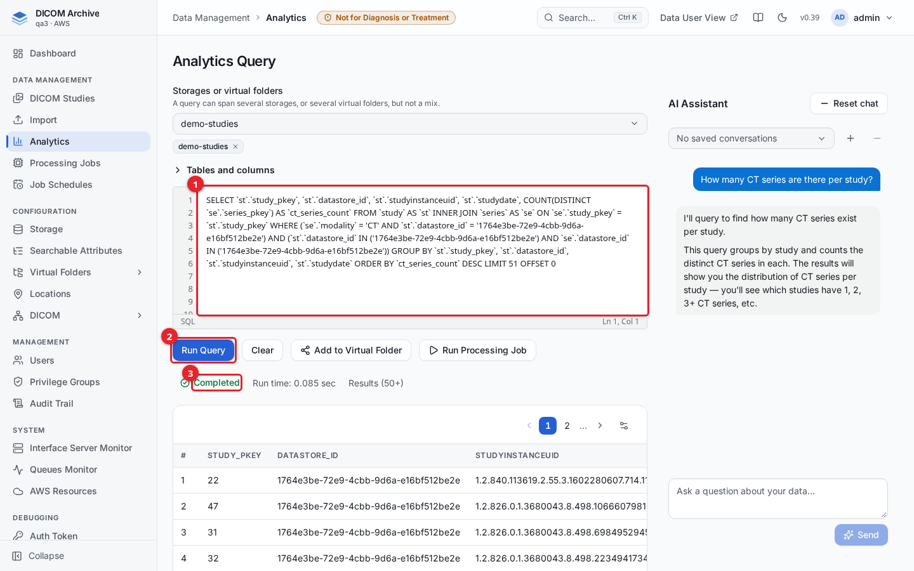
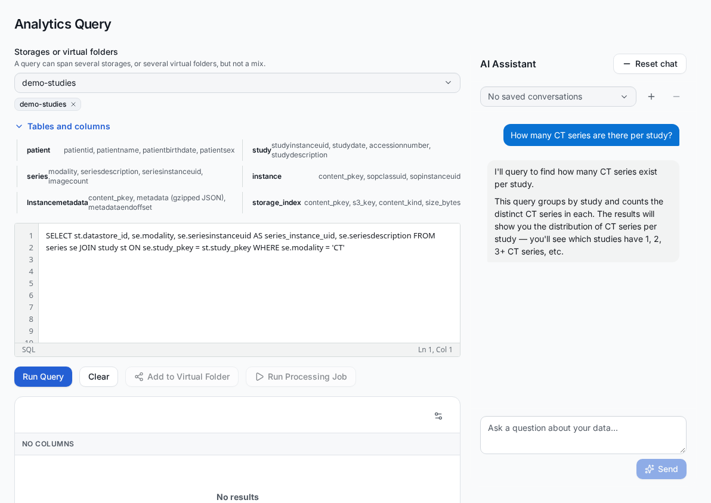
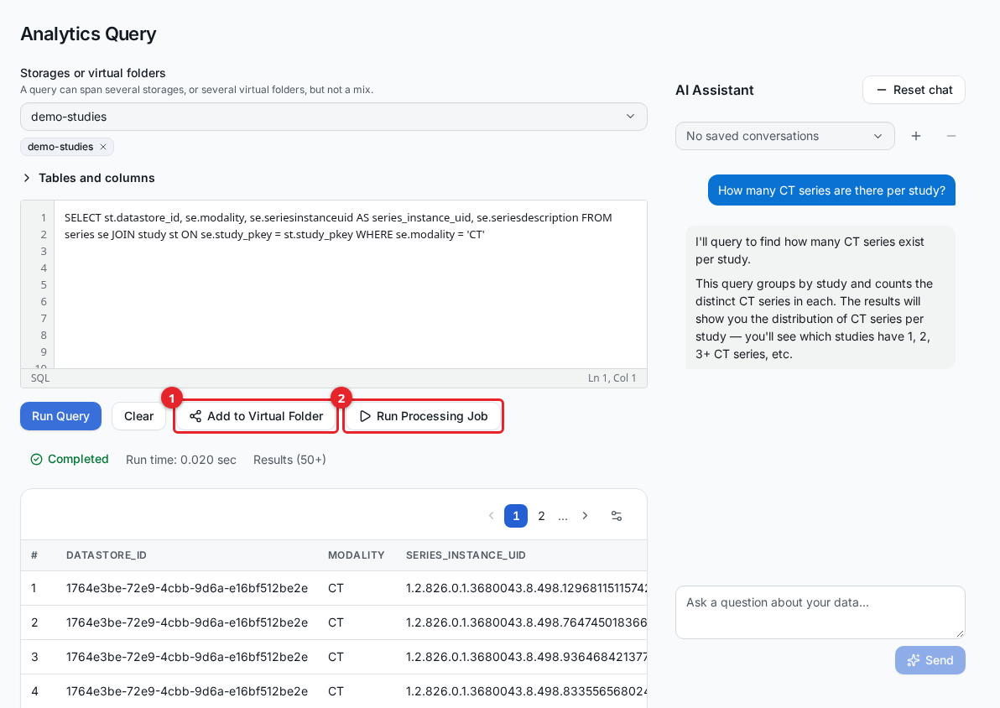

# Analytics

Analytics lets you ask questions about the DICOM metadata in your archive in plain English and get answers as a table of rows. You pick a storage location or a virtual folder, type a question such as "How many CT series are there per study?", and an AI assistant turns it into a read-only SQL query that runs against the live index. You can review and edit the SQL, run it directly, and send the matching studies on to a virtual folder or a processing job.

Analytics reads metadata indexes only. It never returns pixel data, and it is for research, development and archival use, not for clinical diagnosis.

## Before you start

- You reach Analytics from the admin console sidebar under **Data Management > Analytics**.
- You need the **Analytics** management privilege `canList` or `canQuery` to open the screen, granted through a privilege group. See [users-and-access.md](users-and-access.md).
- You can only query a storage location or virtual folder you have **read** access to. The selector lists only those.
- The AI assistant (natural-language questions) requires the text-to-SQL feature to be enabled for the deployment and Amazon Bedrock access to the Claude Haiku 4.5 model (and, for retries, Claude Sonnet 4.5) in the deployment region (see [Prerequisite: Bedrock model access](#prerequisite-bedrock-model-access)). Without it you can still write and run SQL by hand.

## The Analytics screen

1. **Analytics** in the sidebar opens the screen.
2. **Storages or virtual folders** is where you choose what to query.
3. The **AI Assistant** rail on the right turns questions into SQL. It is shown when the text-to-SQL feature is enabled.

The screen has no "projects" to create first. You select an index, ask a question or write SQL, and the results appear in the table below the editor.

## Choose what to query

Open the **Storages or virtual folders** selector and tick one or more sources.

1. Click the selector to list every storage location and virtual folder you can read, grouped under **Storages** and **Virtual folders**.

A query can span several storages, or several virtual folders, but not a mix of the two. If you pick both kinds, only the first kind you picked is kept.

The two kinds differ in what they expose:

- A **storage** query reads the shared index tree (patient, study, series, instance) plus the physical-object table, scoped to the datastores you selected.
- A **virtual folder** query reads only that folder's own de-identified index. Patient and study identifiers may be hashed or removed according to the folder's de-identification profile, and the raw shared tables are not reachable, so an analytics query on a virtual folder can never read around its de-identification. See [virtual-folders.md](virtual-folders.md).

## Ask a question in natural language

Type your question in the **AI Assistant** box and send it.

1. Enter a question, for example "How many CT series are there per study?". Press **Enter** to send, or **Shift+Enter** for a new line.
2. Click **Send**.

The assistant generates a SQL query, loads it into the editor, runs it, and shows the result rows. It replies with a short explanation of what it did.

1. The generated SQL appears in the editor. You can read and edit it before running it again.
2. **Run Query** runs the SQL currently in the editor.
3. **Completed** with the run time and row count shows the query succeeded.

If a generated query fails, the assistant automatically tries once to correct it.

### How the assistant writes queries

- **Worked examples.** The assistant's instructions include a fixed set of question-and-SQL examples for the common patterns: counts per modality, stored sizes, date ranges, "patients with both X and Y", top N with ties, multi-valued attributes and document types such as PDFs and structured reports. Every example is checked by the same SQL validator that checks your queries.
- **Stored values.** For a few coded columns (modality, patient sex, body part examined, transfer syntax, SOP class, and manufacturer or institution name when they are indexed), the assistant is shown the most frequent values stored in the selected index, with their counts, so its filters match what is really stored. These values are read through the same validated, scoped, read-only path as any other query, and are refreshed every 5 minutes.
- **A second, stronger model.** The assistant answers with Claude Haiku 4.5. If Haiku cannot finish (it runs out of steps, writes two queries in a row that the validator or the database rejects, or gives no final answer), the question is asked once more, from the start, with Claude Sonnet 4.5. The API response reports which model answered in `model` (and `escalated: true` when the second model ran); the screen does not show it. You can keep the conversation going: follow-up questions ("only MR studies", "order by date") refine the previous query because the assistant keeps the context of the exchange.

### Saved conversations

Each exchange can be saved as a conversation, tied to the selected index and to you. Use the conversation controls at the top of the AI Assistant rail to open a saved conversation, start a new one (the **+** button), or delete one. **Reset chat** clears the on-screen chat and the stored history for the current conversation.

## Write or edit SQL directly

You do not have to use the assistant. Type SQL into the editor and click **Run Query**. **Clear** resets the editor to a default example query.

Expand **Tables and columns** under the selector to see the tables and common columns available for the selected index.

The tables you can query in a storage scope are:

| Table | Holds |
|---|---|
| `patient` | Patient-level attributes (patientid, patientname, patientbirthdate, patientsex). |
| `study` | Study-level attributes (studyinstanceuid, studydate, accessionnumber, studydescription). |
| `series` | Series-level attributes (modality, seriesdescription, seriesinstanceuid, imagecount). |
| `instance` | Instance-level attributes (content_pkey, sopclassuid, sopinstanceuid). |
| `storage_index` | One row per physical S3 object (content_pkey, s3_key, content_kind, size_bytes). |

The tables join down the tree: `study.patient_pkey = patient.patient_pkey`, `series.study_pkey = study.study_pkey`, `instance.series_pkey = series.series_pkey`, and `instance.content_pkey = storage_index.content_pkey`. DICOM attributes are plain lowercase keyword columns (for example `series.modality`, `instance.sopinstanceuid`). Custom index attributes you have configured appear under their own column names; see [searchable-attributes.md](searchable-attributes.md).

A virtual-folder scope exposes the same patient/study/series/instance shape, but as the folder's own de-identified tables, and it does not expose `storage_index` or the raw metadata.

## Review the results

Results appear in the table under the editor. Use the page controls to move through pages and the preferences (gear) control to change the page size (10, 25, 50 or 100 rows).

A single query returns at most 1000 rows. The row count next to the status shows a trailing `+` (for example `Results (50+)`) when more rows match than the current page holds; page forward or narrow the query to see the rest.

Analytics does not export the on-screen table to a file. To get data out of the archive, act on the results instead: send the matching studies to a virtual folder, run a processing job over them (for example DICOM to NIfTI), or use the **DICOM Virtual Folder Export** job to write a folder to S3 as ZIP files with a CSV manifest. See [processing-jobs.md](processing-jobs.md) and [virtual-folders.md](virtual-folders.md).

## Act on the results

When a query has run, two buttons below the editor act on everything the query matches, not just the rows on the current page. The server re-runs the query to gather the full set, so a selection of thousands of series never travels through your browser.

1. **Add to Virtual Folder** copies the matching studies into a virtual folder you can write to. You choose the folder and, optionally, a maximum number of studies.
2. **Run Processing Job** runs a processing job (for example DICOM to NIfTI) over every series the query matched.

Both buttons are enabled only when the query result lets the server identify the rows:

- **Add to Virtual Folder** needs the query to return either `content_pkey` together with `datastore_id`, or a DICOM UID column (`studyinstanceuid`, `seriesinstanceuid` or `sopinstanceuid`).
- **Run Processing Job** needs the query to return `datastore_id` together with a series or study identifier (`series_instance_uid`, `seriesinstanceuid`, `study_instance_uid` or `studyinstanceuid`).

You cannot assign studies that are already in a virtual folder into another virtual folder; select a storage index as the source instead. **Run Processing Job** requires the **Processing jobs** `canRun` privilege.

## Limitations and safety

Analytics is designed so that neither you nor the AI can modify or over-read data:

- **Read-only.** Every query runs as a dedicated read-only database user. Only `SELECT` (and `WITH` / read forms) are allowed; `INSERT`, `UPDATE`, `DELETE`, `DROP`, `ALTER` and `CREATE` are rejected. A storage query and a virtual-folder query use separate read-only users, so a virtual-folder query can never reach the shared tables.
- **Fixed table allowlist.** A query may reference only the tables listed above. Anything else is refused, including the raw gzipped metadata header.
- **Scope is enforced on the server.** Rows are restricted to the storages or folder you selected, and your read access to each selected source is checked before the query runs. The restriction is applied to the physical rows, not suggested to the AI, so a generated query cannot widen its own scope.
- **Row and time limits.** Results are capped at 1000 rows per query, and each query has a server-side execution-time limit.
- **No pixel data.** Analytics reads metadata indexes only.
- **PHI-aware logging.** The query text is never written to operational logs, because its filter values can contain patient identifiers. Only a non-identifying fingerprint and the scope are logged.

## Prerequisite: Bedrock model access

Natural-language questions call Amazon Bedrock. For the AI Assistant to work:

- The deployment must have the text-to-SQL feature enabled.
- The AWS account must have access to the Anthropic **Claude Haiku 4.5** model in the deployment region, requested from the Amazon Bedrock console under **Model access**. Access to **Claude Sonnet 4.5** is also needed for the second-model retry; without it, questions Haiku cannot finish fail as before. Both are called through their US cross-region inference profiles.

If the feature is off or the model is not available, the AI Assistant rail does not generate SQL; you can still write and run SQL by hand.

## Related guides

- [getting-started.md](getting-started.md) - find your way around the admin console.
- [storage.md](storage.md) - storage locations (datastores) you query.
- [virtual-folders.md](virtual-folders.md) - virtual folders, de-identification and export.
- [searchable-attributes.md](searchable-attributes.md) - the indexed DICOM attributes you can query.
- [processing-jobs.md](processing-jobs.md) - run a processing job over query results.
- [studies.md](studies.md) - browse studies and run jobs from a selection.
- [users-and-access.md](users-and-access.md) - the privileges that control Analytics access.
