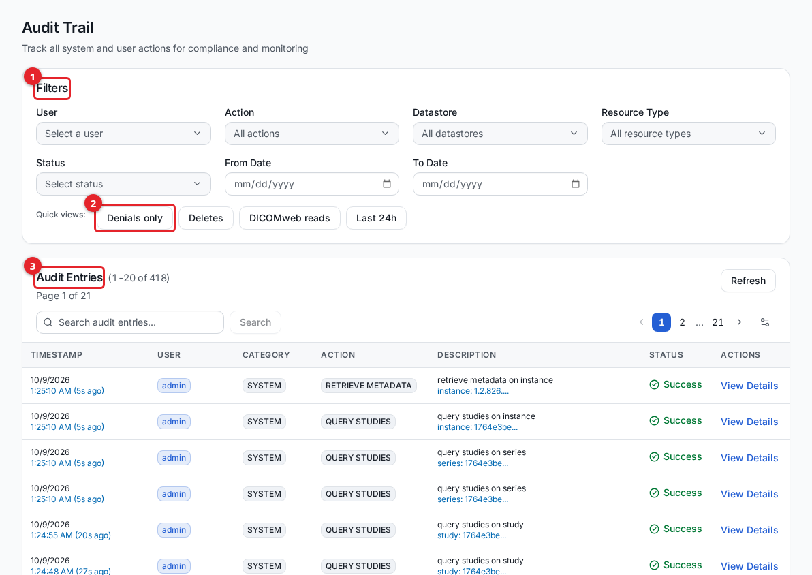
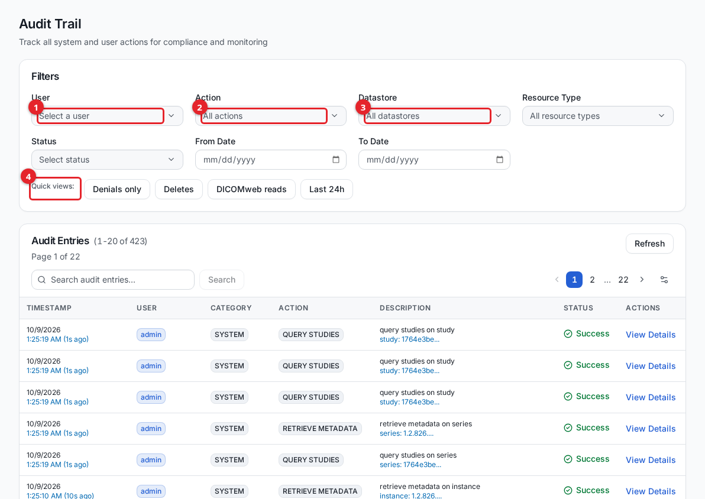
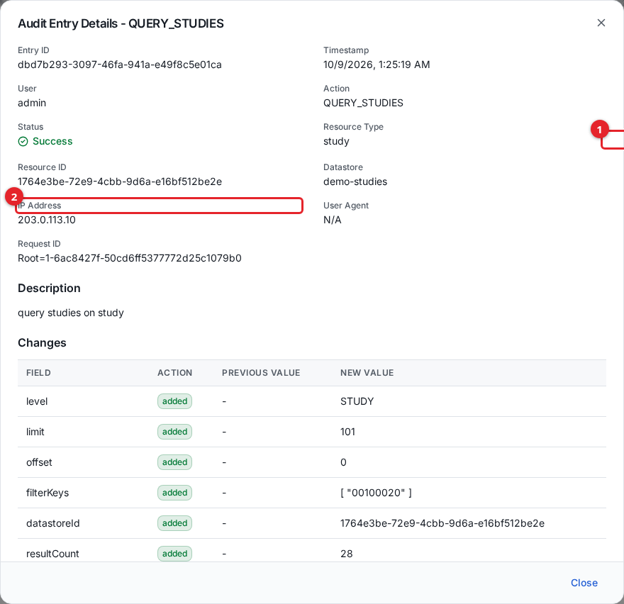

# Audit trail

The audit trail is a searchable record of actions taken in the DICOM Archive: configuration changes, user and privilege-group management, data imports and deletions, DICOMweb study and series reads, and access denials. Use it for compliance review and to answer "who did what, when, and to which resource." This guide is for administrators and compliance reviewers.

Open **Audit Trail** from the **Management** section of the sidebar. Viewing it requires a privilege group that grants **Audit Trail** list permission.

1. **Filters** narrow the trail by user, action, datastore, resource type, status, and date.
2. **Quick views** apply a common compliance lens in one click.
3. **Audit Entries** is the result table, newest first, with a running count and page controls.

## What is recorded

Each audited action becomes one row with a timestamp, the user who performed it, a category, the action name, a description, a status (Success, Failure, or Pending), the resource type and id, and, where applicable, the datastore, IP address, user agent, and request id.

Every create, update, and delete across the product's resources is recorded. The table below groups the action names you will see.

| Area | Audited actions |
|---|---|
| Users | CREATE_USER, UPDATE_USER, RESET_USER_PASSWORD, RESET_USER_MFA, DELETE_USER |
| Privilege groups and privileges | CREATE_PRIVILEGE_GROUP, UPDATE_PRIVILEGE_GROUP, DELETE_PRIVILEGE_GROUP, CREATE_PRIVILEGE, UPDATE_PRIVILEGE, DELETE_PRIVILEGE |
| Storages (datastores) | CREATE_DATASTORE, UPDATE_DATASTORE, DELETE_DATASTORE |
| DICOM entities and interfaces | CREATE_ENTITY, UPDATE_ENTITY, DELETE_ENTITY, CREATE_INTERFACE, UPDATE_INTERFACE, DELETE_INTERFACE |
| Locations and routing | CREATE_LOCATION, UPDATE_LOCATION, DELETE_LOCATION, CREATE_ROUTING_RULE, UPDATE_ROUTING_RULE, DELETE_ROUTING_RULE |
| Virtual folders and assignments | CREATE_VIRTUAL_FOLDER, UPDATE_VIRTUAL_FOLDER, DELETE_VIRTUAL_FOLDER, ASSIGN_STUDY_TO_VIRTUAL_FOLDER, ASSIGN_SERIES_TO_VIRTUAL_FOLDER, REMOVE_ASSIGNMENT_FROM_VIRTUAL_FOLDER |
| Imports | CREATE_IMPORT_JOB, START_IMPORT_JOB, COMPLETE_IMPORT_JOB, FAIL_IMPORT_JOB, CREATE_NON_DICOM_IMPORT, PROCESS_NON_DICOM_IMPORT, COMPLETE_NON_DICOM_IMPORT, FAIL_NON_DICOM_IMPORT, DELETE_NON_DICOM_IMPORT |
| Deletions of imaging data | DELETE_SERIES, DELETE_SERIES_REQUESTED, DELETE_SERIES_FAILED |
| DICOMweb data plane | STORE_INSTANCES (STOW-RS upload), QUERY_STUDIES (QIDO search), RETRIEVE_METADATA (study/series metadata), DELETE (DICOMweb delete) |
| Access control | ACCESS_DENIED (a request blocked by the API authorizer) |

A few points worth knowing:

- **Access denials are recorded.** When the API authorizer blocks a request because the caller has no privileges or is not a known user, it writes an ACCESS_DENIED row. Use the **Denials only** quick view to see them.
- **DICOMweb reads are recorded at the study and series level.** A QIDO search (QUERY_STUDIES) and study-or-series metadata retrieval (RETRIEVE_METADATA) each produce one row.
- **Certificates, private keys, and passwords are never stored in a row.** The audit path strips any field that looks like a secret before the event is saved.

## What is not recorded, and why

- **Instance-level and frame-level reads are not recorded.** Retrieving a single instance, a frame, a rendered frame, or per-instance bulk data below the series level is deliberately not audited. A viewer pulls these per tile and per frame, so recording them would flood the trail with high-volume, low-signal rows and bury the events a reviewer actually needs. Study-level and series-level retrievals are still recorded, because those are one event per request and are what an access review looks for.
- **A read that fails or is refused is still recorded** at any depth, so a blocked or denied access attempt is never hidden by the suppression above.
- **Per-route authorization failures decided after the authorizer allows a request are not captured here.** The ACCESS_DENIED action covers denials made by the API authorizer itself. Denials enforced further downstream are visible only in the service access logs, not in this trail.

Audit events are produced across the system and carry the event source `dicom.archive`.

## Filtering and searching

Use the filter panel to narrow the trail.

1. **User** limits the trail to one user (or **System** for actions the platform took on its own).
2. **Action** is a multi-select of the action names actually present in the trail, so new action types appear automatically.
3. **Datastore** scopes the trail to one storage, shown by name.
4. **Quick views** apply a preset filter and replace any filters already set.

Other filters:

| Filter | Effect |
|---|---|
| Resource Type | Limits to one or more resource types (user, datastore, virtual folder, series, and so on). |
| Status | Success, Failure, or Pending. |
| From Date / To Date | Bounds the time range. |
| Search box | Free-text search over the action, resource type, and username. |

The **Quick views** buttons are shortcuts:

| Quick view | Shows |
|---|---|
| Denials only | Rows with status Failure (includes ACCESS_DENIED). |
| Deletes | Delete actions. |
| DICOMweb reads | QUERY_STUDIES and RETRIEVE_METADATA. |
| Last 24h | Events from the past 24 hours. |

Select **Reset All Filters** to clear everything. Use the table's **Preferences** (the gear control) to change the page size and which columns are shown.

Note that the free-text search matches the action, resource type, and username, but not the resource's display name. To find events for a named resource, filter by its **Resource Type** and action rather than typing the name into the search box.

## Viewing a row's details and value changes

Select **View Details** on any row to open the full record.

1. **Resource Type** and resource id identify what the action touched.
2. **IP Address**, user agent, and request id identify where it came from.

The details dialog shows the entry id, timestamp, user, action, status, resource type and id, datastore, IP address, user agent, and request id. For create and update actions it also shows a **Changes** table listing each field that was added or changed, with its previous value and new value side by side, so you can see exactly what a configuration change did.

## Exporting and retention

The audit trail does not have a one-click export button in the UI. To extract records for an external compliance system, read them through the audit REST endpoint (`GET /api/audit`), which accepts the same filters as the UI and returns pages of entries. See [dicomweb-api.md](dicomweb-api.md) for how to authenticate REST calls.

Audit records are stored in the application database and are not deleted by the product on a timer. (The internal processing queue that carries events to the database holds unprocessed messages for up to 14 days, which is a delivery buffer, not the retention of the saved records.) Plan database backups and any longer-term archival to match your organization's retention policy.

## Related guides

- [users-and-access.md](users-and-access.md)
- [monitoring.md](monitoring.md)
- [dicomweb-api.md](dicomweb-api.md)
- [virtual-folders.md](virtual-folders.md)
