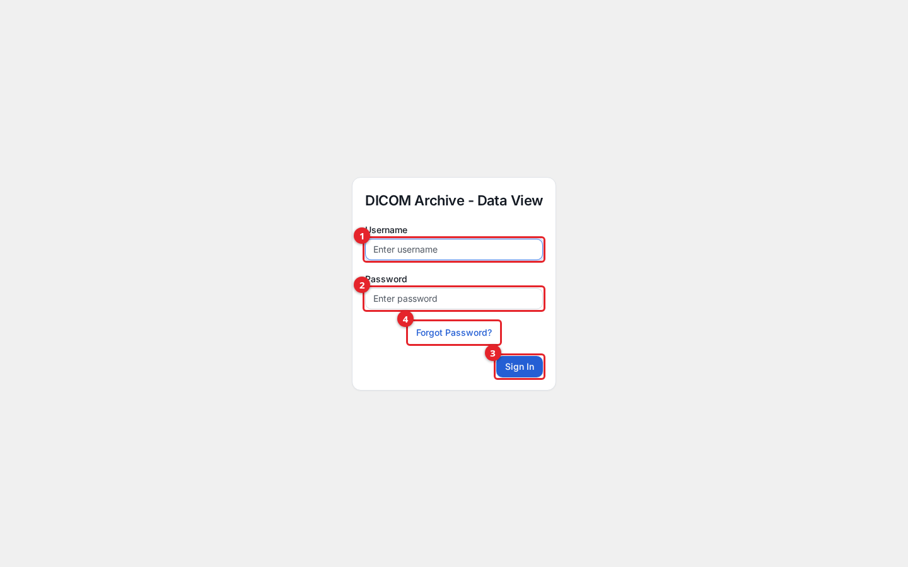
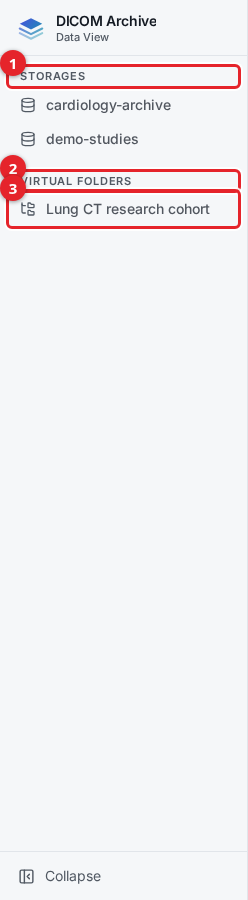
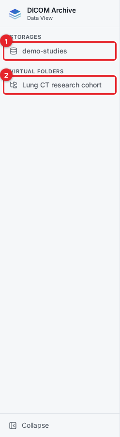
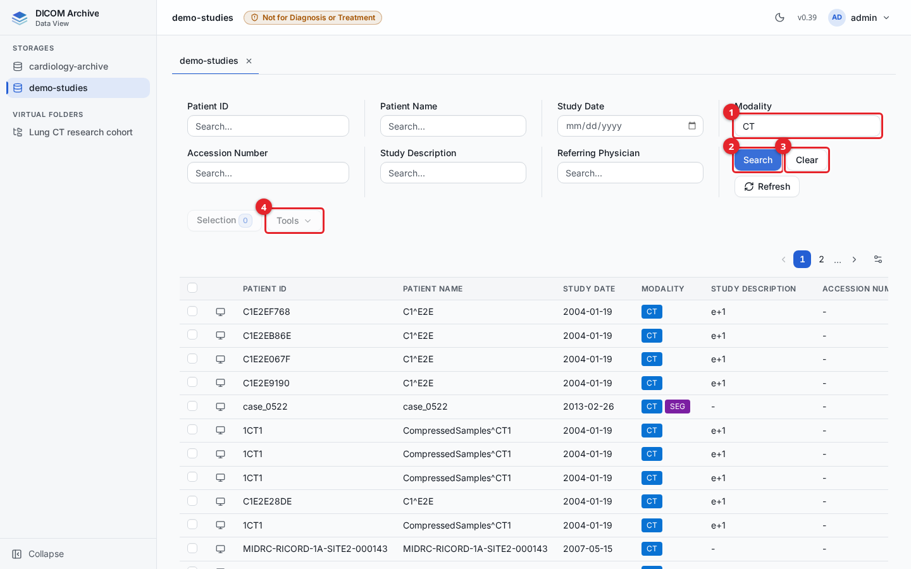
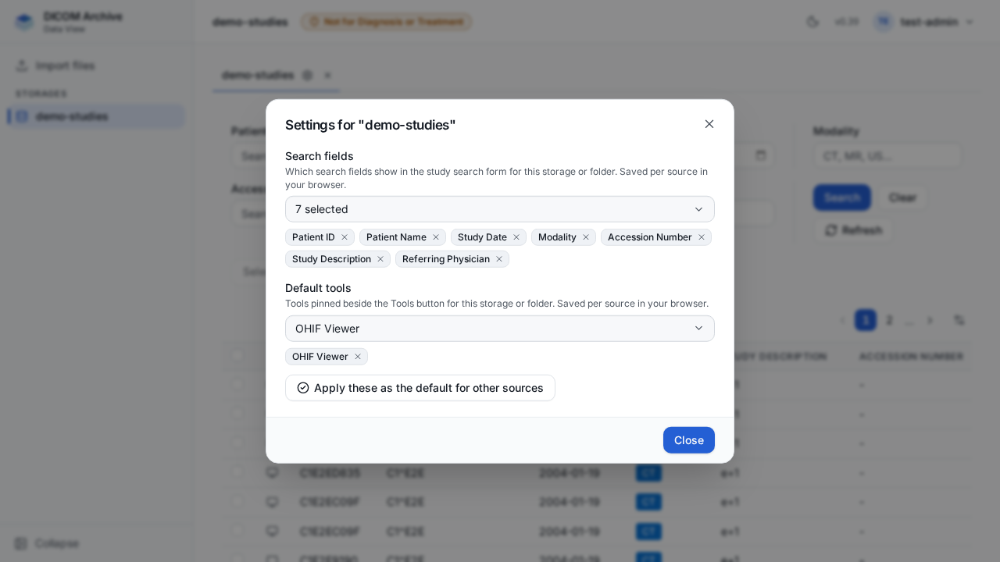
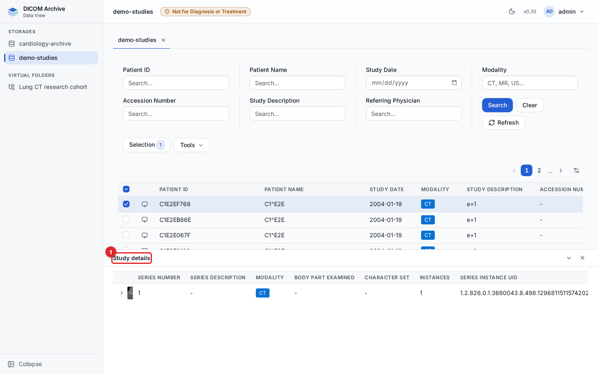
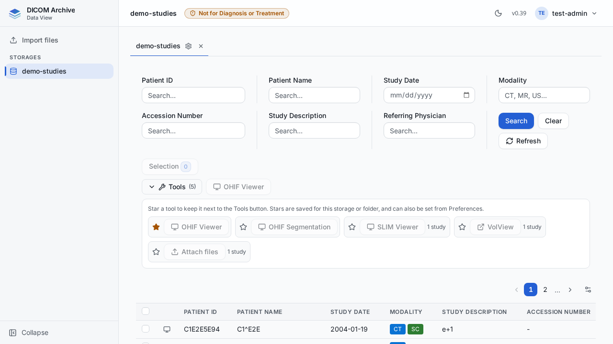
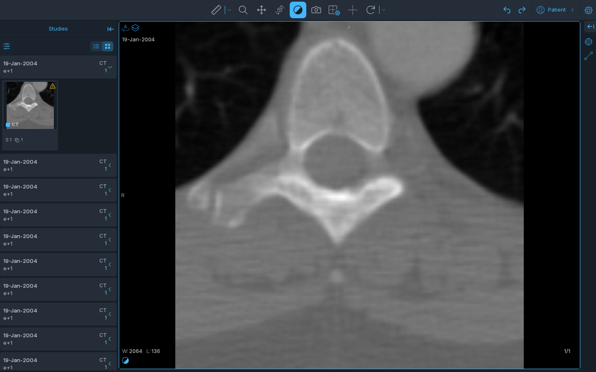
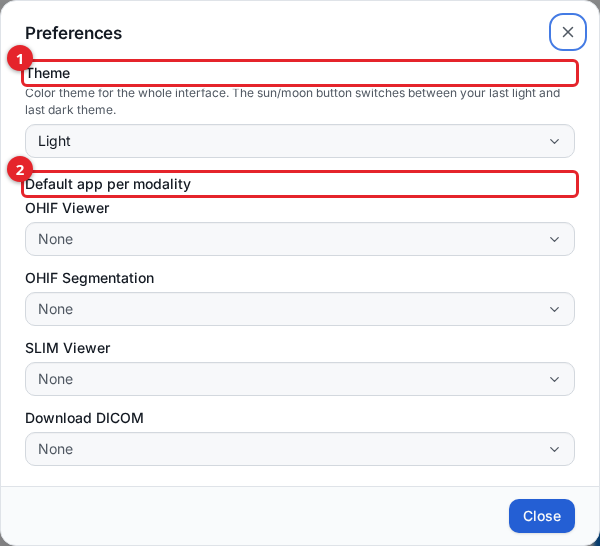
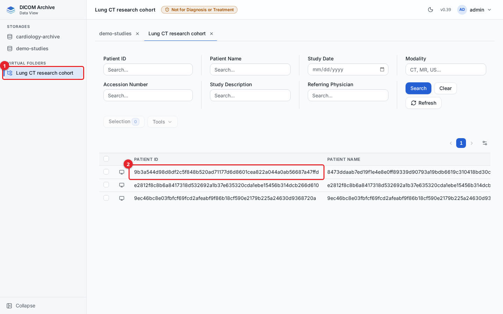

# The data-user website

The data-user website is where a clinician or researcher browses and views the
DICOM studies they have been granted. It is a read-oriented view of the archive:
you can open storages and virtual folders, search for studies, inspect a study's
series and instances, and open images in a viewer. You cannot create storages,
manage users, change configuration, or import data from here. It is served at
`/data-user/` on the same address as the admin console.

This guide is for the end user who works in that website. If instead you
administer the archive (creating storages, managing users and privilege groups,
running processing jobs), you use the admin console; see [studies.md](studies.md)
and [getting-started.md](getting-started.md).

## How the data-user website differs from the admin console

| | Data-user website (`/data-user/`) | Admin console (`/admin/`) |
| --- | --- | --- |
| Who it is for | Clinical and research end users | Administrators |
| Sidebar | Only the storages and virtual folders you were granted | Full management navigation (Dashboard, Users, Audit, and more) |
| What you can do | Browse, search, view studies, open viewers | Everything, including create, import, delete, and configure |
| Scope | Only sources your privilege group grants you | Governed by the administrator's own privileges |

Both interfaces carry a **Not for Diagnosis or Treatment** notice in the header.
This website is for browsing and reference, not for primary diagnostic reading.

## Before you start

- You need an account whose privilege group grants read access to at least one
  storage or virtual folder. Access is scoped per source: you see a storage or
  folder in the sidebar only when your group grants it. An administrator sets
  this up; see [users-and-access.md](users-and-access.md) and
  [virtual-folders.md](virtual-folders.md).
- If you have no grants at all, you can sign in but the sidebar is empty. See
  [What you see with no grants](#what-you-see-with-no-grants) below.

## Signing in

Open `/data-user/`. The sign-in page is headed **DICOM Archive - Data View**.

1. Enter your **Username**.
2. Enter your **Password**.
3. Click **Sign In**.
4. If you have forgotten your password, click **Forgot Password?** instead (see
   [Resetting a forgotten password](#resetting-a-forgotten-password)).

### First sign-in: set a new password

If you were just invited, or an administrator reset your password, your first
sign-in shows a **Change Password** step. Enter and confirm a new password. It
must be at least 12 characters and include an uppercase letter, a lowercase
letter, a number, and a symbol. After the password is accepted you continue to
the archive (or to multi-factor setup, if your pool requires it).

### Multi-factor authentication (MFA)

If your user pool requires MFA with an authenticator app (TOTP), you are guided
through it at sign-in:

- The first time, a **Setup Multi-Factor Authentication** step shows a QR code.
  Scan it with an authenticator app (for example Google Authenticator or Authy),
  then enter the 6-digit code the app shows and click **Verify**.
- On later sign-ins, a **Multi-Factor Authentication** step asks only for the
  current 6-digit code from your app.

MFA appears only when the pool is configured to require it. If your pool does
not require MFA, you go straight to the archive after your password.

### Resetting a forgotten password

1. On the sign-in page click **Forgot Password?**.
2. Enter your username and click **Send Reset Email**. A reset link is emailed to
   the address on your account.
3. Open the link. It lands on a **Reset Password** page where you enter and
   confirm a new password (same rules as above: minimum 12 characters with
   uppercase, lowercase, number, and symbol).
4. On success, click **Go to Login** and sign in with the new password.

If the reset link is missing or malformed, the page shows "Invalid reset link"
and offers to send you back to sign in to request a new one.

## The layout

After you sign in, the window has three parts: a left sidebar listing your
sources, a top bar, and the main area where studies open as tabs. A resizable
**Study details** panel appears at the bottom when you select a study.

### The sidebar: your sources

The sidebar lists the sources you can open, in two sections.

1. **Storages** lists the storages your privilege group grants.
2. **Virtual folders** lists the virtual folders your group grants. A virtual
   folder is a saved, rule-based view across one or more storages; it may apply
   de-identification (see [below](#what-a-de-identified-virtual-folder-looks-like)).
3. Click a source to open it as a tab.

The sidebar only ever shows what you were granted. The screenshot above is an
administrator, who sees everything. A user with narrower access sees fewer
sources. For example, the user below was granted the `demo-studies` storage and
the Lung CT research cohort folder, but not the `cardiology-archive` storage, so
`cardiology-archive` is absent from their sidebar:

1. Under **Storages**, only `demo-studies` appears.
2. Under **Virtual folders**, only `Lung CT research cohort` appears.

Sidebar behaviour:

- **Tabs.** Click a source to open it in its own tab. You can open several
  sources at once; opening a source you already have open just switches to its
  tab.
- **Remembered tabs.** Your open tabs are saved per user and restored the next
  time you sign in. If you have since lost access to a source, its tab is quietly
  dropped on the next sign-in.
- **Filter.** When you have more than eight sources, a **Filter sources** box
  appears at the top of the sidebar to narrow the list by name.
- **Collapse.** Use **Collapse** at the foot of the sidebar to shrink it to
  icons and give the table more room; the control toggles it back open.

## Browse a storage or virtual folder

Opening a source shows its studies in a table, with the search filters above it.

### Search

Fill in one or more filters and click **Search**. Click **Clear** to empty them,
or **Refresh** to re-run the current search.

1. Enter one or more filter values. Here the **Modality** filter is set to `CT`.
2. Click **Search** to run the search.
3. Click **Clear** to empty all filters.
4. **Tools** and **Selection** act on the studies you tick (see
   [Opening studies in a viewer](#opening-studies-in-a-viewer)).

The filters and how each one matches:

| Filter | Matching |
| --- | --- |
| Patient ID | Contains the text you type (wildcard on both sides) |
| Patient Name | Contains the text you type (wildcard on both sides) |
| Study Date | A single day, picked as `YYYY-MM-DD` |
| Modality | A modality code, for example `CT`, `MR`, `US` |
| Accession Number | Contains the text you type (wildcard on both sides) |
| Study Description | Contains the text you type (wildcard on both sides) |
| Referring Physician | Contains the text you type (wildcard on both sides) |

An empty filter is ignored. The Patient ID, Patient Name, Accession Number,
Study Description, and Referring Physician filters are "contains" matches: typing
`CT` finds any value containing `CT`. Study Date matches one exact day. Modality
matches studies that include that modality code.

### Per-source settings: the tab cog

Each open storage or virtual folder has a **settings cog** on its tab, between
the tab name and its close (×). Click it to open **Settings for "<source>"** — a
small dialog holding just that source's own settings. Everything here is saved
**per source**, in your browser, so each storage and folder keeps its own setup.

The dialog has two settings:

**Search fields** — choose which of the search fields appear in this source's
search form. Keep only the ones you use (for example just Patient ID and Study
Date on a storage you search by patient), while another folder keeps the full
set. A source you have not configured shows all the fields. Removing a field also
clears whatever you had typed in it, so a hidden field never keeps filtering your
results.

**Default tools** — choose which tools are pinned beside the **Tools** button for
this source (see [the Tools panel](#the-tools-panel)). **Apply these as the
default for other sources** copies this source's pinned tools to every storage and
virtual folder you can access that you have **not** already configured; it never
changes a source whose tools you have already set, so it is safe to use again.

### The study table

The table lists one row per study. The default columns are Patient ID, Patient
Name, Study Date, Modality, Study Description, Accession Number, Series count,
and Instance count. Two more columns, Referring Physician and Birth Date, are
available but hidden by default.

- **Modality badges.** The Modality column shows one coloured badge per modality
  present in the study, so a mixed study (for example CT plus a segmentation)
  shows more than one badge.
- **Paging.** The table shows one page at a time. Use the pager above the table
  to move between pages; the page size is set in column preferences.
- **Column preferences.** Click the preferences icon (above the right of the
  table) to open a dialog where you can set the **Page size** (10, 20, 50, or
  100), choose which columns are **visible**, and drag to **reorder** them. Your
  choices are remembered per source.

## Study details: series, thumbnails, and instances

Tick a single study's checkbox to open the **Study details** panel at the bottom
of the window.

1. The **Study details** panel lists the selected study's series. Each series row
   shows a thumbnail (for a storage source), series number, series description,
   modality, body part examined, character set, instance count, and the Series
   Instance UID.

Expand a series row to list its individual instances: instance number, SOP Class
UID, dimensions (rows by columns), and SOP Instance UID. Drag the top edge of the
panel to resize it, or use the chevron and close controls in its header to hide
or close it. Selecting more than one study (or none) closes the panel, since it
describes a single study.

## Selecting studies and the Selection control

You can build up a selection across pages and across searches:

- Tick a study's checkbox to add it to your selection; untick to remove it. Your
  selection persists as you page through results and change filters.
- The **Selection** button shows how many studies are currently selected. Click
  it to open a dialog that lists your selected studies, where you can **Remove
  Selected** rows or **Clear All**.

The selection is what the **Tools** menu acts on when you open several studies at
once.

## Opening studies in a viewer

To view images, open a study in one of the configured viewer applications. There
are two ways:

- **A single study:** click the **view** control (the screen icon) at the start
  of its row. This opens the study in your default viewer for that study's
  modality (see [Preferences](#preferences)).
- **One or more studies together:** tick their checkboxes, then open a tool from
  the **Tools** panel above the table. Tools act on your current selection.

### The Tools panel

Every viewer and action lives in one **Tools** panel. Click **Tools** to open or
close it; the number beside it is how many tools are available for the source.

1. **Selection** shows how many studies are selected and opens the selection
   dialog.
2. **Tools** opens or closes the panel. Starred tools stay as buttons beside it.
3. Each tool has a **star**. Click it to pin that tool as a button next to
   **Tools**, so your favourites are always one click away without opening the
   panel. OHIF Viewer is starred by default.

**Your stars are saved per source, in your browser.** Each storage and virtual
folder keeps its own starred tools, so a slide-image folder can keep SLIM Viewer
starred while a CT storage keeps OHIF. Whether the panel is open or closed is
remembered for you across every source. You can also set a source's pinned tools
from its **tab cog** (see [Per-source settings](#per-source-settings-the-tab-cog)),
which stays in step with the stars here.

**Set the same tools everywhere at once.** Open a source's **tab cog** →
**Settings for "<source>"** and use **Apply these as the default for other
sources**. This copies that source's pinned tools to every storage and virtual
folder you can access that you have **not** already configured. It never changes a
source whose tools you have already set, so it is safe to use again; it only fills
in the ones you have not touched.

**Tools that take one study are disabled when several are selected.** SLIM Viewer,
VolView, and Attach files open exactly one study at a time, so when you have more
than one study selected they are greyed out and marked "1 study"; hover to see
why. OHIF Viewer, OHIF Segmentation, and Download DICOM take several studies at
once and stay enabled.

The tools available in this build are:

| Tool | What it is for | Several studies at once? |
| --- | --- | --- |
| OHIF Viewer | General-purpose image viewing for standard imaging | Yes |
| OHIF Segmentation | OHIF opened in its segmentation layout | Yes |
| SLIM Viewer | Whole-slide microscopy (SM / slide images) | No |
| VolView | 3D / volume rendering of a study | No |
| Attach files | Add PDFs, images, or video to a study (where you can store to the source) | No |
| Download DICOM | Save the study's DICOM files as a `.zip` (where you have Download) | Yes |

Which tools appear depends on the source and your privileges: VolView shows only
when the viewer is configured, Attach files only where you can store to the
source, and Download DICOM only where your group grants Download.

Each viewer opens in a new browser tab and resolves the images directly from the
archive. A viewer can take several seconds to load the first image.

The example below is OHIF opened on a CT study from the data-user website:

## Preferences

Open the user menu at the top right and choose **Preferences**.

1. **Theme** sets the colour theme for the whole interface. The options are
   Light, Dark, Nord, Catppuccin Frappé, Solarized Dark, and Solarized Light. The
   sun/moon button in the top bar switches between your last light and last dark
   theme.
2. **Default app per modality** sets which viewer opens by default for each
   modality. Each application (OHIF Viewer, OHIF Segmentation and SLIM Viewer)
   has a box where you choose the modality codes it
   should be the default for. Choose **All** to make an application the default
   for every modality; setting **All** on one application clears **All** from any
   other.

When you open a single study with the row **view** icon, the website uses the
default application whose modality list includes that study's modality. If no
specific match applies, it uses the application set to **All**, and otherwise the
first configured application. Your preferences are stored in your browser, so
they are per-browser rather than per-account.

## What a de-identified virtual folder looks like

A virtual folder can apply de-identification so that research users see
pseudonymised data instead of the original patient identifiers. When you open
such a folder, the identifying fields are already transformed; you cannot see
the original values through it.

The Lung CT research cohort folder below is de-identified. Compared with the same
studies in their storage, the patient name and patient ID are replaced with
pseudonymised hashes, the accession number is removed, and dates are shifted:

1. The folder opens as its own tab in the **Virtual folders** section.
2. The Patient ID (and Patient Name) show pseudonymised values, not the original
   identifiers.

What is transformed depends on how the administrator configured the folder's
de-identification profile. A common configuration pseudonymises Patient Name and
Patient ID, removes the accession number and referring physician, and shifts
dates. The browsing, search, study details, and viewer features all work the same
way on a de-identified folder; you are simply working with the transformed data.
See [virtual-folders.md](virtual-folders.md) for how these folders are built.

## What you see with no grants

If your privilege group grants you no storages and no virtual folders, you can
still sign in, but the sidebar shows **No storages or folders available.** and
there is nothing to open. The main area prompts you to select a source in the
sidebar. If you expect to see data here, ask your administrator to grant your
privilege group read access to the storages or folders you need; see
[users-and-access.md](users-and-access.md).

## Downloading

You can save a study's DICOM files to your computer as a `.zip` archive, but only
from a storage or virtual folder where your privilege group grants **Download**
(see [users-and-access.md](users-and-access.md)). Read access alone lets you
browse and view; it does not let you download. Where you lack Download, the
download controls are not shown.

Where you have Download:

- **One study:** select it so the **Study details** panel opens, then click
  **Download study (.zip)** above its series list.
- **Several studies:** tick their checkboxes, open the **Tools** menu and choose
  **Download DICOM**. Each study is saved as its own `.zip`, one after another.
- In [Preferences](#preferences) you can also make **Download DICOM** the default app
  for a modality, so the row **view** icon downloads instead of opening a viewer.

Each archive is named `<StudyInstanceUID>.zip` and holds one folder with the
study's instances as `IM00001.dcm`, `IM00002.dcm`, and so on. In browsers that
support it (Chrome, Edge) you are asked where to save the file first and it is
written to disk as it arrives; other browsers save it when it has finished
downloading.

Things to know:

- **De-identified folders download de-identified files.** From a virtual folder
  with de-identification, every file is transformed by the folder's profile
  exactly as the viewers see it, and the file names inside the archive do not
  carry the original UIDs. The files themselves still carry the original Study,
  Series and SOP Instance UIDs (folders keep UIDs at their source values), so
  they can be matched back to identified copies of the same data. See
  [Limits of folder de-identification](virtual-folders.md#limits-of-folder-de-identification).
- **Size limits.** A study with more than 10,000 instances, or larger than 2 GB,
  cannot be downloaded from the website (these are the defaults; the operator
  can change them on the DICOMweb service). Too many instances is refused up front with a message. A study that
  turns out to be too large stops part-way and the incomplete archive is not
  saved.
- **Archived files.** If some of a study's files are in an archive storage class
  and not currently available, the download is refused; nothing partial is saved.
- **Whole-slide images** stored as `.svs` files (not DICOM) are left out of the
  archive.
- **Every download is audited.** Each download (and each refused attempt) is
  recorded in the audit trail as a `DOWNLOAD_STUDY` entry with your username,
  the study, the number of files, and the bytes sent.

To retrieve DICOM objects by script, use the DICOMweb API; see
[dicomweb-api.md](dicomweb-api.md). Its WADO-RS retrieve needs read access only,
while the website's `.zip` download needs Download.

## Signing out

Open the user menu at the top right and choose **Sign out**. You are returned to
the sign-in page. Your remembered tabs and preferences are kept for your next
sign-in.

## Troubleshooting

- **A storage or folder I expect is missing from the sidebar.** The sidebar only
  lists sources your privilege group grants. If one is missing, you have not been
  granted it. Ask your administrator to add read access for your group; see
  [users-and-access.md](users-and-access.md).
- **The table is empty or still loading.** Studies are fetched from the archive;
  a large source or a busy system can take a few seconds. Use **Refresh** to
  re-run the search. If a search returns nothing, check your filters and click
  **Clear**.
- **A viewer is slow to open the first image.** Viewers open in a new tab and
  load images directly from the archive; the first image of a session can take
  several seconds. Later images load faster.
- **I was signed out, or a viewer tab shows an authorization error.** Your
  session token expires after a period. Sign in again on the data-user website;
  if a viewer tab was already open, re-open it from the website so it gets a
  fresh token.

## Related guides

- [getting-started.md](getting-started.md)
- [studies.md](studies.md)
- [virtual-folders.md](virtual-folders.md)
- [users-and-access.md](users-and-access.md)
- [searchable-attributes.md](searchable-attributes.md)
- [dicomweb-api.md](dicomweb-api.md)
