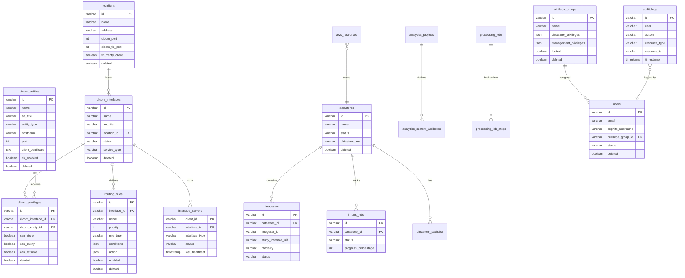

# DICOM Archive - Database Schema

## Overview

The DICOM Archive uses Aurora MySQL Serverless v2 (4–8 ACU) with the RDS Data API enabled for serverless Lambda access. The schema is normalized and optimized for DICOM medical imaging workflows.

It is initialized from three SQL files by the Database Stack's schema-init custom resource:
- `schema.sql` — core tables (datastores, DICOM interface config, imaging data, import, analytics, processing jobs, users, system)
- `schema-virtual-folder.sql` — virtual folder tables (applied when the virtual folder feature is enabled)
- `schema-non-dicom-import.sql` — the `non_dicom_imports` table

These schema files always describe the current end-state and run in full on fresh installs. Schema changes assume a fresh deployment; there is no in-place migration path for already-deployed databases.

Together these define ~41 tables. The entity-relationship diagram below shows the core operational tables; the additional virtual-folder, analytics, and processing-job tables are described in the catalog sections that follow.

> **Note:** The `instances` table is **defined but currently unused** — no code writes to it (per-instance detail lives in S3-indexed metadata). The `v_datastore_summary` view joins it, so its instance-derived counts are effectively zero.

## Entity Relationship Diagram

## Core Tables

### datastores
S3-backed datastores. Tracks datastore lifecycle, configuration, and status.

**Key Fields:**
- `id` (PK), `name`, `description`
- `status`: CREATING, ACTIVE, DELETING, ERROR
- `s3_bucket_name`, `s3_prefix` (S3 archive bucket — the only backend)
- `imported`, `access_level` (read-only / read-write for imported buckets)
- Versioning: `current_version`, `previous_versions`
- Soft delete: `deleted`, `deleted_at`, `deleted_by`

### locations
Physical or logical locations where DICOM interfaces are deployed.

**Key Fields:**
- `id` (PK), `name`, `description`
- `address`, `city`, `state`, `country`, `postal_code`
- `dicom_port`
- `dicom_tls_port`: TLS listener port (default NULL, typically 2762)
- `tls_verify_client`: Enable mTLS client certificate verification
- Versioning and soft delete support

### dicom_interfaces
DICOM SCP/SCU interface servers for receiving and sending DICOM data.

**Key Fields:**
- `id` (PK), `name`, `ae_title`, `description`
- `status`: ACTIVE, INACTIVE, CREATING, DELETING, ERROR
- `service_type`: SCP, SCU, SCP_SCU
- `protocol`: DIMSE
- `location_id` (FK to locations)
- `host`, `max_associations`
- Versioning and soft delete support

### dicom_entities
External DICOM systems (clients/servers) that can interact with interfaces.

**Key Fields:**
- `id` (PK), `name`, `ae_title`, `description`
- `entity_type`: CLIENT, SERVER
- `hostname`, `port`
- `client_certificate`: PEM-encoded client certificate for mTLS verification
- `tls_enabled`: Whether to use TLS when connecting to this entity (outbound)
- `status`: ACTIVE, INACTIVE
- Versioning and soft delete support

### dicom_privileges
Defines what operations a DICOM entity can perform on an interface.

**Key Fields:**
- `id` (PK)
- `dicom_interface_id` (FK), `dicom_entity_id` (FK)
- `can_store`, `can_query`, `can_retrieve` (boolean)
- Versioning and soft delete support

### routing_rules
Defines how incoming DICOM data is routed to datastores based on conditions.

**Key Fields:**
- `id` (PK), `interface_id` (FK to dicom_interfaces)
- `name`, `description`, `priority`
- `rule_type`: AUTO_ROUTE, DESTINATION
- `conditions` (JSON): matching criteria
- `action` (JSON): routing destination
- `enabled` (boolean)
- Versioning and soft delete support

### imagesets
S3 object index records. Tracks DICOM hierarchy (study/series).

**Key Fields:**
- `id` (PK), `datastore_id` (FK)
- `imageset_id`, `version_id`
- `study_instance_uid`, `series_instance_uid`
- `is_primary`, `modality`
- `patient_id`, `patient_name`, `study_date`
- `status`: ACTIVE, DELETED, ERROR
- `instance_count`, `size_bytes`

### instances
Individual DICOM instance metadata. **Defined but currently unused** — no code writes to this table; per-instance detail is served from S3-indexed metadata directly. Retained in the schema for potential future use.

**Key Fields (as defined):**
- `id` (PK), `datastore_id` (FK), `imageset_id` (FK)
- `sop_instance_uid`, `study_instance_uid`, `series_instance_uid`
- `sop_class_uid`, `instance_number`, `modality`
- Image properties: `rows`, `columns`, `bits_allocated`, `number_of_frames`
- `size_bytes`
- `dicom_tags` (JSON): full DICOM metadata

### import_jobs
Tracks DICOM import operations from various sources.

**Key Fields:**
- `id` (PK), `datastore_id` (FK)
- `job_name`, `import_job_id`
- `source_location`, `source_type`: S3, DICOM_SCP, FILE_SYSTEM
- `status`: PENDING, IN_PROGRESS, COMPLETED, FAILED, CANCELLED
- `progress_percentage`
- Statistics: `total_files`, `processed_files`, `failed_files`
- `imagesets_created`, `instances_imported`
- `error_message`, `error_details` (JSON)

### privilege_groups
Define sets of permissions for users.

**Key Fields:**
- `id` (PK), `name` (unique), `description`
- `datastore_privileges` (JSON): per-datastore permissions
- `management_privileges` (JSON): system management permissions
- `locked` (boolean): prevents deletion/modification
- Versioning and soft delete support

### users
Application users linked to Cognito.

**Key Fields:**
- `id` (PK), `email` (unique), `cognito_username`
- `first_name`, `last_name`
- `privilege_group_id` (FK)
- `status`: ACTIVE, INACTIVE, SUSPENDED
- `last_login`
- Versioning and soft delete support

### interface_servers
Active DICOM server instances (ECS tasks or remote services).

**Key Fields:**
- `client_id` (PK), `interface_id` (FK)
- `interface_type`: DICOM
- `hostname`, `ip_address`, `port`
- `status`: ACTIVE, INACTIVE, ERROR
- `last_heartbeat`
- `server_metadata` (JSON)

### datastore_statistics
Aggregated datastore statistics.

**Key Fields:**
- `id` (PK), `datastore_id` (FK)
- Counts: `study_count`, `series_count`, `instance_count`
- `total_size_bytes`
- `modality_breakdown` (JSON)
- `latest` (boolean)
- `last_updated`

### audit_logs
System audit trail for most operations.

**Key Fields:**
- `id` (PK), `user`, `username`
- `action`, `resource_type`, `resource_id`, `resource_name`
- `old_values` (JSON), `new_values` (JSON)
- `status`, `error_message`
- `ip_address`, `user_agent`
- `timestamp`

### aws_resources
Track all AWS resources used by the application.

**Key Fields:**
- `id` (PK), `resource_type`, `resource_arn`, `resource_name`
- `service`, `region`, `account_id`
- `deployment`, `construct`, `construct_id`
- `status`: ACTIVE, DELETED, ERROR
- `tags` (JSON), `metadata` (JSON)

### non_dicom_imports
Non-DICOM file import records (PDF/JPEG/PNG/MP4 encapsulated as DICOM). Defined in `schema-non-dicom-import.sql`.

**Key Fields:**
- `id` (PK), `datastore_id`
- Source file metadata, encapsulation status, resulting study/series UIDs

### analytics_projects
Analytics project definitions that index ImageSet metadata into S3-backed Iceberg tables (Glue/Athena).

**Key Fields:**
- `id` (PK), `name`, `description`, `status`
- Datastore scope, Glue/Athena/S3 target configuration

### analytics_custom_attributes
User-defined DICOM tag columns added to an analytics project (with optional backfill).

**Key Fields:**
- `id` (PK), `project_id` (FK to `analytics_projects`)
- DICOM tag, column name, data type

### processing_jobs
Processing-job definitions for the processing-jobs framework (e.g. the seeded `dicom-vf-export` job).

**Key Fields:**
- `id` (PK), `name`, `description`
- Associated Step Functions ARN and configuration

### processing_job_steps
Per-step tracking for processing-job runs.

**Key Fields:**
- `id` (PK), job reference, step status/progress

### study_modification_jobs
Tracks asynchronous series-deletion and metadata-update jobs (Data Management stack).

**Key Fields:**
- `id` (PK), datastore/study references
- Operation type, status, error details

### Virtual Folder tables
Defined in `schema-virtual-folder.sql` (created when the virtual folder feature is enabled). See the [System Design — Database Schema](SYSTEM_DESIGN.md#database-schema) for the full list. Summary:
- **Virtual folder config:** `virtual_folder_indexing_profiles`, `virtual_folder_deid_profiles`, `virtual_folders`, `virtual_assignment_rules`, `virtual_folder_statistics`
- **Assignment rules:** `virtual_folder_assignment_rules`, `virtual_folder_assignment_rule_conditions`, `virtual_folder_assignment_rule_datastores`, `virtual_folder_assignments`
- **Per-folder indexed hierarchy:** `virtual_patient`, `virtual_study`, `virtual_series`, `virtual_imageset`, `virtual_instance` (IssuerOfPatientID is a column on `virtual_patient`)

> **Note:** The retired `schema-dicomweb.sql` (DICOMweb reference index `issuer`/`patient`/`study`/`series`/`instance`/`imageset` and de-identification mapping `virtual_folder_patients`/`virtual_folder_studies`/`virtual_folder_series`/`virtual_folder_instances`) was never executed by the schema-init custom resource — those tables do not exist in deployed databases.

> **Residual tables (out of scope):** `schema.sql` also defines `hl7_entities` and `hl7_mappings`. HL7 has been removed from the project and these tables are not used by any deployed feature.

## Views

### v_datastore_summary
Datastore summary view. Note it `LEFT JOIN`s the `instances` table, which is currently unpopulated, so any instance-derived counts from this view are zero; authoritative counts come from `datastore_statistics` and `imagesets`.

### v_active_imports
Active import jobs with progress and duration.

### v_entity_privileges
DICOM entity privileges with interface and entity details.

## Common Patterns

### Versioning
Tables with versioning support track changes:
- `current_version`: Integer version number
- `previous_versions`: JSON array of historical states

### Soft Delete
Tables with soft delete support:
- `deleted`: Boolean flag
- `deleted_at`: Timestamp of deletion
- `deleted_by`: User who deleted the record

### Audit Trail
Most CRUD operations are logged to the `audit_logs` table with:
- User information
- Action performed
- Resource affected
- Old and new values
- Timestamp and status
