# DICOM networking (DIMSE)

DICOM Archive can receive and serve imaging over the classic DICOM network protocol (DIMSE), so modalities, workstations, and PACS systems that speak DICOM can talk to the archive the same way they talk to any other DICOM node. This guide is for administrators who set up the network listener, decide which remote systems may connect, and route incoming objects to storage.

The archive acts as a DICOM Service Class Provider (SCP) and supports these services:

- **C-ECHO** (Verification) to test connectivity.
- **C-STORE** to receive objects. Stored objects are written straight to S3 storage, in the transfer syntax they arrived in. Accepted syntaxes: Implicit and Explicit VR Little Endian, Explicit VR Big Endian, Deflated Explicit VR Little Endian, Encapsulated Uncompressed, JPEG (baseline, extended and lossless), JPEG-LS, JPEG 2000, HTJ2K, RLE, JPEG XL (lossless, JPEG recompression and lossy), Deflated Image Frame Compression, MPEG-2, H.264 and HEVC. When a sender offers an uncompressed syntax alongside a compressed one, the uncompressed one is chosen.
- **C-FIND** to answer queries (Study, Series, and Instance level).
- **C-GET** and **C-MOVE** to send objects back to a requesting node.

If you only need REST/HTTP access instead of DIMSE, see [dicomweb-api.md](dicomweb-api.md).

## How the pieces fit together

Four objects work together. Create them in this order.

| Object | What it is |
|--------|------------|
| **Location** | Where a DICOM service runs and the network ports it listens on. A location is hosted in the cloud on AWS Fargate (behind a Network Load Balancer) or runs on-premise on your own server. |
| **DICOM interface** | A named listener on a location: an AE title plus the storage it can reach for query and retrieve. A connecting system addresses this AE title as the "called AE". |
| **DICOM entity** | A remote system (modality, workstation, PACS, viewer) that is allowed to talk to an interface, identified by its "calling AE" title, host, and port, with per-interface STORE / QUERY / RETRIEVE permissions. |
| **Routing rule** | Decides which storage an incoming C-STORE object is written to, optionally based on DICOM tag values. |

An inbound association is accepted only when the called AE matches a configured interface **and** the calling AE matches a DICOM entity that holds the required privilege on that interface. Everything else is rejected and audited.

## Before you start

- You need an administrator account with access to the **Configuration** section (Locations and the DICOM menu) and, for the monitor, the **System** section.
- Create at least one storage first. See [storage.md](storage.md).
- Have the network details of each remote system ready: its AE title, IP address or hostname, and port.

## Find the DIMSE screens

In the left sidebar:

- **Configuration > Locations** manages locations.
- **Configuration > DICOM** expands to **DICOM Entities**, **DICOM Interfaces**, and **Routing Rules**.
- **System > Interface Server Monitor** shows the health of running services.

## Step 1: Create a location

A location defines the ports the archive listens on and whether the service is cloud-hosted or on-premise.

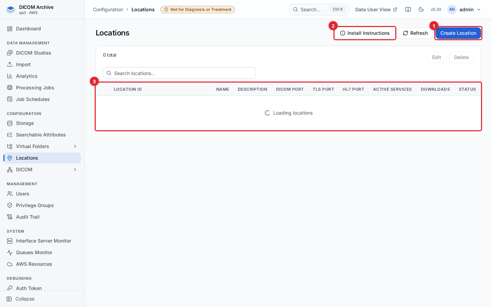

1. Click **Create Location** to add a new location.
2. Click **Install Instructions** to get the on-premise installer commands (see [Step 6](#step-6-install-an-on-premise-gateway)).
3. The table lists each location with its ID, ports, active services, and status. A cloud-hosted location shows a **Fargate** badge and its Network Load Balancer DNS name.

To create a location:

1. In the sidebar, open **Configuration > Locations**, then click **Create Location**.
2. Fill in the fields described below and click **Create**.

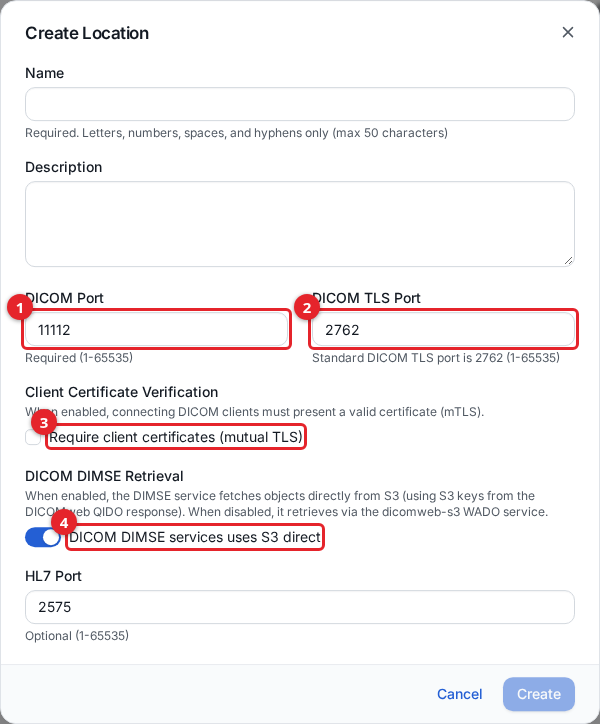

1. **DICOM Port** is the plain (unencrypted) listener port. The default is `11112`.
2. **DICOM TLS Port** is the encrypted listener port. The standard DICOM TLS port is `2762`.
3. **Require client certificates (mutual TLS)** turns on mTLS. Leave it off unless you intend to verify client certificates (see [Step 5](#step-5-set-up-tls)).
4. **DICOM DIMSE services uses S3 direct** controls how the service fetches objects for query and retrieve. Leave it on (the default): the service reads objects directly from S3. When off, it retrieves through the internal DICOMweb service instead.

| Field | Required | Default | Notes |
|-------|----------|---------|-------|
| Name | Yes | - | Letters, numbers, spaces, and hyphens only. Max 50 characters. |
| Description | No | - | Free text. |
| DICOM Port | Yes | 11112 | Plain DICOM listener (1-65535). |
| DICOM TLS Port | No | 2762 | TLS listener (1-65535). |
| Require client certificates | No | Off | Enables mutual TLS. |
| DICOM DIMSE uses S3 direct | No | On | Retrieval source for C-FIND/C-GET/C-MOVE. |
| HL7 Port | No | 2575 | Only used for HL7 interfaces. |

Cloud-hosted (Fargate) locations are provisioned by the platform and carry extra service settings you edit later (task counts and the IP allowlist). You cannot delete a Fargate location from this screen.

## Step 2: Allow a modality to reach a cloud listener

For a cloud-hosted (Fargate) location, remote systems reach the listener through a Network Load Balancer. By default no source IP is allowed; you add each modality's public IP (or CIDR range) to an allowlist, per port.

1. In **Configuration > Locations**, select the Fargate location and click **Edit**.
2. Open the **Service Configuration** tab.

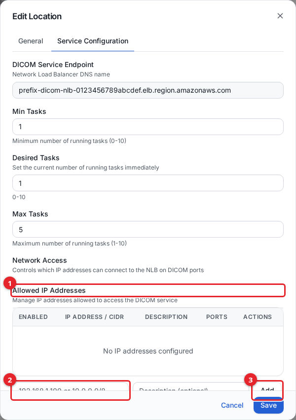

1. **Allowed IP Addresses** lists every source permitted to connect, with the ports it may use.
2. Enter an IP address or CIDR range (for example `203.0.113.10` or `10.0.0.0/8`) and an optional description.
3. Click **Add**. Use the **DICOM (11112)** and **DICOM TLS (2762)** checkboxes beneath the field to choose which ports the entry opens.

The **DICOM Service Endpoint** field at the top of the tab shows the Network Load Balancer DNS name. This is the host your modalities connect to. Opening DICOM ports to the public internet (`0.0.0.0/0`) is not offered; always scope access to known IP ranges.

Allowing a source IP here is a network-layer control only. The connecting system must still match a DICOM entity (Step 4) before any association is accepted.

Use the **Min Tasks**, **Desired Tasks**, and **Max Tasks** fields on the same tab to control how many service instances run (0-10 each). Set Desired Tasks to the number you want running right now.

> **The DICOM service is stopped until you start it.** An in-cloud location is deployed with **Desired Tasks** set to `0`, so nothing listens on the endpoint and every C-ECHO or C-STORE fails to connect. Set **Desired Tasks** to at least `1` and save. The task usually takes a minute or two to start. Setting it back to `0` stops the service and its Fargate cost.

## Step 3: Create a DICOM interface

An interface is the AE title the archive answers to on a location, plus the storage it can reach for query and retrieve.

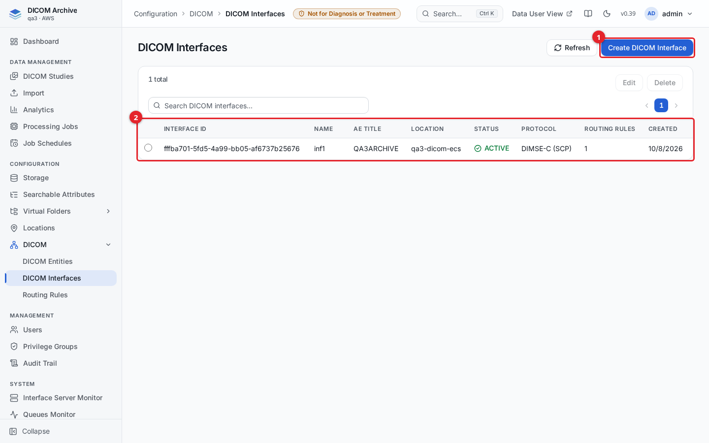

1. Click **Create DICOM Interface**.
2. The table shows each interface with its AE title, location, status, protocol, and routing-rule count. An interface with no routing rules is flagged, because incoming C-STORE objects would have nowhere to go.

To create an interface:

1. Open **Configuration > DICOM > DICOM Interfaces**, then click **Create DICOM Interface**.
2. Fill in the fields and click **Create Interface**.

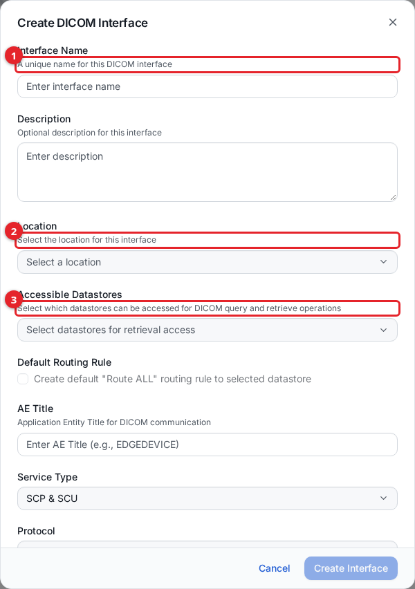

1. **Interface Name** is a unique label for the interface.
2. **Location** is the location whose ports this interface listens on. Select one of your locations.
3. **Accessible Datastores** are the storages this interface may read for query (C-FIND) and retrieve (C-GET/C-MOVE). Select one or more.
4. **AE Title** is the called AE that connecting systems address. Max 16 characters.

| Field | Required | Notes |
|-------|----------|-------|
| Interface Name | Yes | Unique name. |
| Description | No | Free text. |
| Location | Yes | The location this interface runs on. |
| Accessible Datastores | No | Storage reachable for query/retrieve. |
| AE Title | Yes | Called AE title. Uppercase letters, numbers, `_`, `-`; max 16 characters. |
| Service Type | Yes | **SCP & SCU** (default), **SCP (Receiver)**, or **SCU (Sender)**. |
| Protocol | Yes | **DIMSE**. |

If you select exactly one accessible datastore, you can tick **Create default "Route ALL" routing rule to selected datastore** to have the archive create a catch-all routing rule automatically. Otherwise, add routing rules in Step 7.

## Step 4: Register a remote system as a DICOM entity

A DICOM entity is a remote system allowed to connect, matched by its calling AE title. Each entity holds per-interface permissions for STORE, QUERY, and RETRIEVE.

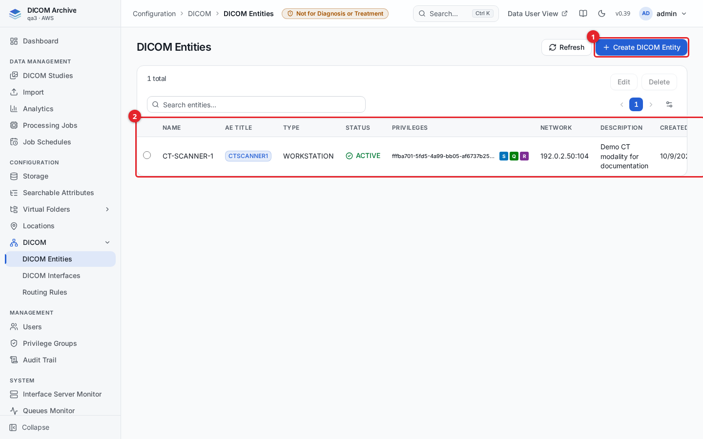

1. Click **Create DICOM Entity**.
2. The table shows each entity with its AE title, type, status, granted privileges, and network address.

To create an entity:

1. Open **Configuration > DICOM > DICOM Entities**, then click **Create DICOM Entity**.
2. Fill in the fields and click **Create**.

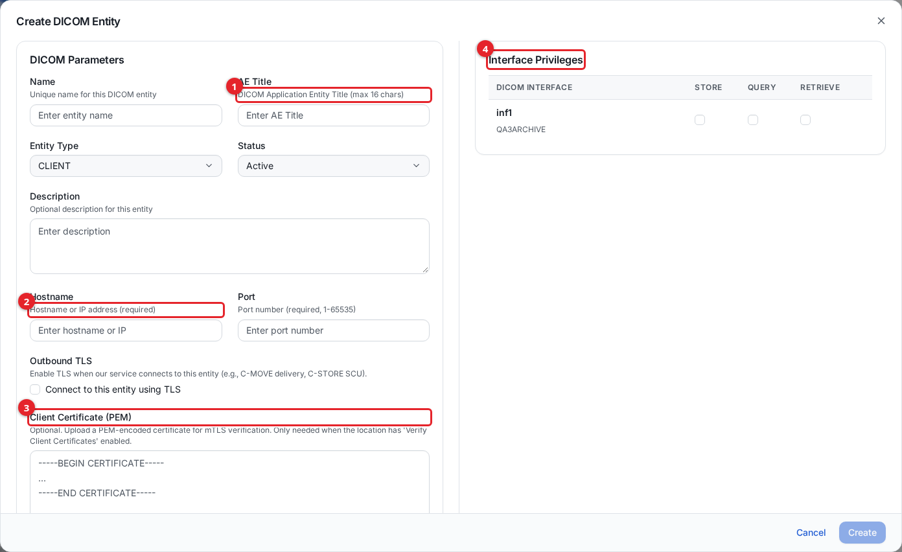

1. **AE Title** is the calling AE of the remote system. Max 16 characters; uppercase letters, numbers, underscores, and hyphens only.
2. **Hostname** and **Port** are where the archive connects back to this system (used for C-MOVE delivery and outbound C-STORE). Both are required.
3. **Client Certificate (PEM)** is optional. Paste a PEM certificate here only when the entity connects to a location that has client-certificate verification (mTLS) enabled. See [Step 5](#step-5-set-up-tls).
4. **Interface Privileges** is a table of every interface. Tick **STORE**, **QUERY**, and **RETRIEVE** per interface to grant exactly the operations this system may perform.

| Field | Required | Notes |
|-------|----------|-------|
| Name | Yes | Unique display name. |
| AE Title | Yes | Calling AE title (max 16 characters). |
| Entity Type | No | Client, Application, Workstation, PACS, Viewer, or Other. |
| Status | No | Active, Inactive, Suspended, or Pending Approval. Default Active. |
| Description | No | Free text. |
| Hostname | Yes | Host or IP the archive calls back to. |
| Port | Yes | Port the archive calls back to (1-65535). |
| Connect using TLS | No | Enables TLS when the archive connects out to this entity. |
| Client Certificate (PEM) | No | Only for mTLS inbound verification. |

The privilege checks map directly to operations: STORE is required for C-STORE, QUERY for C-FIND, RETRIEVE for C-GET/C-MOVE. C-ECHO succeeds if the entity holds any privilege on the interface.

## Step 5: Set up TLS

The archive can serve DICOM over TLS on the TLS port (default `2762`) alongside the plain port. Mutual TLS (client-certificate verification) is optional.

### Server certificate

The server certificate and its signing CA are generated automatically when the platform is first deployed and are kept in AWS Secrets Manager. You do not create or upload a server certificate. Clients that want to verify the server use that CA certificate; test clients can skip verification with the DCMTK `--ignore-peer-cert` option.

### Mutual TLS (verify connecting clients)

To require connecting systems to present a client certificate:

1. In **Configuration > Locations**, edit the location and enable **Require client certificates (mutual TLS)**.
2. In **Configuration > DICOM > DICOM Entities**, edit each entity that will connect over mTLS and paste its client certificate into **Client Certificate (PEM)**.

With verification on, the archive accepts a TLS association only when the client presents a certificate that matches the one pinned on its entity. A connection with no certificate, or with a certificate that does not match the entity, is rejected and audited.

Note that pynetdicom (the DICOM library the service uses) supports TLS 1.2 as its maximum version. Some viewers, such as Weasis, do not support DIMSE over TLS; use the DICOMweb API over HTTPS instead ([dicomweb-api.md](dicomweb-api.md)).

## Step 6: Install an on-premise gateway

A location can run on your own server instead of in the cloud. The on-premise service is a container that registers with the archive and listens for DICOM on your network.

1. In **Configuration > Locations**, click **Install Instructions**.

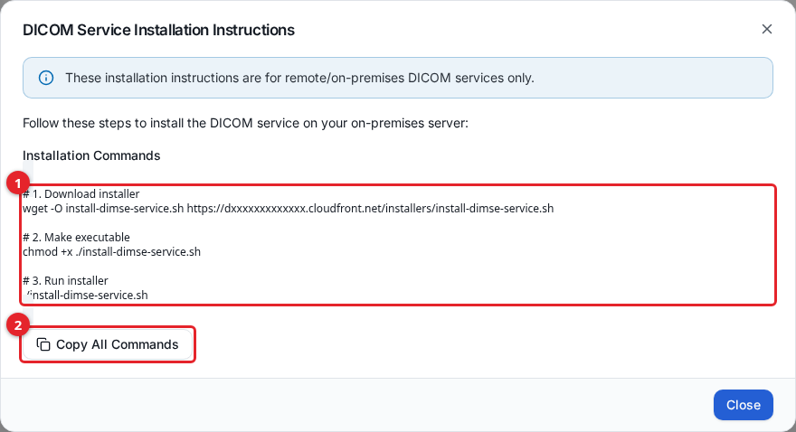

1. Copy the three commands shown: download the installer, make it executable, and run it.
2. **Copy All Commands** copies them to the clipboard.

On the on-premise server, run the installer. It:

- Installs prerequisites (`unzip`, the AWS CLI) and detects Docker or Podman.
- Prompts for your archive username and password (and an MFA code if your account requires one) and signs you in.
- Lists your locations and asks which one this server is for.
- Downloads an encrypted configuration bundle (`config.zip`) for that location. The bundle holds the service configuration and the IAM Roles Anywhere certificates the container uses to obtain temporary AWS credentials for writing to S3. The bundle is AES-256 encrypted and is decrypted in memory by the service at runtime, so certificates are never written to disk in plain text.
- Starts the service with Docker Compose or Podman Compose.

Once running, the on-premise service appears in the **Interface Server Monitor** (Step 8) and heartbeats to the archive. For a cloud-hosted (Fargate) location you do not run an installer; the service is provisioned for you.

## Step 7: Route incoming objects to storage

A routing rule decides which storage an incoming C-STORE object is written to. Rules are evaluated in priority order per interface; the first matching rule wins.

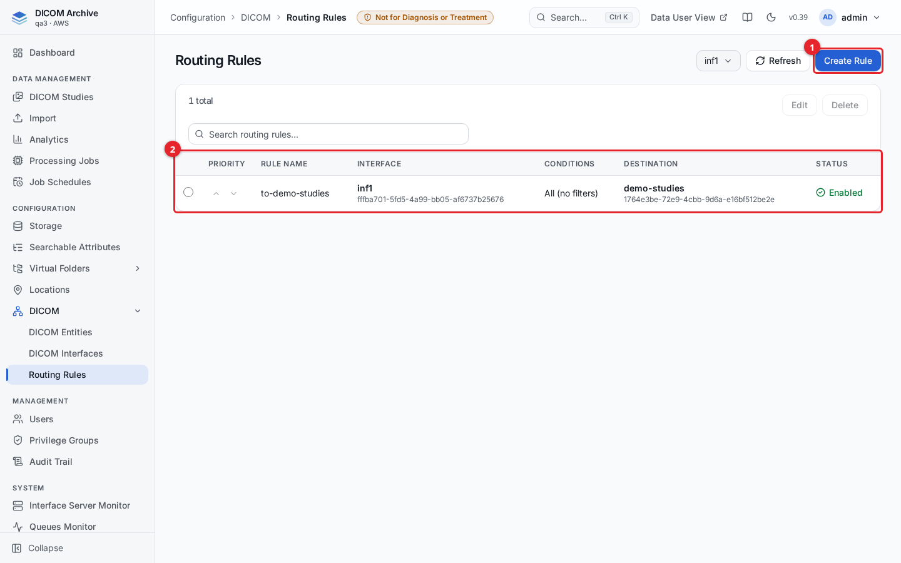

1. Select an interface from the dropdown, then click **Create Rule**.
2. The table lists the rules for the selected interface, with their conditions, destination storage, and enabled state. Use the up/down arrows in the **Priority** column to reorder rules.

To create a rule:

1. Open **Configuration > DICOM > Routing Rules**, select the interface, then click **Create Rule**.
2. Fill in the fields and click **Create**.

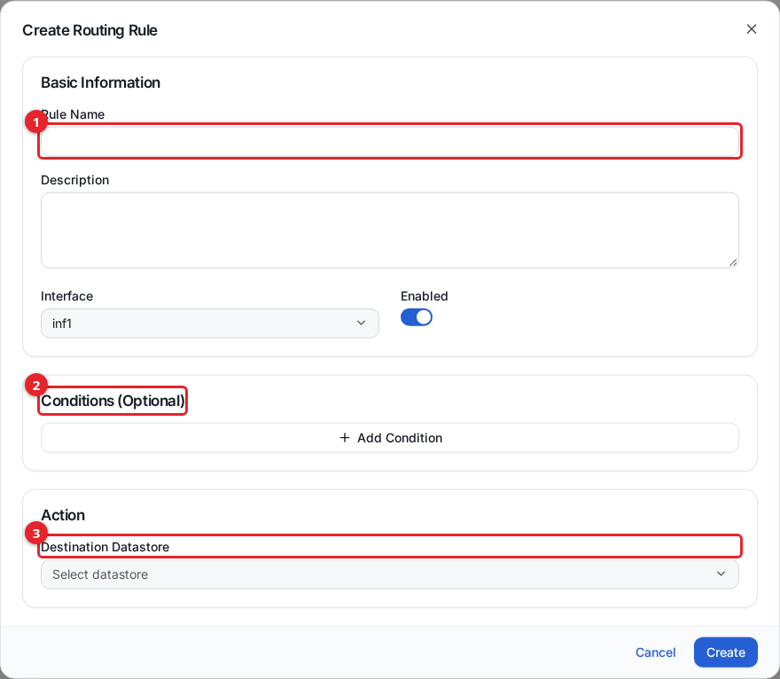

1. **Rule Name** and an optional **Description**. The **Interface** is preselected, and **Enabled** controls whether the rule is active.
2. **Conditions (Optional)** restrict the rule to objects matching DICOM tag values. Click **Add Condition**, pick a DICOM tag, an operator, and a value. A rule with no conditions matches every object (a catch-all).
3. **Destination Datastore** is the storage objects are written to when the rule matches. Only storages the interface can access are listed.

Condition operators depend on the tag's value type. Text tags offer Equals, Not Equals, Contains, Not Contains, Starts With, Ends With, Exists, and Not Exists. Date tags offer Equals, Not Equals, Before, After, Between, Last N Days, Exists, and Not Exists. Combine multiple conditions with AND or OR.

To make sure nothing is dropped, give each interface at least one catch-all rule (no conditions) at the lowest priority.

## Step 8: Monitor running services

**System > Interface Server Monitor** shows every DICOM (and HL7) service instance that has registered, cloud-hosted or on-premise.

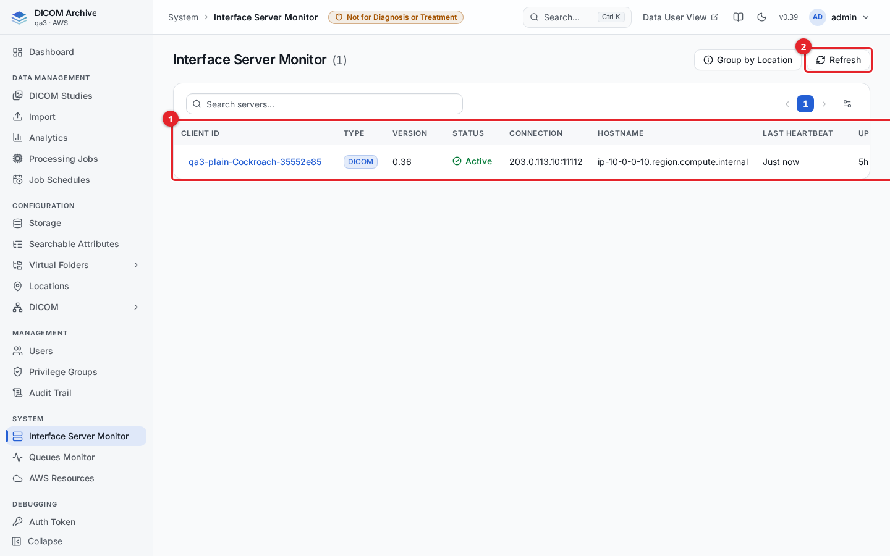

1. The table lists each service with its client ID, type, version, status, connection address, hostname, last heartbeat, and uptime. Click a client ID to see full details.
2. **Refresh** reloads the list; it also refreshes on its own about every 30 seconds. Use **Group by Location** to collapse instances under their location.

Each service heartbeats about once a minute. A service that stops heartbeating for several minutes is shown as **Disconnected** and is cleaned up automatically.

## Step 9: Test the connection

Use the DCMTK tools or pynetdicom from a host that is allowed to reach the listener. Replace the placeholders with your values: `<host>` is the location's NLB DNS name (cloud) or server address (on-premise), `<called-ae>` is the interface AE title, and `<calling-ae>` is the AE title of a configured DICOM entity.

Verify connectivity (C-ECHO) on the plain port:

```bash
echoscu -aec <called-ae> -aet <calling-ae> <host> 11112
```

Send an object (C-STORE):

```bash
storescu -aec <called-ae> -aet <calling-ae> <host> 11112 /path/to/image.dcm
```

Query at study level (C-FIND):

```bash
findscu -aec <called-ae> -aet <calling-ae> -S \
  -k QueryRetrieveLevel=STUDY \
  -k PatientID="*" \
  -k StudyInstanceUID= \
  <host> 11112
```

Retrieve to a destination (C-MOVE). The destination AE must itself be a configured DICOM entity with a reachable host and port:

```bash
movescu -aec <called-ae> -aet <calling-ae> -S \
  -k QueryRetrieveLevel=STUDY \
  -k StudyInstanceUID=<study-uid> \
  -aem <destination-ae> \
  <host> 11112
```

C-ECHO over TLS (no client certificate), on the TLS port:

```bash
echoscu --tls12 --anonymous-tls --ignore-peer-cert <host> 2762
```

C-STORE over mutual TLS (with a client certificate registered on the entity):

```bash
storescu --tls12 \
  +cf /path/to/client-cert.pem \
  +pk /path/to/client-key.pem \
  +ca /path/to/ca-cert.pem \
  <host> 2762 /path/to/image.dcm
```

The equivalent pynetdicom tools are `echoscu`, `storescu`, `findscu`, and `movescu` from the `pynetdicom` package, with `-aec`, `-aet`, and `-aem` meaning the same thing.

## Audit of DIMSE operations

Every DIMSE operation is recorded in the audit trail. Because a DICOM peer has no user account, the actor is the calling AE title, shown as `dicom:<AE>`. The records hold UIDs, AE titles, counts, and status codes only, never patient data.

- **C-STORE**: one record per association (written when the association ends), with how many instances were stored and refused and the study/series UIDs stored. There is no per-instance record, which would flood the trail at modality scale.
- **C-FIND / C-GET / C-MOVE**: one record per request, with the query/retrieve level, the identifier keys sent (not their values), the UIDs asked for, match or sub-operation counts, and the final status.
- **A rejected association**: one failure record with the reason (for example, the calling AE is not configured, or a client certificate did not match).

See [audit-trail.md](audit-trail.md) for how to search and read these records.

## Related guides

- [getting-started.md](getting-started.md)
- [installation.md](installation.md)
- [storage.md](storage.md)
- [dicomweb-api.md](dicomweb-api.md)
- [importing-data.md](importing-data.md)
- [users-and-access.md](users-and-access.md)
- [audit-trail.md](audit-trail.md)
- [monitoring.md](monitoring.md)
