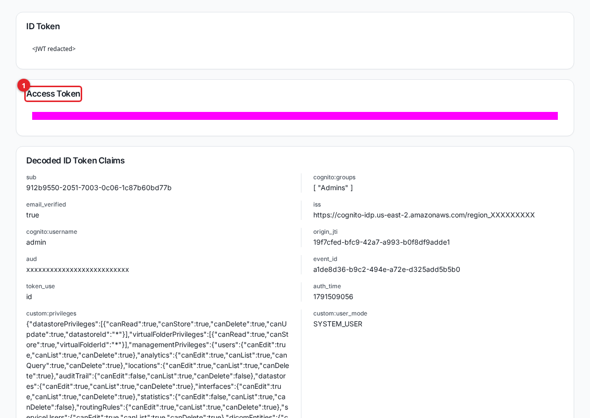

# DICOMweb and the REST API

The DICOM Archive exposes a standard DICOMweb interface for querying, retrieving, and uploading imaging over HTTPS, plus a REST management API for everything the admin UI does. This guide is for developers and integrators connecting a viewer, a sending tool, or a script to the archive.

DICOMweb is served per storage and per virtual folder, so a client talks to one scope at a time. Both interfaces authenticate with the same Amazon Cognito access token.

## Authentication

Every request carries a Cognito **access token** (not the ID token, which is rejected). The token is valid for about one hour; request a fresh one when it expires.

Send it with a `Bearer ` prefix to both interfaces:

```
Authorization: Bearer <access-token>
```

The REST management API also accepts the bare token without the prefix, but DICOMweb rejects a bare token with HTTP 401, so use `Bearer` everywhere.

### Getting a token for testing

For a quick manual test, copy a token from the admin UI. Open **Auth Token** from the **Debugging** section of the sidebar.



1. **Access Token** is the value to copy. Send it as `Bearer <access-token>`.

Treat a token like a password. It grants whatever your account can do for its lifetime, so never paste a real token into a document, a ticket, a commit, or a shared log.

In scripts, obtain a token programmatically from Cognito with the user pool's app client using the `USER_PASSWORD_AUTH` flow, and read `AuthenticationResult.AccessToken` from the response. Ask your administrator for the user pool client id and the API host.

The examples below use the placeholders `<cloudfront-domain>` (the UI/DICOMweb host), `<api-url>` (the REST API base, ending in `/api`), `<access-token>`, `<datastore-id>`, and `<virtual-folder-id>`.

## DICOMweb base URLs

DICOMweb is served under the CloudFront `/dicomweb` path, scoped by an id in the first path segment:

- Per storage: `https://<cloudfront-domain>/dicomweb/<datastore-id>`
- Per virtual folder: `https://<cloudfront-domain>/dicomweb/<virtual-folder-id>`

The same URL shape serves both; the service resolves the id to either a storage or a virtual folder and scopes the request accordingly. A virtual-folder scope returns only the content assigned to that folder, with the folder's de-identification applied. Find a storage id on the **Storage** page and a virtual folder id on the **Virtual Folders** page, or read them from the REST API.

A health check needs no scope and no auth:

```bash
curl https://<cloudfront-domain>/dicomweb/health
```

## QIDO-RS: search

Search returns DICOM JSON (`application/dicom+json`). Add standard QIDO query parameters such as `limit`, `offset`, `PatientID`, `StudyDate`, or `Modality`.

```bash
# Search studies in a storage (first 10)
curl -H "Authorization: Bearer <access-token>" \
  "https://<cloudfront-domain>/dicomweb/<datastore-id>/studies?limit=10"

# Search the series of one study
curl -H "Authorization: Bearer <access-token>" \
  "https://<cloudfront-domain>/dicomweb/<datastore-id>/studies/<study-uid>/series"

# Search the instances of one series
curl -H "Authorization: Bearer <access-token>" \
  "https://<cloudfront-domain>/dicomweb/<datastore-id>/studies/<study-uid>/series/<series-uid>/instances"
```

Series and instances can also be searched across a whole scope with `/series` and `/instances` at the base. A bare `/studies` with no `limit` returns a bounded first page rather than every study.

The same paths work against a virtual folder by using `<virtual-folder-id>` in place of `<datastore-id>`.

## WADO-RS: retrieve

```bash
# Study, series, or instance metadata (DICOM JSON)
curl -H "Authorization: Bearer <access-token>" \
  "https://<cloudfront-domain>/dicomweb/<datastore-id>/studies/<study-uid>/metadata"
curl -H "Authorization: Bearer <access-token>" \
  "https://<cloudfront-domain>/dicomweb/<datastore-id>/studies/<study-uid>/series/<series-uid>/metadata"

# Retrieve an instance (DICOM Part 10, multipart/related)
curl -H "Authorization: Bearer <access-token>" \
  "https://<cloudfront-domain>/dicomweb/<datastore-id>/studies/<study-uid>/series/<series-uid>/instances/<sop-uid>"

# Retrieve specific frames of an instance
curl -H "Authorization: Bearer <access-token>" \
  "https://<cloudfront-domain>/dicomweb/<datastore-id>/studies/<study-uid>/series/<series-uid>/instances/<sop-uid>/frames/1,2,3"
```

### Rendered images and thumbnails

A single instance (or a frame of it) can be rendered to a consumer image such as JPEG or PNG:

```bash
# Rendered instance
curl -H "Authorization: Bearer <access-token>" \
  "https://<cloudfront-domain>/dicomweb/<datastore-id>/studies/<study-uid>/series/<series-uid>/instances/<sop-uid>/rendered"

# Rendered single frame
curl -H "Authorization: Bearer <access-token>" \
  "https://<cloudfront-domain>/dicomweb/<datastore-id>/studies/<study-uid>/series/<series-uid>/instances/<sop-uid>/frames/1/rendered"
```

Rendering is supported at the instance and frame level. Study-level and series-level `/rendered` return HTTP 501 (not implemented), because they are unbounded; render one instance or frame at a time.

### Transfer syntaxes

The service serves frames as stored, transcodes lossless and near-lossless syntaxes to Explicit VR Little Endian on request, and decodes a wide range of syntaxes for rendering. Supported families include Implicit and Explicit VR Little Endian, Explicit VR Big Endian, Deflated, RLE, the JPEG family (baseline, extended, lossless), JPEG-LS, JPEG 2000 Part 1 and Part 2, HTJ2K, encapsulated uncompressed, and the MPEG/H.264/HEVC video syntaxes (served as a single stream, not per frame). Lossy syntaxes are always served as stored, because re-encoding them would add loss. The pixel pipeline is validated against a broad matrix of transfer syntaxes in the service's test suite.

## STOW-RS: upload

Upload instances with `POST` and a `multipart/related; type="application/dicom"` body, where each part is one DICOM Part 10 object. A request without that content type is refused with HTTP 400.

```bash
curl -X POST \
  -H "Authorization: Bearer <access-token>" \
  -H 'Content-Type: multipart/related; type="application/dicom"; boundary=BOUNDARY' \
  --data-binary @stow-body.dat \
  "https://<cloudfront-domain>/dicomweb/<datastore-id>/studies"
```

The response is DICOM JSON (`application/dicom+json`) describing which instances were stored. You can also post to `/studies/<study-uid>` to target a specific study. STOW against a `<virtual-folder-id>` stores into that folder.

For bulk uploads, a DICOMweb-capable sending tool, a DIMSE C-STORE sender ([dicom-networking.md](dicom-networking.md)) or a direct copy into the storage bucket ([importing-data.md](importing-data.md)) is usually simpler than hand-built multipart bodies.

## Deleting through DICOMweb

The DICOMweb `DELETE` verb removes a study, series, or instance from a storage or virtual folder, subject to the caller's Delete privilege:

```bash
curl -X DELETE -H "Authorization: Bearer <access-token>" \
  "https://<cloudfront-domain>/dicomweb/<datastore-id>/studies/<study-uid>/series/<series-uid>"
```

Deletes are always audited. See [audit-trail.md](audit-trail.md).

## Connecting third-party viewers and tools

Point any DICOMweb client at a scope's base URL and give it the `Bearer` access token.

- **OHIF Viewer**: configure a data source of type `dicomweb` with `qidoRoot`, `wadoRoot`, and `stowRoot` (if uploading) all set to `https://<cloudfront-domain>/dicomweb/<datastore-id>`, and send the access token in the `Authorization: Bearer <access-token>` header.
- **3D Slicer** (DICOMweb extension): set the server URL to the same base and supply the `Bearer` token as an authorization header.
- **dicomweb-client** (Python) or **dcm4che**: set the QIDO/WADO/STOW base URL to the scope URL and add the `Authorization: Bearer <access-token>` header to every request.

Because the token expires in about an hour, long-running tools need to refresh it. Cognito returns a refresh token with the access token, and a tool can exchange it for a new access token with the `REFRESH_TOKEN_AUTH` flow without asking for the password again.

## The REST management API

The REST API is the interface behind the admin UI. Its base is `<api-url>` (ending in `/api`). Send the access token with the `Bearer ` prefix. Responses are JSON.

```bash
# List storages
curl -H "Authorization: Bearer <access-token>" "<api-url>/datastores"

# List virtual folders
curl -H "Authorization: Bearer <access-token>" "<api-url>/virtual-folders"

# Read the audit trail (same filters as the UI)
curl -H "Authorization: Bearer <access-token>" "<api-url>/audit?pageSize=20"
```

The main resource groups are:

| Resource | Purpose |
|---|---|
| `/datastores`, `/storage` | Storages. |
| `/virtual-folders`, `/vf-assignments`, `/assign-study`, `/assign-series` | Virtual folders and their assignments. |
| `/users`, `/privilege-groups` | User and permission management. |
| `/audit` | The audit trail. |
| `/locations`, `/dicom-interfaces`, `/dicom-entities`, `/routing-rules` | DICOM networking configuration. |
| `/studies`, `/update-metadata`, `/delete-study`, `/delete-series`, `/delete-instance` | Study management. |
| `/import`, `/upload-url`, `/list-buckets` | Imports. |
| `/analytics-projects`, `/statistics` | Analytics and dashboard data. |
| `/processing-jobs`, `/processing-job-schedules`, `/plugins` | Processing jobs and plug-ins. |
| `/index-attributes`, `/dicom-tags` | Searchable attributes. |
| `/system-monitor`, `/aws-resources` | Monitoring. |

Access to each route is governed by the caller's privilege group, so a token only reaches what its account is allowed to; see [users-and-access.md](users-and-access.md).

## Errors and limits

| Status | Meaning |
|---|---|
| 400 | Malformed request (for example, a STOW body that is not `multipart/related`). |
| 401 | Missing, expired, or wrong token (including a DICOMweb call without the `Bearer` prefix, or using the ID token). |
| 403 | Authenticated but not privileged for this scope or action. Recorded as ACCESS_DENIED in the audit trail. |
| 404 | Unknown storage, virtual folder, study, series, or instance. |
| 429 | Rate or quota limit reached (for example, the user-invitation email limit on the REST user API). Retry later. |
| 501 | Not implemented (study-level or series-level `/rendered`). |
| 503 | A dependency was temporarily unavailable; retry. |

Tokens expire after about an hour; refresh them for anything long-running. Scope every DICOMweb call to one storage or one virtual folder, and expect a bare `/studies` to return a bounded first page rather than the entire archive.

## Related guides

- [users-and-access.md](users-and-access.md)
- [audit-trail.md](audit-trail.md)
- [importing-data.md](importing-data.md)
- [studies.md](studies.md)
- [virtual-folders.md](virtual-folders.md)
- [searchable-attributes.md](searchable-attributes.md)
- [dicom-networking.md](dicom-networking.md)
