# Getting started

This guide walks a new administrator through setting up the DICOM Archive from an empty deployment: sign in, create your first storage, get DICOM data into it, find and view a study, receive images from a scanner or PACS over the network, and give your team access. It ends with a short tour of the admin UI so you know where everything lives.

It assumes the product is already deployed. If it is not, deploy it first with [installation.md](installation.md), which also covers first login and MFA.

## What you will set up

By the end you will have a storage holding DICOM data, a working network listener a modality can send to, and at least one teammate who can read the data.

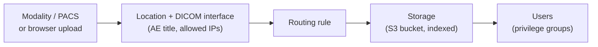

The pieces, in the order this guide builds them:

1. **Storage** - an S3 bucket the archive indexes. Everything you store lands here.
2. **Data** - loaded by browser upload, direct S3 copy, or over the network.
3. **DICOM networking** - a location, interface, entity, and routing rule, so a modality or PACS can send over DIMSE.
4. **Users and privilege groups** - who can sign in and what they can see.

## Before you start

- Sign in as the `admin` user, or any account whose privilege group grants the management permissions each step names (storage needs `datastores`, networking needs `locations` and the DICOM features, access needs `users` and `privilege groups`).
- For the network step, the deployment must have been installed with `enableDicomService: true` (the shipped default). See [installation.md](installation.md).

## 1. Sign in for the first time

Open the admin UI at `https://<distribution>.cloudfront.net/admin/` and sign in with your username and password. On the very first sign-in you set a new password (at least 12 characters) and, if MFA is required for the deployment, enroll a TOTP authenticator app. The full first-login flow, including where the temporary password comes from, is in [installation.md](installation.md).

After signing in you land on the **Dashboard**, an overview of what the archive holds. A fresh deployment shows zeros until you add data.

## 2. Create your first storage

A storage is one S3 bucket the archive owns and indexes. You need at least one before you can import anything.

1. In the sidebar, open **Configuration > Storage**.
2. Click **Create Storage**.
3. Enter a **Storage Name** and an optional **Description**, then click **Create**.

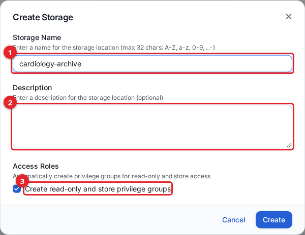

1. **Storage Name** (required). Maximum 32 characters, using letters, numbers, dots (`.`), hyphens (`-`), and underscores (`_`). The name is used to derive the S3 bucket name.
2. **Description** (optional). Free text shown in the storage table.
3. **Create read-only and store privilege groups** (checked by default). When checked, the archive creates two privilege groups for this storage, one granting read-only access and one granting store (write) access. These are the groups the DICOMweb and network services check on every request, and reusing them in step 6 is the quickest way to grant access. Leave it checked.

The new storage appears as `CREATING` and becomes `ACTIVE` once its bucket is provisioned.

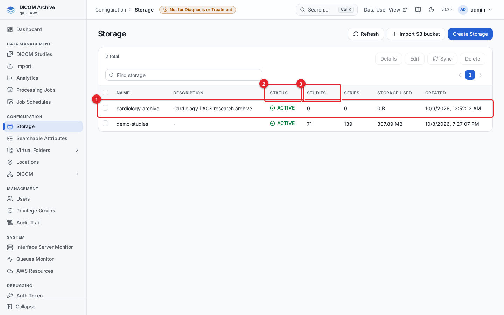

1. Your new storage, for example `cardiology-archive`.
2. **Status** reads `ACTIVE` once the bucket is ready.
3. **Studies**, **Series**, and **Storage Used** stay at zero until you load data in the next step.

For importing an existing bucket (always read-only, prepared by the bucket owner beforehand) and cross-account buckets, see [storage.md](storage.md).

## 3. Put DICOM data in it

There are three ways to get objects into a storage. Pick whichever fits.

### Upload from the browser

Good for a one-off set of files from your own machine.

1. In the sidebar, open **Data Management > Import**.
2. On the **DICOM files** tab, choose your storage under **Target storage datastore**.
3. Click **Upload DICOM files**.
4. Drop files or folders into the dialog, then click **Start Upload**.

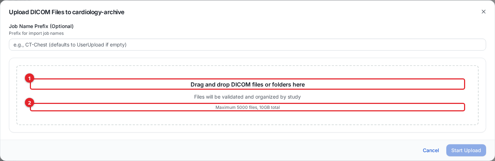

1. **Drag and drop DICOM files or folders here**, or click the area to browse. Folders are read recursively.
2. The upload accepts a maximum of **5000 files** and **10 GB** total per batch.

### Copy straight into the bucket

Good for bulk loads or scripted ingest. Because a storage is an S3 bucket the archive watches, copying objects in is enough; no import job is needed. Find the bucket name on the storage's **Details** panel (**Configuration > Storage**, select the row, **Details**).

```sh
# Copy one file
aws s3 cp CT0001.dcm s3://<storage-bucket>/incoming/CT0001.dcm

# Copy a whole folder
aws s3 cp ./study/ s3://<storage-bucket>/incoming/study/ --recursive
```

### How long until it is searchable

Each object is indexed automatically as it lands, usually within seconds. The dashboard and the Storage list counts, however, are maintained by a scheduled statistics job, so study and series totals can lag a fresh load by a few minutes even though the studies are already searchable. Check **Configuration > Storage** (the **Studies** and **Series** columns) or the **Dashboard** to confirm the counts.

More detail, including whole-slide images, archive files, and import jobs, is in [importing-data.md](importing-data.md).

## 4. Find and view a study

1. In the sidebar, open **Data Management > DICOM Studies**.
2. Pick your storage from **Select Storage**.
3. Enter a filter (for example a **Patient Name**) and click **Search**.

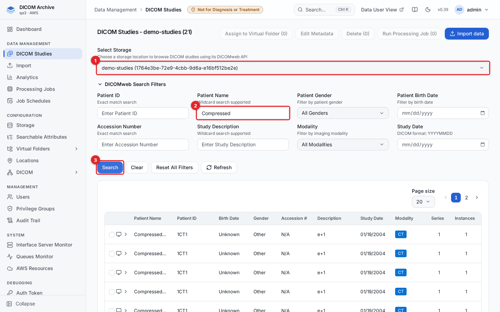

1. **Select Storage** chooses which index to browse. Pick the storage you loaded.
2. Type into a filter field, for example **Patient Name** (matched as a contains search).
3. Click **Search** to apply the filters.

Expand a study row to see its series, then click the **view** control (the screen icon) on the study to open it in the OHIF viewer. The viewer opens in a new browser tab and may take a few seconds to load the first image.

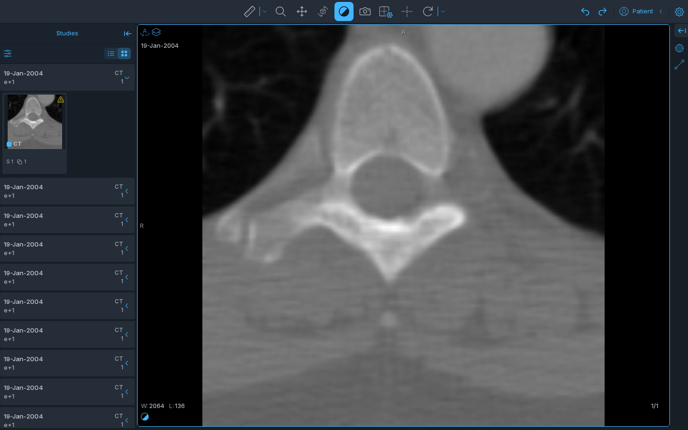

Full search, metadata editing, and bulk actions are in [studies.md](studies.md).

## 5. Receive images from a modality or PACS over DICOM

To accept studies pushed over the classic DICOM network (DIMSE C-STORE), four objects work together: a **location** (where the service listens), a **DICOM interface** (the AE title the archive answers to), a **DICOM entity** (the remote system allowed to connect), and a **routing rule** (which storage incoming objects are written to).

When the deployment is installed with `enableDicomService: true`, it creates a default in-cloud location for you, named `<stackPrefix>-dicom-ecs`. This location runs the DICOM service on AWS Fargate behind a Network Load Balancer (plain port `11112`, TLS port `2762`), so you do not create or install anything for it. You only configure who may reach it and where objects go.

### 5a. Allow the sender's IP

A cloud location starts with no source IP allowed. Add each sender's public IP or CIDR range.

1. In the sidebar, open **Configuration > Locations**, select the location, and click **Edit**.
2. Open the **Service Configuration** tab.

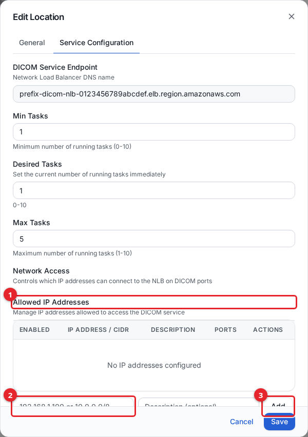

1. **Allowed IP Addresses** lists every source permitted to connect.
2. Enter an IP address or CIDR range (for example `203.0.113.10` or `10.0.0.0/8`).
3. Click **Add**, using the **DICOM (11112)** and **DICOM TLS (2762)** checkboxes to choose which ports the entry opens.

The **DICOM Service Endpoint** at the top of the tab is the Network Load Balancer DNS name, which is the host your modalities connect to. Opening ports to `0.0.0.0/0` is not offered; always scope to known ranges. Allowing an IP here is a network-layer control only; the sender must still match a DICOM entity (step 5c).

### 5b. Create a DICOM interface

An interface is the AE title the archive answers to on a location, plus the storage it can reach for query and retrieve.

1. Open **Configuration > DICOM > DICOM Interfaces** and click **Create DICOM Interface**.
2. Fill in the fields and click **Create Interface**.

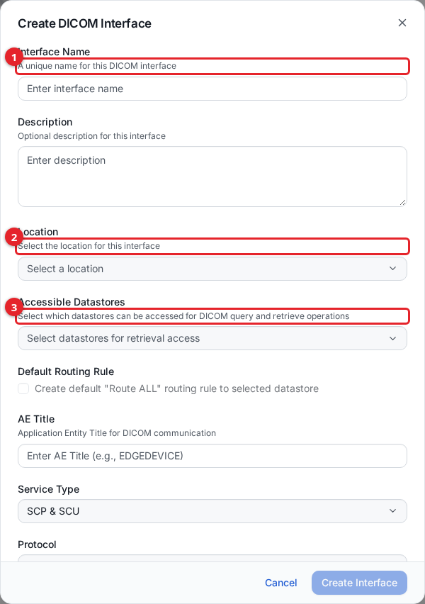

1. **Interface Name** is a unique label for the interface.
2. **Location** is the location this interface listens on. Select your in-cloud location.
3. **Accessible Datastores** are the storages this interface may read for query and retrieve. Select the storage from step 2.

Set an **AE Title** (the called AE connecting systems address, max 16 characters, uppercase letters, numbers, `_`, `-`). Leave **Service Type** at **SCP & SCU** and **Protocol** at **DIMSE**. If you select exactly one accessible datastore, you can tick **Create default "Route ALL" routing rule to selected datastore** to have the archive create a catch-all routing rule for you and skip step 5d.

### 5c. Register the sender as a DICOM entity

An entity is a remote system allowed to connect, matched by its calling AE title, with per-interface permissions.

1. Open **Configuration > DICOM > DICOM Entities** and click **Create DICOM Entity**.
2. Fill in the fields and click **Create**.

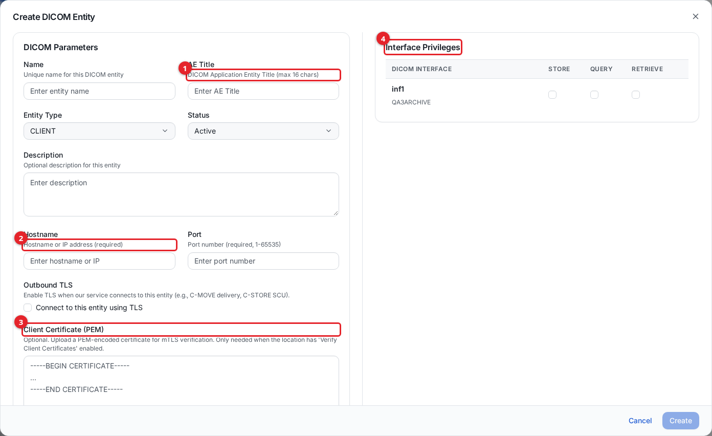

1. **AE Title** is the calling AE of the remote system (max 16 characters).
2. **Hostname** and **Port** are where the archive connects back to the system (used for C-MOVE and outbound C-STORE). Both are required.
3. **Client Certificate (PEM)** is optional; paste one only when the location has mutual TLS enabled (see [dicom-networking.md](dicom-networking.md)).
4. **Interface Privileges** lists every interface. Tick **STORE** (and **QUERY** / **RETRIEVE** if the sender will also query or pull) on the interface you created. STORE is what a C-STORE push requires.

### 5d. Route incoming objects to your storage

A routing rule decides which storage an incoming C-STORE object is written to. Skip this if you ticked the default "Route ALL" rule in step 5b.

1. Open **Configuration > DICOM > Routing Rules**, select your interface, and click **Create Rule**.
2. Fill in the fields and click **Create**.

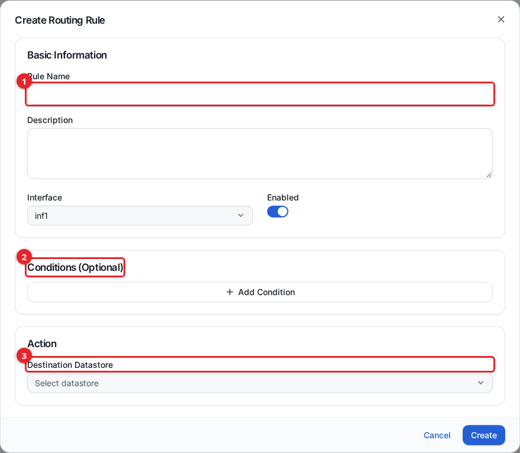

1. Give the rule a **Rule Name**. The **Interface** is preselected and **Enabled** is on.
2. **Conditions (Optional)** restrict the rule to objects matching DICOM tag values. Leave empty for a catch-all that matches every object.
3. **Destination Datastore** is the storage objects are written to. Select the storage from step 2.

Give each interface at least one catch-all rule (no conditions) so nothing is dropped.

### 5e. Start the service and test

The in-cloud DICOM service starts with zero running tasks. On the location's **Service Configuration** tab (step 5a), set **Desired Tasks** to `1` (the range is 0-10) and save; this starts a task. Then test from a host whose IP you allowed, using the DCMTK or pynetdicom tools. Replace `<host>` with the DICOM Service Endpoint, `<called-ae>` with the interface AE title, and `<calling-ae>` with the entity's AE title.

```bash
# Verify connectivity (C-ECHO)
echoscu -aec <called-ae> -aet <calling-ae> <host> 11112

# Send an object (C-STORE)
storescu -aec <called-ae> -aet <calling-ae> <host> 11112 /path/to/image.dcm
```

The TLS port is `2762`. A received object arrives as a **DIMSE Import** job (see the **Import > Jobs** tab) and is written to the storage your routing rule points at, where it is indexed like any other object.

### 5f. Confirm the service is running

Open **System > Interface Server Monitor**. A healthy service appears with its type, status, and a recent heartbeat (about one per minute). A service that stops heartbeating for several minutes shows as **Disconnected**.

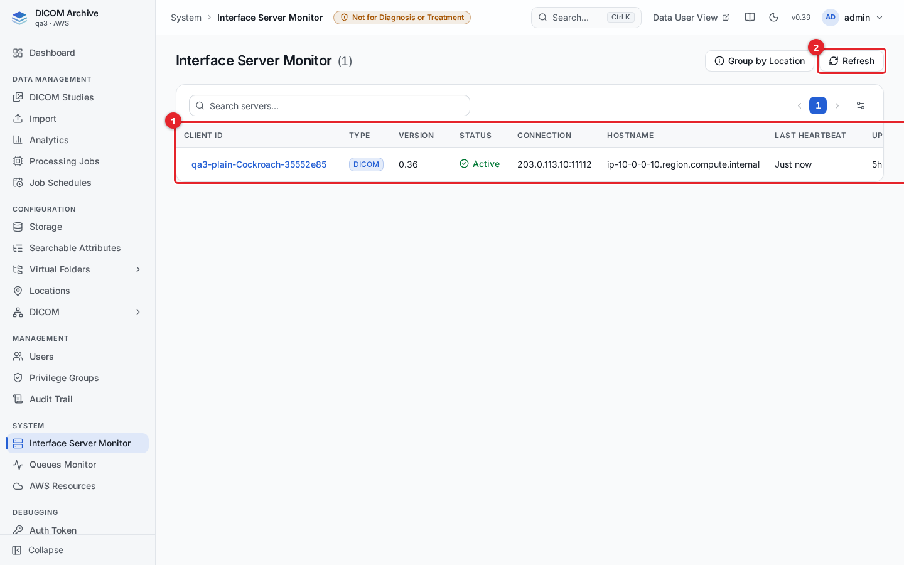

1. The table lists each registered service with its client ID, type, status, connection address, last heartbeat, and uptime.
2. **Refresh** reloads the list; it also refreshes on its own about every 30 seconds.

To receive from scanners or PACS that are not in AWS, you install an on-premise gateway instead of using the in-cloud location. That full workflow, plus TLS and mutual TLS, is in [dicom-networking.md](dicom-networking.md).

## 6. Give someone access

A user signs in with their own account; a privilege group decides what they can see. Create the group first, then the user.

1. Open **Management > Privilege Groups** and click **Create Privilege Group**.
2. Fill in the group and click **Save**.

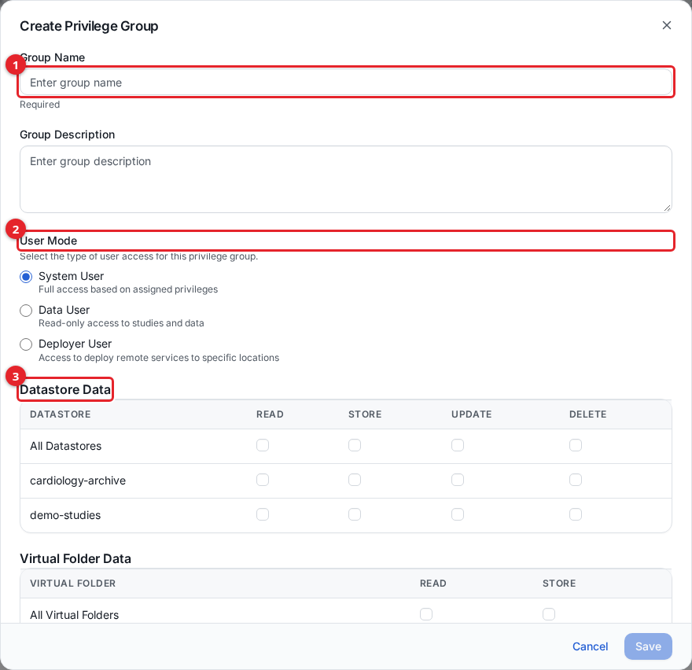

1. **Group Name** (required).
2. **User Mode** sets what kind of account the group is for.
3. **Datastore Data** grants per-storage permissions. For a reader, tick **Read** on your storage. (If you left step 2's checkbox on, you can instead reuse the storage's generated read-only group and skip creating one here.)

Leave **User Mode** at **System User** for an administrator-style account, or choose **Data User** for someone who should only use the read-oriented data-user website. To let the storage appear in the UI, also grant **Datastores** List under **Management**. Privilege-group details and ready-made examples are in [users-and-access.md](users-and-access.md).

Then create the user:

1. Open **Management > Users** and click **Create User**.
2. Fill in the form, choosing the privilege group you just made, and click **Create**.

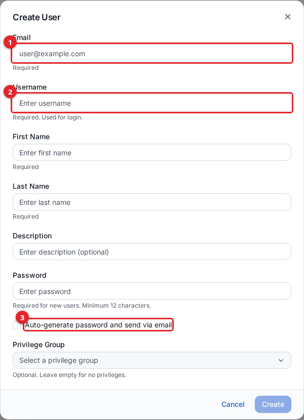

1. **Email** is where the invitation and reset messages go. It cannot be changed later.
2. **Username** is what the person types to sign in.
3. **Auto-generate password and send via email** emails a temporary password. Leave it unchecked to set one yourself and hand it over directly.

Creating a user sends a Cognito invitation email. The account's email sender allows only about 50 emails per day across the whole AWS account per region; when the limit is reached, creating a user returns HTTP 429 and you retry later or set a password by hand. See [users-and-access.md](users-and-access.md).

## 7. Point users at the data-user website

Clinical and research users who only browse and view data use the separate data-user website, not the admin console. It is served at `https://<distribution>.cloudfront.net/data-user/` on the same address. They sign in with the account you created and see only the storages and virtual folders their privilege group grants. See [data-user-view.md](data-user-view.md).

## 8. Optional next steps

- **Virtual folders and de-identification** - grouped, shareable, optionally de-identified views over your storage: [virtual-folders.md](virtual-folders.md).
- **Searchable attributes** - add DICOM tags as searchable index columns: [searchable-attributes.md](searchable-attributes.md).
- **Analytics** - SQL and natural-language queries over the metadata index: [analytics.md](analytics.md).
- **Processing jobs** - run plug-ins over studies and series: [processing-jobs.md](processing-jobs.md).
- **Audit trail** - search who did what, including DIMSE operations: [audit-trail.md](audit-trail.md).
- **Monitoring** - interface, queue, and AWS-resource health: [monitoring.md](monitoring.md).

## Finding your way around the admin UI

The admin UI is the web console for running the archive. This is a quick tour of its layout so you know where the screens above live.

### The dashboard

After signing in you land on the **Dashboard**, a read-only overview refreshed from live statistics.

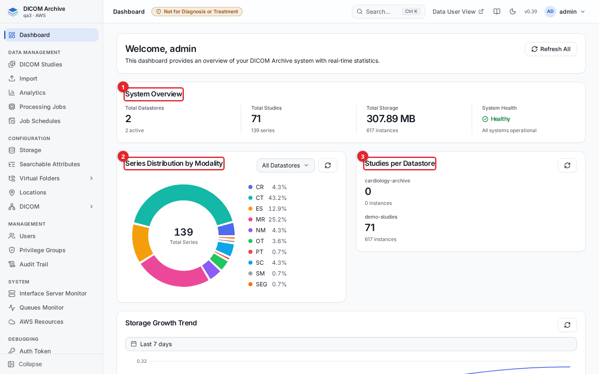

1. **System Overview** - headline numbers: total storage count (with how many are active), total studies (with series count), total storage used (with instance count), and overall system health.
2. **Series Distribution by Modality** - a donut chart of series grouped by modality. The **All Datastores** selector narrows it to one storage.
3. **Studies per Datastore** - study and instance counts per storage.

Below these, a **Storage Growth Trend** chart covers a selectable time window. **Refresh All** at the top right reloads every panel. Because counts come from a scheduled job, the totals can lag a fresh import by a short time.

### The sidebar

The left sidebar is how you navigate. Items are grouped into sections; **Virtual Folders** and **DICOM** expand into sub-items when clicked. What you see depends on your privileges, so entries you cannot use are hidden.

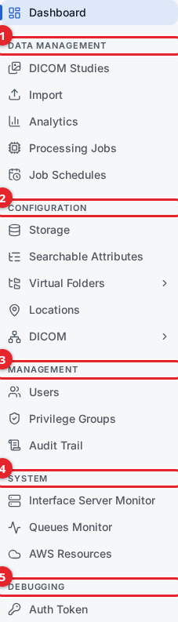

1. **Data Management** - **DICOM Studies**, **Import**, **Analytics**, **Processing Jobs**, and **Job Schedules**.
2. **Configuration** - **Storage**, **Searchable Attributes**, **Virtual Folders**, **Locations**, and **DICOM** (DICOM Entities, DICOM Interfaces, Routing Rules).
3. **Management** - **Users**, **Privilege Groups**, and **Audit Trail**.
4. **System** - **Interface Server Monitor**, **Queues Monitor**, and **AWS Resources**.
5. **Debugging** - **Auth Token**, which shows your current access token for testing the API.

The **Collapse** control at the bottom narrows the sidebar to icons only, and your choice is remembered.

### The top bar

The top bar carries the global tools.

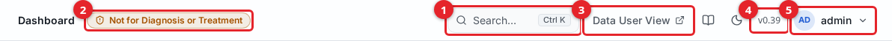

1. **Search** (**Ctrl K**, or **⌘K** on macOS) - the command palette.
2. **Not for Diagnosis or Treatment** - a standing badge. The archive is not a diagnostic device.
3. **Data User View** - opens the data-user website in a new tab. See [data-user-view.md](data-user-view.md).
4. The version button (for example **v0.40**) - opens the version history.
5. The user menu, with a sun/moon button next to it that toggles light and dark themes.

### Command palette

Select **Search** or press **Ctrl K** (**⌘K** on macOS) to open the command palette, then type to jump to any page or run a quick action.

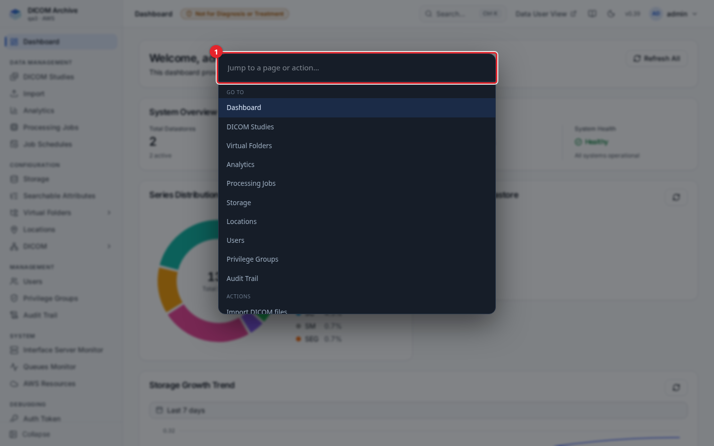

1. Type a page or action name in the **Jump to a page or action…** field. Results group into **Go to** (pages) and **Actions**. Use the arrow keys to move and Enter to select.

### User menu

Select your name at the top right to open your account menu.

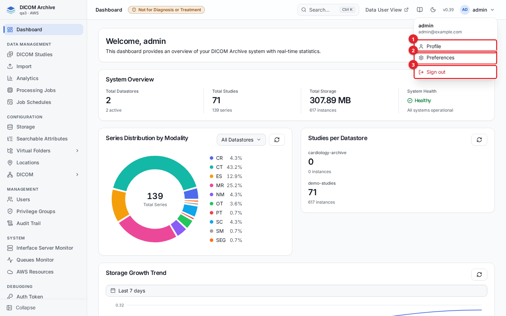

1. **Profile** - your account details.
2. **Preferences** - personal settings, including the color theme.
3. **Sign out** - ends your session.

## Related guides

- [installation.md](installation.md) - deploying, first login, and MFA setup.
- [storage.md](storage.md) - creating and importing storage.
- [importing-data.md](importing-data.md) - upload, direct copy, STOW, and import jobs.
- [studies.md](studies.md) - browsing and managing studies.
- [dicom-networking.md](dicom-networking.md) - locations, interfaces, entities, routing, and on-premise DIMSE.
- [users-and-access.md](users-and-access.md) - users and privilege groups.
- [data-user-view.md](data-user-view.md) - the data-user website.
