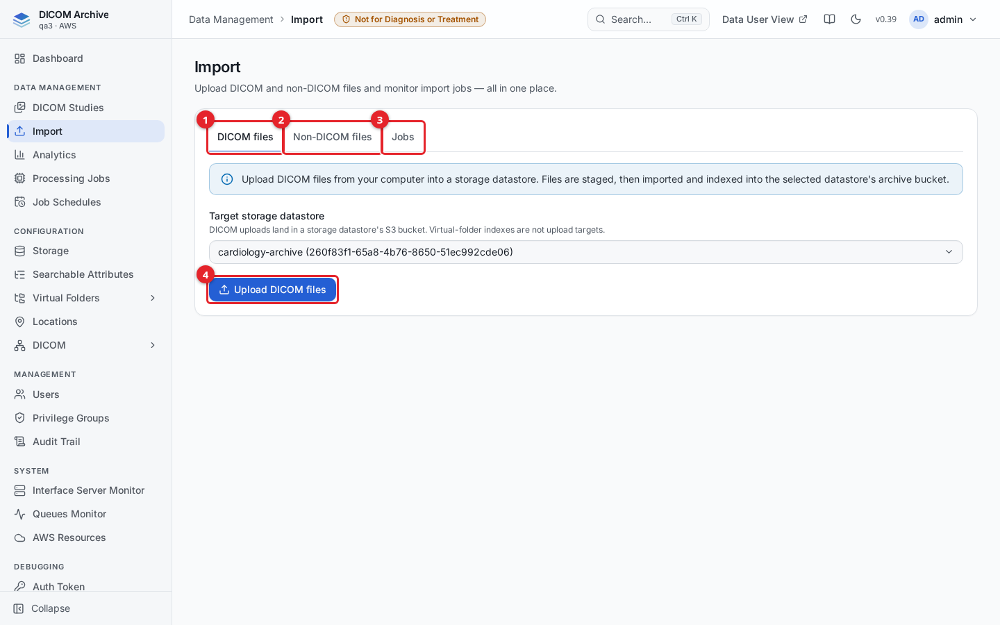
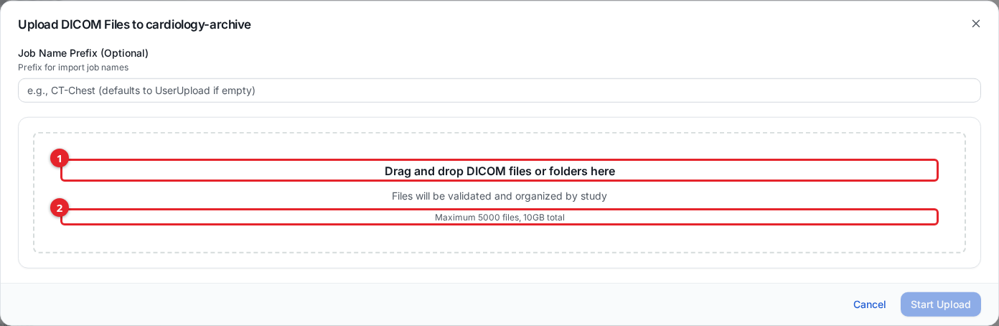
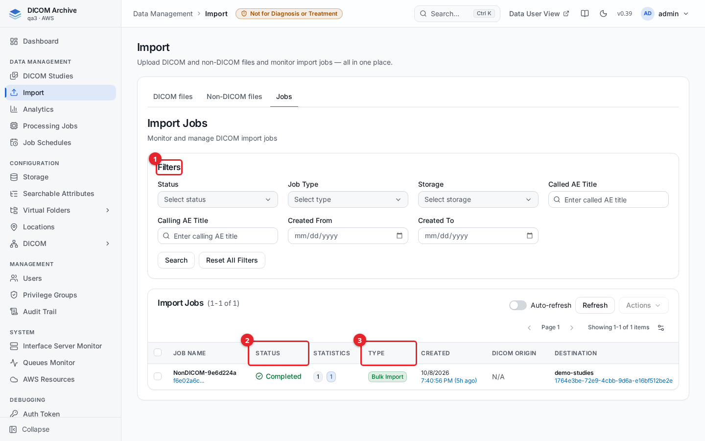
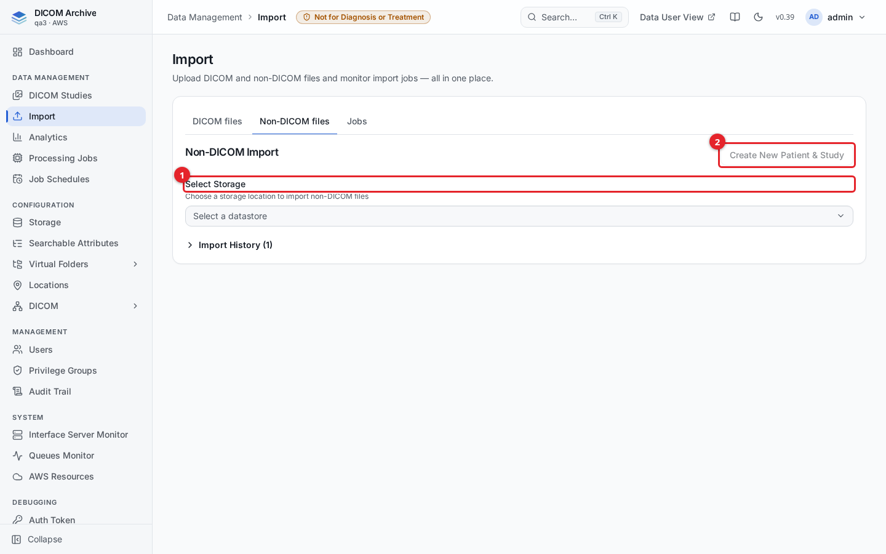

# Importing data

The **Import** page is where DICOM and non-DICOM data enters a storage location. You can upload files from your browser, convert ordinary images and documents into DICOM, and monitor import jobs. The archive also accepts data over DICOMweb STOW-RS, over the DICOM network (C-STORE), and by copying objects straight into the storage bucket. This guide covers each path and how to track its progress.

Uploads always target a **storage** location, never a virtual folder (a virtual folder is an index view with no bucket of its own).

## Before you start

- You need read access to the target storage, and store (`canStore`) privilege to upload into it.
- A read-only imported bucket cannot be an upload target: upload copies objects into the bucket, which a read-only import does not permit.

## Supported files

### DICOM

| What | Handling |
|---|---|
| DICOM Part 10 files | Indexed and stored exactly as received, with any file name or extension. A file is recognised by the `DICM` marker at byte 128, or by a parseable DICOM header. Headers up to 64 MB are read. |
| Transfer syntaxes | Stored as received, never re-encoded. Retrieval over DICOMweb is tested for 31 syntaxes: Implicit, Explicit and Big Endian; deflated; JPEG baseline, extended and lossless; JPEG-LS; JPEG 2000 and HTJ2K; RLE; JPEG XL; MPEG-2, H.264 and HEVC video. JPEG XL and video are served as stored but can't be rendered to an image. |
| Uncompressed tar archives | Each DICOM file inside is indexed where it lies, without extracting it. |
| ZIP and compressed tar (`.tar.gz`, `.tgz`, `.tar.bz2`, `.tar.xz`) | Unpacked into the bucket under `<archive key>.extracted/`, then each file is indexed. The original archive is kept. The default limits are 4 GiB and 20,000 files per archive. Zstandard (`.tar.zst`) isn't supported. |

### Pathology (whole-slide images)

| Format | Handling |
|---|---|
| DICOM WSI (VL Whole Slide Microscopy) | Indexed like any other DICOM file, and opens in the SLIM viewer. |
| Aperio SVS, Ventana/Roche BIF | Indexed in place as DICOM WSI without conversion. Patient and study details come from an optional JSON sidecar. See [Whole-slide images](#whole-slide-images-aperio-svs-and-ventanaroche-bif). |
| Hamamatsu NDPI, plain tiled TIFF | Refused. The import job shows the failure. Convert these to DICOM WSI first. |
| Leica SCN, 3DHISTECH MIRAX (`.mrxs`), Olympus VSI | Not converted. Convert to DICOM WSI first. |

### Non-DICOM files

| File | Handling |
|---|---|
| PDF | Converted on the **Non-DICOM files** tab to Encapsulated PDF (modality DOC). |
| JPEG, PNG | Converted on the **Non-DICOM files** tab to Secondary Capture (SC). |
| MP4, MPEG, QuickTime (`.mov`) | Converted on the **Non-DICOM files** tab to Video Photographic Image (XC). |
| Aperio SVS, Ventana/Roche BIF | Importable on the **Non-DICOM files** tab too: you enter the patient and study details, the slide is copied into the storage with a sidecar, and ingest virtualizes it as DICOM WSI (modality SM) — the same result as copying the slide into the bucket. Up to 5 GB per slide. |
| `.pdf`, `.png`, `.jpg`, `.jpeg`, `.txt`, `.csv`, `.xml` copied straight into a bucket | Kept and recorded as non-DICOM objects in the storage index. They aren't converted, and they don't appear in study search or the viewers. |
| Anything else that isn't DICOM | Fails ingest. The failure appears on the import job and in the ingest dead-letter queue. |

### Which import path accepts what

| | Browser upload (**DICOM files** tab) | **Non-DICOM files** tab | Copy into the bucket | DICOMweb STOW-RS | DICOM network (C-STORE) |
|---|---|---|---|---|---|
| DICOM files | Yes, files and folders. At most 5,000 files and 10 GB per batch. | No | Yes | Yes, `multipart/related; type="application/dicom"` | Yes, for the supported storage SOP classes, in Implicit or Explicit VR Little Endian |
| tar and ZIP archives | No | No | Yes | No | No |
| SVS and BIF slides | No | Yes, with patient/study details you enter (up to 5 GB) | Yes, with an optional sidecar | No | No |
| PDF, JPEG, PNG, video to convert | No | Yes | No | No | No |

Two limits apply to C-STORE:
- **Compressed transfer syntaxes:** the DICOM service accepts C-STORE in any transfer syntax it can store: uncompressed, deflated, JPEG, JPEG-LS, JPEG 2000, HTJ2K, RLE, JPEG XL (lossless, JPEG recompression and lossy), Deflated Image Frame Compression, MPEG-2, H.264 and HEVC. Files are stored exactly as received, never re-compressed. When a sender offers both an uncompressed and a compressed syntax, the service picks the uncompressed one. A C-GET returns a compressed file only to a client that offers its syntax, because the service doesn't transcode.
- **SOP classes:** the service accepts 75 storage SOP classes, covering:
  - CT, MR, ultrasound, CR, DX, mammography and intra-oral X-ray;
  - X-ray angiography and fluoroscopy, and breast tomosynthesis;
  - NM, PET and RT;
  - ophthalmic, visible light and whole-slide microscopy, and video;
  - presentation states, structured reports and segmentation;
  - encapsulated PDF, CDA and STL, ECG waveforms and raw data.

  The full list is `storage_sop_classes` in `interface-container/DICOM/DIMSEtoS3/main.py`. Objects of any other SOP class can go in through DICOMweb or the bucket.

## The Import page

Open **Import** from the Data Management section of the sidebar. It has three tabs.



1. **DICOM files** uploads DICOM files or folders from your computer.
2. **Non-DICOM files** converts images, PDFs, and video into DICOM ("DICOMize").
3. **Jobs** monitors import jobs and their status.
4. **Upload DICOM files** opens the uploader for the selected target storage.

## Upload DICOM files from the browser

On the **DICOM files** tab, choose a **Target storage datastore**, then click **Upload DICOM files**. Only active storage locations you can read are listed; a read-only imported bucket is shown but disabled as a target.



1. **Drag and drop DICOM files or folders here**, or click the area to browse. Folders are read recursively.
2. The upload accepts a maximum of **5000 files** and **10 GB** total per batch.

After the files are added, the dialog parses them in the browser and groups them into studies and series. Non-DICOM files in the selection are skipped with a count. Every series is selected by default; clear the checkboxes for any you do not want to send, optionally set a **Job Name Prefix**, then click **Start Upload**. A progress bar tracks instances as they upload, and each series shows its own status.

Files are uploaded directly into the storage's archive bucket using presigned URLs, keyed by their DICOM identity (`study/series/sop.dcm`, under a date prefix when the study date is present). The archive's bucket-event ingest then indexes each object automatically - the same path described in [Storage](storage.md). Objects become searchable as they finish indexing.

## Import jobs and their status

The **Jobs** tab lists import jobs so you can watch progress and act on them.



1. **Filters** narrow the list by status, job type, storage, called/calling AE title, and creation date range. Click **Search** to apply.
2. **Status** is the job's current state.
3. **Type** is how the data arrived.

The **Statistics** column shows badges for total, processed (blue), and failed (red) file counts. Turn on **Auto-refresh** to poll while jobs are active. Select a job and use **Actions** to **View Details**, **Cancel** a running job, **Retry** a failed one, or **Delete** a finished one.

### Job statuses

| Status | Meaning |
|--------|---------|
| Pending | Queued, not started |
| Triggered | Hand-off to the import pipeline initiated |
| In Progress / Running | Objects are being imported |
| Completed | All files imported |
| Completed with Failures | Finished, but some files failed |
| Failed | The job failed |
| Cancelled | Cancelled by a user |
| Paused | Paused |

### Job types

| Type | Source |
|------|--------|
| DICOM Import | Generic DICOM import |
| Bulk Import | Bulk / backfill of existing bucket objects (for example a storage **Sync**) |
| Scheduled Import | A scheduled import |
| DIMSE Import | Received over the DICOM network (C-STORE) |
| STOW Import | Received over DICOMweb STOW-RS |
| Upload Import | Uploaded from the browser |

Open a job's **Details** to see its source and destination S3 URIs, DICOM context (interface and AE titles for network imports), progress counts, and any failure or per-error messages.

## Non-DICOM import (DICOMize)

The **Non-DICOM files** tab turns ordinary files into DICOM instances and imports them into a storage, attached to a patient and study.



1. **Select Storage** chooses the destination storage.
2. **Create New Patient & Study** starts an import against a brand-new patient and study.

The files it accepts and the DICOM each becomes are listed under [Non-DICOM files](#non-dicom-files).

### Steps

1. Select a storage. Existing studies load so you can search by Patient ID, Patient Name, or Accession Number.
2. Choose where the files go:
   - **Copy Patient & New Study** - reuse a found study's patient on a new study.
   - **Add Files to This Study** - add to an existing study (its existing series are listed).
   - **Create New Patient & Study** - enter new patient (Patient ID, Patient Name, Birth Date, Sex) and study (Description, Date, Time, Accession Number) details.
3. In the **Files** panel, drop or browse for files. Each shows a thumbnail (PDF first page, video first frame, image preview).
4. In the **Series** panel, click **Add new series** (or select an existing one), select files, and click **Assign files to series**. Images can only join a Secondary Capture (SC) series and PDFs a Document (DOC) series; all files assigned together must produce the same SOP class.
5. Click **Submit Import**.

The files upload, each is encapsulated into a DICOM Part 10 object with the chosen patient/study/series attributes, and the result is imported like any other DICOM. Watch progress in **Import History** on the same tab, or on the **Jobs** tab. Non-DICOM job statuses are `SUBMITTED` → `PROCESSING` → `IMPORTING` → `COMPLETED` or `FAILED`.

## Upload directly with the AWS CLI

Because a storage is an S3 bucket the archive indexes on object-created events, you can copy DICOM files straight into the bucket and they will be ingested automatically - no import job needed. Find the bucket name on the storage's **Details** panel (see [Storage](storage.md)).

```sh
# Copy one file
aws s3 cp CT0001.dcm s3://<storage-bucket>/incoming/CT0001.dcm

# Copy a whole folder
aws s3 cp ./study/ s3://<storage-bucket>/incoming/study/ --recursive
```

Uncompressed tar archives are indexed in place; compressed tar (`.tar.gz`, `.tar.bz2`, `.tar.xz`) and ZIP archives are unpacked on ingest. See [Storage](storage.md) for the archive-handling and availability details. If objects are added out of band and do not appear, run **Sync** on the storage to reconcile the index.

### Whole-slide images (Aperio SVS and Ventana/Roche BIF)

Pathology whole-slide images in **Aperio SVS** and **Ventana/Roche BIF** format can be copied into a storage bucket the same way. Ingest doesn't convert the file. It indexes each pyramid level as a DICOM VL Whole Slide Microscopy instance (modality SM) whose frames point at the tiles inside the original file, so the slide opens in the microscopy viewer without a copy being made.

An SVS or BIF file holds no patient or study information. To set it, upload a JSON sidecar next to the slide, named for example `slide-01.svs.json`:

```json
{
  "filepath": "s3://<storage-bucket>/pathology/slide-01.svs",
  "DICOM": {
    "00100010": { "vr": "PN", "Value": [ { "Alphabetic": "DOE^JANE" } ] },
    "00100020": { "vr": "LO", "Value": [ "PAT-0001" ] },
    "00081030": { "vr": "LO", "Value": [ "Liver biopsy" ] }
  }
}
```

The `DICOM` object uses DICOM JSON. The sidecar can be uploaded before or after the slide. Without a sidecar, ingest generates placeholder identity derived from the object key.

Other whole-slide formats, such as Hamamatsu NDPI and plain tiled TIFF, are recognised but refused. The failure appears on the import job and in the ingest dead-letter queue. Convert those slides to DICOM WSI first and upload the DICOM files.

## DICOMweb STOW-RS

Applications can store instances over DICOMweb using STOW-RS. A STOW import appears on the **Jobs** tab as a **STOW Import**. For endpoints, authentication, and request examples, see [DICOMweb API](dicomweb-api.md).

## DICOM network (DIMSE C-STORE)

A remote modality or PACS can send studies to the archive over the DICOM network using C-STORE. These arrive as **DIMSE Import** jobs, with the originating interface and called/calling AE titles shown in the job's DICOM context. For configuring network interfaces and AE titles, see [DICOM networking](dicom-networking.md).

## Related guides

- [Storage](storage.md) - storage locations, buckets, and automatic ingest
- [Searchable attributes](searchable-attributes.md) - make extra DICOM tags searchable
- [Studies](studies.md) - browse imported studies
- [DICOMweb API](dicomweb-api.md) - STOW-RS and query/retrieve
- [DICOM networking](dicom-networking.md) - DIMSE C-STORE and interfaces
- [Processing jobs](processing-jobs.md) - run plug-ins over imported data
