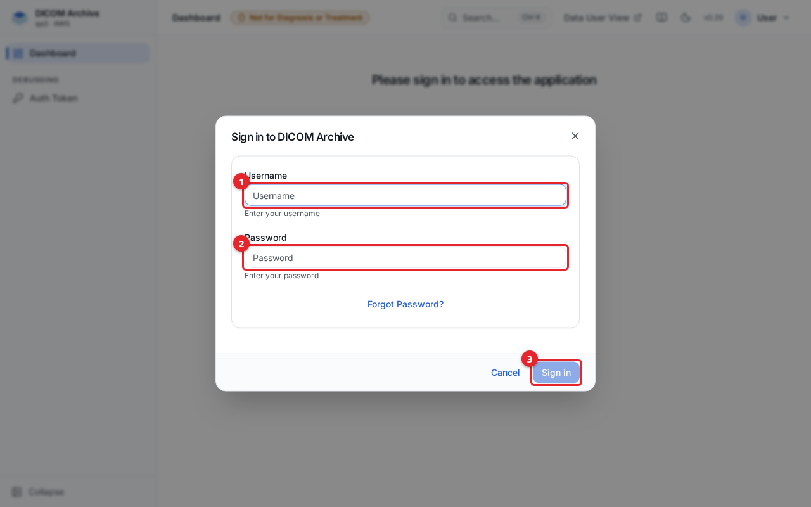

# Installing the DICOM Archive

The DICOM Archive is an S3-only DICOM archive that runs in your own AWS account. You deploy it from source with the AWS CDK: one command builds the VPC, database, authentication, APIs, web UIs, and (optionally) the DICOM network service and plug-in framework. This guide is for an administrator deploying the product for the first time, updating an existing deployment, or tearing one down.

For a tour of the admin interface once you are signed in, see [getting-started.md](getting-started.md).

## Before you start

You need:

- An **AWS account** with permission to create CloudFormation stacks, IAM roles, VPCs, Aurora, Cognito, API Gateway, Lambda, ECS, S3, CloudFront, SQS, EventBridge, and Step Functions resources. A dedicated account is recommended so imaging data sits inside its own security boundary and resource names do not collide with other workloads.
- The **AWS CLI v2**, configured with credentials for that account.
- **Node.js 20 (LTS) or later** and npm.
- **AWS CDK v2.** The project pins the CDK library at `2.272.0` and the CLI at `2.1144.0` through `cdk-infrastructure/package.json`, so you do not need a global install; `npx cdk ...` run from `cdk-infrastructure/` uses the pinned CLI.
- **Docker** (or **Finch**/**Podman**) running locally. The deploy builds container image assets (the DICOM DIMSE service, the DICOMweb proxy, and plug-in images) and Lambda layers, which requires a working container builder.
- **A CDK bootstrap** in the target account and region. Run `cdk bootstrap aws://<account-id>/<region>` once per account/region if you have never used the CDK there. See the [AWS CDK Getting Started guide](https://docs.aws.amazon.com/cdk/v2/guide/getting_started.html).
- **Amazon Bedrock model access**, only if you enable the analytics natural-language-to-SQL feature (`analyticsFeatureTextToSQL`). The analytics stack grants the query Lambda access to the Anthropic Claude Haiku 4.5 model `anthropic.claude-haiku-4-5-20251001-v1:0` through the `us.` cross-region inference profile `us.anthropic.claude-haiku-4-5-20251001-v1:0`. Request access to that model in the Bedrock console (Model access) in your region before deploying with this feature on.

## 1. Clone and install

```bash
git clone <repository-url>
cd <repository-folder>/cdk-infrastructure
npm install
```

All CDK commands in this guide run from the `cdk-infrastructure/` directory.

## 2. Configure `config.json`

Edit `cdk-infrastructure/config.json`. The CDK app reads it at synth time. Every key the app reads is listed below.

| Key | Type | Default | Meaning |
|-----|------|---------|---------|
| `stackPrefix` | string | required | Prefix for the CloudFormation stack and every resource name. It is lowercased and stripped of hyphens at the earliest point (so `My-Archive` becomes `myarchive`), because S3 bucket names derived from it may not contain uppercase. Must be unique across deployments in the same account. Changing it after a deploy renames the stack, which creates a new stack and leaves the old one behind. |
| `deploymentName` | string | `"DICOM Archive"` | Human-readable name shown in the UI and used as context in system emails. |
| `adminEmail` | string | required | Email for the default `admin` user. The temporary password is sent here on first deploy. Must be a valid email address or synth fails. |
| `enableDicomService` | boolean | `false` | Deploy the ECS Fargate DICOM DIMSE service behind a Network Load Balancer (plain port 11112, TLS port 2762). Set `false` for a web/API-only deployment. The shipped `config.json` sets this `true`. |
| `mfa` | boolean | `true` | Multi-factor authentication (TOTP) posture. Default **required** for all users. Set `"mfa": false` to make MFA **optional** instead (users may enroll but are not forced to). |
| `debugUi` | boolean | `false` | Expose extra debugging information in the admin UI. Leave `false` outside debugging. |
| `devOnlyAuthBypass` | boolean | `false` | DEV/DEBUG ONLY, not a production feature. Synthesizes an identity from the URL so the DICOMweb-S3 service can be exercised without a token. It disables all access control on that service and must never be `true` in a deployment holding real data. |
| `viewers` | object | all `false` | DICOM viewer toggles, grouped into one struct: `{"ohif": bool, "slim": bool, "volview": bool}`. `ohif` hosts the OHIF zero-footprint viewer at `/ohif/`; `slim` the SLIM whole-slide-imaging viewer at `/slim/`; `volview` the Kitware VolView 3D viewer on the data-user site at `/volview/`. Each key defaults to `false`. Each is also overridable per deploy with `-c viewers.ohif=true` etc. (Replaces the former flat `ohifViewer` / `slimViewer` / `volviewFeature` keys.) |
| `networkMode` | object | `{"mode":"public"}` when the key is omitted; the shipped `config.json` sets `"vpc"` | Network posture, grouped into one struct. See the dedicated table below. Replaces the former flat `inVpcOnly` / `existingVpcId` / `internalUiCertArn` / `internalUiDomainName` keys. |
| `devOnlyDisableAuth` | boolean | `false` | DEV/DEBUG ONLY, not a production feature. Turns token verification off on the virtual-folder DICOMweb proxy and the DICOMweb-S3 service, for a headless test window. Reads are then anonymous; writes and deletes are still refused. Must never be `true` in a deployment holding real data. |
| `analyticsFeature` | boolean | `false` | Enable analytics: SQL and natural-language queries over the archive's metadata index, run directly against Aurora MySQL through a read-only database user. See [analytics.md](analytics.md). |
| `analyticsFeatureTextToSQL` | boolean | `false` | Enable natural-language-to-SQL in the analytics UI. Requires Bedrock access to Claude Haiku 4.5 (see Before you start). Only effective when `analyticsFeature` is `true`. |
| `exportFeature` | boolean | `false` | Enable DICOM export (export S3 bucket, Lambda functions, Step Functions workflow). |
| `ingestionV2` | boolean | `false` | Route new archive buckets through the experimental coalescing-FIFO ingest pipeline. Off by default. |
| `dicomWebService` | boolean | `true` | Deploy the DICOMweb-S3 service stack. Set `false` to stand up the rest of the deployment without it (isolates a DICOMweb-S3 failure from rolling back the whole stack). |

Keys relating to the former cloud imaging backend are no longer used; S3 storage is always on.

**Virtual folders** are now a core, always-on capability: there is no longer a `virtualFolderFeature` toggle (the former key is removed and has no effect). The virtual-folder DICOMweb proxy, its Lambda functions, and its database tables are always deployed.

### `networkMode`

`networkMode.mode` selects the network posture. Its other keys apply only when `mode` is `"vpc"`.

**The shipped `config.json` uses `"vpc"`**, so a default deploy exposes nothing to the internet. Before deploying it, set `networkMode.dnsName` to a hostname you control (the shipped value `myarchive.internal.test` is a placeholder), and plan how users reach the internal load balancer (VPN, Direct Connect, peering or a bastion), plus the DNS record. To deploy the CloudFront-fronted public posture instead, set `"mode": "public"` or pass `-c networkMode.mode=public`. In public mode the web UIs and the REST API are reachable from the internet, behind Cognito sign-in (MFA required by default).

| Key | Type | Default | Meaning |
|-----|------|---------|---------|
| `networkMode.mode` | `"public"` \| `"vpc"` | `"public"` | `public`: the original CloudFront-fronted public posture. `vpc`: a private, in-VPC posture — a PRIVATE API Gateway, an internal DICOM NLB, a single internal ALB UI front door (no CloudFront), the full set of VPC interface endpoints, and `natGateways=0`. |
| `networkMode.dnsName` | string | required in `vpc` mode | The private hostname users reach the solution at (e.g. `archive.internal.example`). Every absolute URL the UI builds (OHIF, DICOMweb, viewers) is pinned to it, and a self-signed cert uses it as the CN/SAN. **You must create the DNS record** (Route 53 private hosted zone, or on-prem DNS) pointing this name at the internal ALB. Ignored in `public` mode. |
| `networkMode.certArn` | string | optional | ACM certificate ARN covering `dnsName`. When **omitted/empty in `vpc` mode, the stack mints a self-signed certificate** for `dnsName` at deploy time (a custom resource imports it to ACM). Self-signed is test-grade: browsers warn, and the DICOM service skips TLS verification on the internal hop. Supply a trusted (imported or private-CA) certificate for production. |
| `networkMode.existingVpcId` | string | optional | Deploy into an existing VPC (`vpc-xxxx`) instead of creating one. Empty/absent creates a new VPC. The existing VPC must expose subnets selectable as PRIVATE_WITH_EGRESS (and PUBLIC unless `vpc` mode). |

Each key is also overridable per deploy, e.g. `-c networkMode.mode=vpc -c networkMode.dnsName=archive.internal.example`.

A minimal public `config.json`:

```json
{
  "stackPrefix": "my-dicom-archive",
  "deploymentName": "DICOM Archive",
  "adminEmail": "admin@example.com",
  "enableDicomService": true,
  "mfa": true,
  "viewers": { "ohif": true, "slim": false, "volview": false },
  "analyticsFeature": true,
  "analyticsFeatureTextToSQL": true,
  "networkMode": { "mode": "public" }
}
```

An in-VPC `config.json` (self-signed cert auto-generated; supply `certArn` for a trusted one):

```json
{
  "stackPrefix": "my-dicom-archive",
  "deploymentName": "DICOM Archive",
  "adminEmail": "admin@example.com",
  "enableDicomService": true,
  "mfa": true,
  "viewers": { "ohif": true, "slim": true, "volview": true },
  "networkMode": {
    "mode": "vpc",
    "dnsName": "archive.internal.example",
    "certArn": "",
    "existingVpcId": ""
  }
}
```

## 3. Deployment context flags

Some settings are passed per deploy with `-c <key>=<value>` (CDK context) rather than in `config.json`. The app reads these:

| Context flag | Default | Purpose |
|--------------|---------|---------|
| `environment` | `prod` | Deployment posture. `prod` (the default when omitted) protects the database and user pool with deletion protection and a RETAIN removal policy and disables ECS Exec. Pass `-c environment=dev` (or `test`) to allow those resources to be destroyed on teardown. The app warns on the console when no `environment` is given. |
| `region` | `us-east-1` | Target region. Also read from `CDK_DEFAULT_REGION`. |
| `account` | - | Target account ID. Read from `CDK_DEFAULT_ACCOUNT` if not passed. Required: synth fails without it. |
| `stackPrefix` | from `config.json` | Overrides the config value for this deploy (also lowercased/hyphen-stripped). |
| `projectTag` | `DICOM-Archive` | Value of the `Project` resource tag. An existing deployment must keep passing the value it was created with, because an AWS Batch compute environment refuses an in-place tag change. |
| `apiThrottleRate` | `500` | API Gateway steady-state request-per-second throttle. |
| `apiThrottleBurst` | `1000` | API Gateway burst throttle. |
| `maxLambdaMemoryMb` | off | Test-only. Caps every Lambda function's memory at this value (minimum 128). Helps fit a brand-new account whose Lambda memory quota is low. Not a shippable configuration. |
| `dropReservedConcurrency` | off | Test-only. Removes reserved concurrency from every function. Helps fit a new account whose concurrent-execution quota is below the reservations the stack requests. Not a shippable configuration. |

See [Account limits](#account-limits-for-a-new-account) for when the two test-only flags are needed.

## 4. Deploy

```bash
npx cdk deploy --all --require-approval never
```

A fresh deployment takes roughly 55 to 60 minutes. It builds the VPC, Aurora Serverless database, Cognito user pool, API Gateway, 30-plus Lambda functions, the admin and data-user web UIs (built in CodeBuild), CloudFront, S3 buckets, SQS queues, an EventBridge bus, Step Functions workflows, and - when enabled - the ECS Fargate DICOM service, the DICOMweb-S3 proxy, and the plug-in framework.

For a production posture, deploy with the default `environment=prod` (omit the flag). For a disposable test stack, add `-c environment=dev`.

### Deploy outputs

When the deploy finishes, the stack prints its outputs. The ones you use first:

| Output | What it is |
|--------|------------|
| `FrontDoorUrl` | `vpc` mode: `https://<networkMode.dnsName>` - the entry point for all web UIs. Create the DNS record for this name pointing at `FrontDoorAlbDns`. |
| `FrontDoorAlbDns` | `vpc` mode: DNS name of the internal ALB front door. |
| `CloudFrontDistributionUrl` | `public` mode: `https://<id>.cloudfront.net` - the entry point for all web UIs. |
| `ApiUrl` | The REST API base, under `.../v1/api`. |
| `DefaultUsername` | `admin` - the default administrator. |

The web UIs live under the entry-point URL (`FrontDoorUrl` in `vpc` mode, `CloudFrontDistributionUrl` in `public` mode). In `public` mode:

- Admin UI: `https://<distribution>.cloudfront.net/admin/`
- Data-user UI: `https://<distribution>.cloudfront.net/data-user/`
- OHIF viewer (if enabled): `https://<distribution>.cloudfront.net/ohif/`
- SLIM viewer (if enabled): `https://<distribution>.cloudfront.net/slim/`

The stack prints many more outputs (queue URLs, function names, the DICOM service load-balancer DNS, and so on) for operational use.

## 5. First login

On first deploy, a default `admin` user is created in Cognito and a temporary password is emailed to `adminEmail`. Cognito sends these emails from its built-in sender, which allows about 50 emails per day for the whole AWS account in each region. Every new user's invitation and every admin password reset counts against it. When the limit is reached, creating a user or resetting a password returns HTTP 429 with a message to try again later.

1. Open `https://<distribution>.cloudfront.net/admin/`.
2. Enter the username and the temporary password from the email, then select **Sign in**.



1. **Username** - enter `admin`.
2. **Password** - enter the temporary password from the invite email.
3. Select **Sign in**.

3. You are prompted to set a new password. The password policy requires at least 12 characters.
4. If MFA is required (the default), you are prompted to set up a TOTP authenticator (Google Authenticator, Authy, or similar) by scanning a QR code and entering a one-time code. If `mfa` is `false`, this step is optional.

After first login you can create more users and privilege groups from the **Management** section. See [users-and-access.md](users-and-access.md).

## Known first-deploy issues

**UI did not build (CloudFront serves `NoSuchKey` for `/admin/index.html`).** The web UIs are built by CodeBuild projects that are triggered during the deploy. On a brand-new account the shared CodeBuild service role's logging permissions can take a moment to propagate, and a build triggered before that fails in the queue. The CloudFormation stack still reaches `CREATE_COMPLETE` because the builds run asynchronously, but the UI bucket is left empty.

If a UI is missing after deploy, re-run its build:

```bash
aws codebuild start-build --project-name <stackPrefix>-build          # admin UI
```

The admin UI build project is named `<stackPrefix>-build`; the data-user and viewer builds have their own project names (visible in the CodeBuild console). Re-running syncs the built site to the bucket and invalidates CloudFront.

## Account limits for a new account

A freshly created AWS account can start with reduced service quotas. Check these before a first deploy:

- **Lambda memory and concurrency.** Some new accounts cap per-function memory (for example 512 MB) and concurrent executions (for example 5 or 10) well below what the stack requests. Lambda also refuses any reserved-concurrency setting that would leave the account under its unreserved floor. If the deploy fails on a Lambda memory or concurrency limit, request a quota increase, or use the two test-only context flags to fit the account:

  ```bash
  npx cdk deploy --all --require-approval never \
    -c environment=dev -c maxLambdaMemoryMb=512 -c dropReservedConcurrency=true
  ```

  These flags make the deploy fit a constrained account; they are not a shippable production configuration.

  Check the real concurrency quota in Service Quotas before deploying: `aws service-quotas get-service-quota --service-code lambda --quota-code L-B99A9384`. On a new account, `aws lambda get-account-settings` can report 1000 while the applied quota is 5. With a quota of 5 or 10, `dropReservedConcurrency=true` is required: Lambda keeps a floor of unreserved concurrency, so any reservation fails. Request an increase as well, because a stack sharing 5 concurrent executions across all its functions is throttled under load.
- **VPC and Elastic IP quotas.** The stack creates a VPC with NAT gateways. Confirm you are under the per-region VPC and Elastic IP limits.

## Remote / on-premise DICOM service

To receive DICOM from scanners or PACS that are not in AWS, you install the DIMSE service on a remote or on-premise machine. The installer is served from the deployment itself under `/installers/`:

```bash
wget -O install-dimse-service.sh https://<distribution>.cloudfront.net/installers/install-dimse-service.sh
chmod +x install-dimse-service.sh
./install-dimse-service.sh
```

A Windows PowerShell installer (`install-dimse-service.ps1`) is served from the same path. The remote service authenticates to AWS using IAM Roles Anywhere with X.509 certificates and connects back to the deployment. You first create a **Location** in the admin UI and associate it with a DICOM interface and at least one storage.

This is the overview. For the full workflow - creating locations, DICOM interfaces and entities, routing rules, and TLS - see [dicom-networking.md](dicom-networking.md).

### Network path for DICOMweb

CloudFront serves DICOMweb under `/dicomweb/*` and reaches the DICOMweb service through a CloudFront VPC origin. The service's Application Load Balancer is internal (`internetFacing: false`) and has no public listener, so it can't be reached from the internet. Two internal hops use HTTP inside the AWS private network: CloudFront to that load balancer (port 80, admitted only from the CloudFront VPC-origin subnets), and the load balancer to the DICOMweb containers (port 8080, admitted only from the load balancer's security group). Browsers and clients still connect to CloudFront over HTTPS.

The shipped stack uses HTTP on this hop only so that it can be deployed without a domain of your own: CloudFront connects over HTTPS only to an origin whose certificate matches the origin's domain name, and the stack has no domain to issue one for.

> **Required before use beyond the demo scope.** HTTP on these internal hops is acceptable only for demonstration. Before you use the deployment outside the demo scope, you **must** enable TLS on them:
>
> 1. Get a custom domain you control and an ACM certificate for it.
> 2. Add an HTTPS listener with that certificate to the load balancer (`cdk-infrastructure/lib/dicomweb/dicomweb-service-stack.ts`), replacing the port-80 listener.
> 3. Set the origin's `protocolPolicy` in `cdk-infrastructure/lib/main/main-stack.ts` to `HTTPS_ONLY`.
> 4. Switch the target group to HTTPS and serve TLS from the DICOMweb container, so traffic is also encrypted between the load balancer and the containers. Then redeploy.

## Updating an existing deployment

Pull the new source, reinstall dependencies if needed, and re-run the same deploy command from `cdk-infrastructure/`:

```bash
git pull
npm install
npx cdk deploy --all --require-approval never
```

Keep passing any context flags you used at create time - in particular `projectTag` if you set a non-default value, and `environment` if you deployed as `dev`/`test` - because changing them on an existing stack can force replacements or roll the deploy back.

To change only a feature flag, edit `config.json` and redeploy. Turning the DICOMweb-S3 service on with `dicomWebService: true` after a base deploy adds just that nested stack, so a failure there rolls back only that stack rather than the whole deployment.

## Teardown

To remove a deployment:

```bash
npx cdk destroy --all
```

(Equivalently, delete the stack with `aws cloudformation delete-stack --stack-name <stackPrefix>`.)

Some resources are deliberately **retained** so data and audit history are not destroyed by an accidental teardown. These stay behind and must be removed separately if you want them gone:

- **The Aurora database and the Cognito user pool** are retained when `environment` is `prod` (the default). They are destroyed on teardown only when the stack was deployed with `-c environment=dev` or `-c environment=test`.
- **Archive storage buckets** (`<stackPrefix>-ds-*`), created by the product when you add storage, are retained. Their DICOM objects are your data; empty and delete these buckets manually after teardown if you no longer need them.
- Other retained resources include the plug-in I/O bucket and the DICOM service and export buckets.

Because retained resources keep the prefix-derived names, reusing the same `stackPrefix` for a fresh deploy can collide with leftovers from a prior one. Remove retained resources first, or use a new prefix.

## Related guides

- [getting-started.md](getting-started.md) - first tour of the admin UI.
- [storage.md](storage.md) - creating and importing storage.
- [dicom-networking.md](dicom-networking.md) - locations, DICOM interfaces, entities, routing, and remote DIMSE.
- [users-and-access.md](users-and-access.md) - users and privilege groups.
- [analytics.md](analytics.md) - the analytics feature and text-to-SQL.
- [importing-data.md](importing-data.md) - importing existing data.
