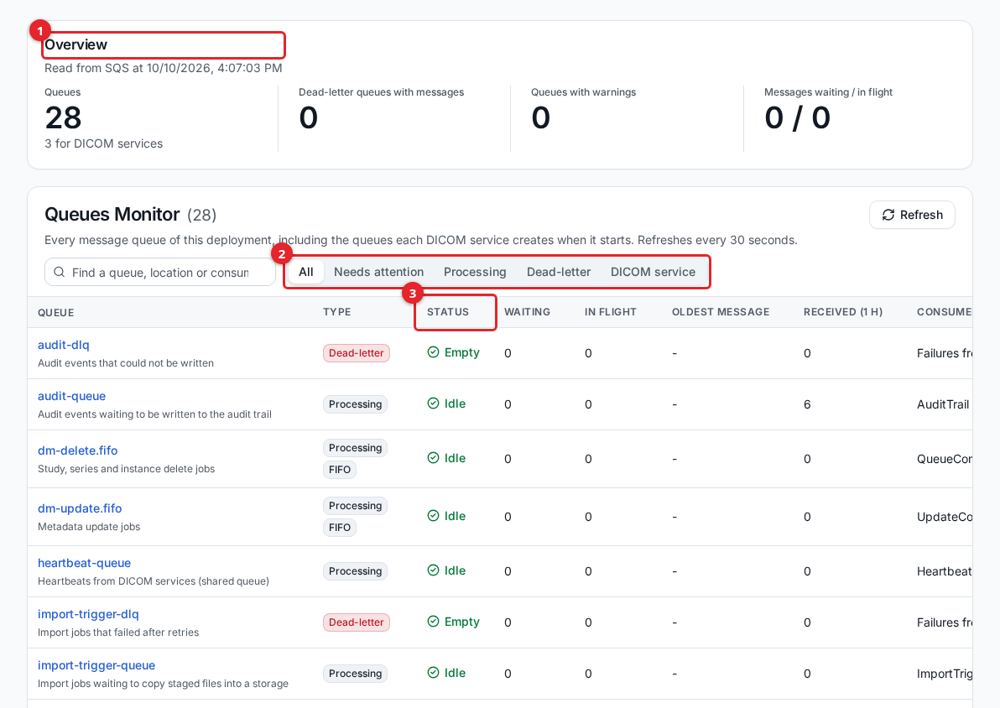
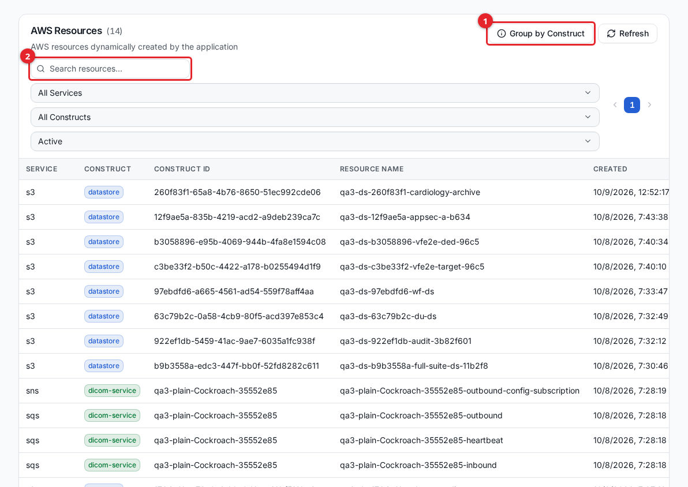

# Monitoring

The DICOM Archive gives administrators several views for checking that the system is healthy: the **Queues Monitor** for background processing queues, the **AWS Resources** page for the resources the deployment created, the **Exception Management** page for studies that need attention, and CloudWatch for logs and metrics. This guide is for administrators keeping an eye on a running deployment.

## Queues Monitor

Background work in the archive, such as ingesting uploaded DICOM files, flows through Amazon SQS message queues. The Queues Monitor lists every queue of this deployment, read live from SQS each time the page loads:

- **Processing** queues carry work to a background function, for example new storage objects waiting to be indexed.
- **Dead-letter** queues (DLQs) hold messages that failed every processing attempt.
- **DICOM service** queues are created by each DICOM service when it starts, three per service: `inbound`, `outbound` (configuration updates) and `heartbeat`. They appear and disappear with the service, and the page shows the location each one belongs to if you may also list locations or DICOM interfaces (see below).

A queue belongs to the deployment when its name starts with the stack prefix and it carries the deployment's `Deployment` tag. The monitor is only allowed to read queues with that tag, so a queue of another deployment whose name happens to share the prefix is never shown. A DICOM service queue created moments ago can be missing from one refresh while its tag takes effect; it appears on the next.

Open **Queues Monitor** from the **System** section of the sidebar. The page refreshes on its own every 30 seconds, and **Refresh** reloads it on demand. Queues that need attention are listed first.

1. The **Overview** counts the queues, the dead-letter queues holding messages, the queues with warnings, and the messages waiting and in flight across all queues.
2. **Needs attention** and the type filters narrow the table; the search box matches queue names, descriptions, locations and consumers.
3. **Status** says why a queue is flagged. Click a queue name for its full details.

The columns:

| Column | Meaning |
|---|---|
| Queue | The queue name without the stack prefix, and what it is for. |
| Type | Processing, Dead-letter or DICOM service, and FIFO for first-in-first-out queues. |
| Status | Whether the queue is healthy, and if not, why (see below). |
| Waiting | Messages waiting to be picked up, including delayed ones. |
| In flight | Messages a consumer has picked up and not yet finished. |
| Oldest message | How long the oldest waiting message has waited, from CloudWatch. |
| Received (1 h) | Messages sent to the queue in the last hour, from CloudWatch. |
| Consumer / location | The function that reads the queue, the location of a DICOM service queue, or for a DLQ the queues whose failures it collects. |

The statuses:

| Status | When |
|---|---|
| Error: *N failed messages* | A dead-letter queue holds messages. |
| Warning: *Messages waiting, consumer is disabled* | Messages are waiting and the queue's event source mapping is disabled, so nothing will read them. |
| Warning: *Oldest message has waited N min* | A message has waited more than 15 minutes. |
| Warning: *DICOM service has stopped sending heartbeats* | The service that owns the queue has sent no heartbeat for 10 minutes, or is no longer active. |
| Warning: *No DICOM service is registered for this queue* | The queue is left over from a service that is gone. The heartbeat clean-up normally deletes these, together with the heartbeat queue's event source mapping. |
| Info: *Had failed messages in the last 24 hours* | A dead-letter queue is empty now but held messages earlier in the day. |
| Healthy: *Processing* or *Idle* | Work is flowing, or there is none. |

The details panel adds messages processed in the last hour, the highest waiting count in 24 hours, the visibility timeout and retention, the dead-letter queue and retry count, each consumer's state, batch size and concurrency, and for a DICOM service queue its client id and last heartbeat.

The location, client id and last heartbeat of DICOM service queues are shown only to users whose privilege group can also list **Locations** or **Interfaces**. Other users with Queues Monitor access see *Location hidden* instead; the queue's counts and status are unchanged.

The message counts are read live on every refresh. The CloudWatch figures (**Oldest message**, **Received (1 h)**, processed in the last hour and the 24-hour peak) are reused for up to 2 minutes, so they can lag the counts slightly; adding or removing a queue fetches them again at once.

CloudWatch only reports on queues that have been active recently, so **Oldest message** and **Received (1 h)** show `-` for a queue idle for several hours. If CloudWatch, the consumer list or the DICOM service status cannot be read, the page says so in a notice and still shows the message counts.

### What a non-zero DLQ means and what to do

A healthy queue has zero messages in its DLQ: work is flowing through and nothing is failing. A dead-letter queue with an **Error** status means one or more messages failed every processing attempt and were set aside. The work in those messages did not complete. For an ingest DLQ, that typically means some uploaded files were not indexed and will not appear in search results until the problem is fixed.

When you see a non-zero DLQ:

1. Note which queue it is and how many messages it holds.
2. Open the processing lambda's CloudWatch logs for that queue (see below) and read the failure cause: a malformed file, a permissions error, or a downstream dependency that was unavailable.
3. Fix the root cause (for example, correct a permission, or exclude a corrupt file).
4. Re-drive or re-send the affected items once the cause is resolved. The count returns to zero as messages are reprocessed or discarded.

A single transient message that clears on its own is usually not a concern. A count that grows or stays high is a signal that ingestion or another background path is broken and needs attention.

## AWS Resources

The archive creates AWS resources as you use it, such as an S3 bucket per storage and the queues, topics, and services behind each feature. The **AWS Resources** page is an inventory of those resources, useful for confirming a storage's bucket exists, locating a resource by name, or reviewing what a deployment is running.

Open **AWS Resources** from the **System** section.

1. **Group by Construct** toggles between a flat list and a view grouped by the construct that owns each resource.
2. The search box filters by resource name, ARN, or description.

Each row shows the service (S3, SQS, SNS, and so on), the owning construct, the resource name, the creation time, the type, the region, and a status of **Active**, **Deleted**, or **Error**. Use the service, construct, and status dropdowns to narrow the list. The page shows **Active** resources by default; switch the status filter to review deleted or errored ones. This page is read-only; it reports resources, it does not change them.

## Exceptions

Some studies arrive but cannot be treated as primary imaging, for example a secondary capture or a non-image object. These are surfaced on the **Exception Management** page so you can review them rather than have them silently dropped.

The page's **Non-Primary Studies** tab lists these studies with their patient id, study date, modality, descriptions, instance count, storage used, and state. Filter by datastore or modality, search within the results, and select **View Details** on a row to see the full DICOM metadata, technical details (institution, scanner model, body part, pixel spacing), and workflow status. A second tab, **Other Exceptions**, is a placeholder for future exception types such as failed imports.

Exception Management is reached from the admin UI navigation where it is enabled for your deployment. Review these studies periodically so that anything misclassified or failed is caught.

## CloudWatch logs and metrics

Deeper diagnostics live in Amazon CloudWatch in the account and region where the archive is deployed. When the Queues Monitor shows a stuck DLQ, or a feature misbehaves, the lambda logs are where the cause is.

- Lambda log groups follow the standard `/aws/lambda/<function-name>` naming. The function names are prefixed with the deployment's stack prefix, so filtering the CloudWatch Logs console by that prefix narrows to this deployment's functions.
- The DICOMweb service runs as a container; its logs are under its own log group rather than a lambda group.
- To find the exact resource behind a feature, use the **AWS Resources** page to read the resource name, then open the matching log group in CloudWatch.

For a stuck ingest DLQ specifically, the ingest lambda's log stream shows whether a file was parsed and indexed or where it failed. See [importing-data.md](importing-data.md) for how ingestion works end to end.

## Health on the dashboard

The **Dashboard** (the landing page of the admin UI) summarizes the archive's content: study, series, and instance counts and recent activity. If a user without dashboard access opens it, it shows a notice to request access rather than any data. The dashboard reflects indexed content, so counts update as background statistics are refreshed rather than the instant a file lands. For live queue health, use the Queues Monitor; for content counts, use the dashboard.

## Related guides

- [audit-trail.md](audit-trail.md)
- [users-and-access.md](users-and-access.md)
- [importing-data.md](importing-data.md)
- [storage.md](storage.md)
- [dicom-networking.md](dicom-networking.md)
