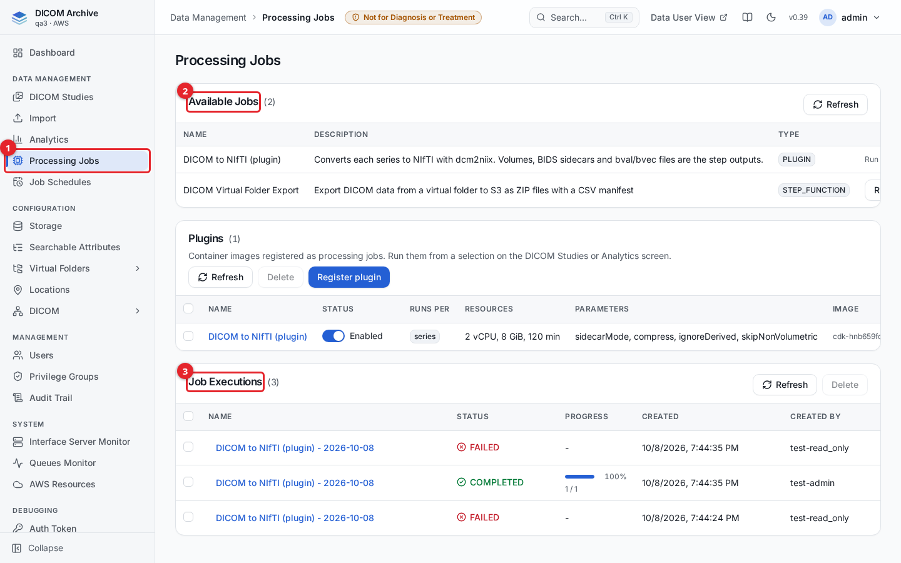
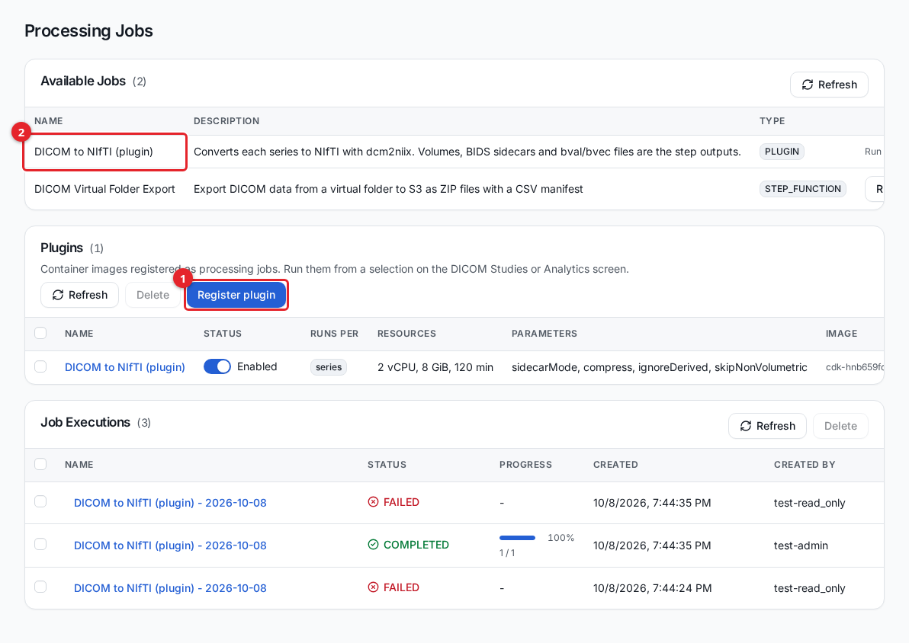
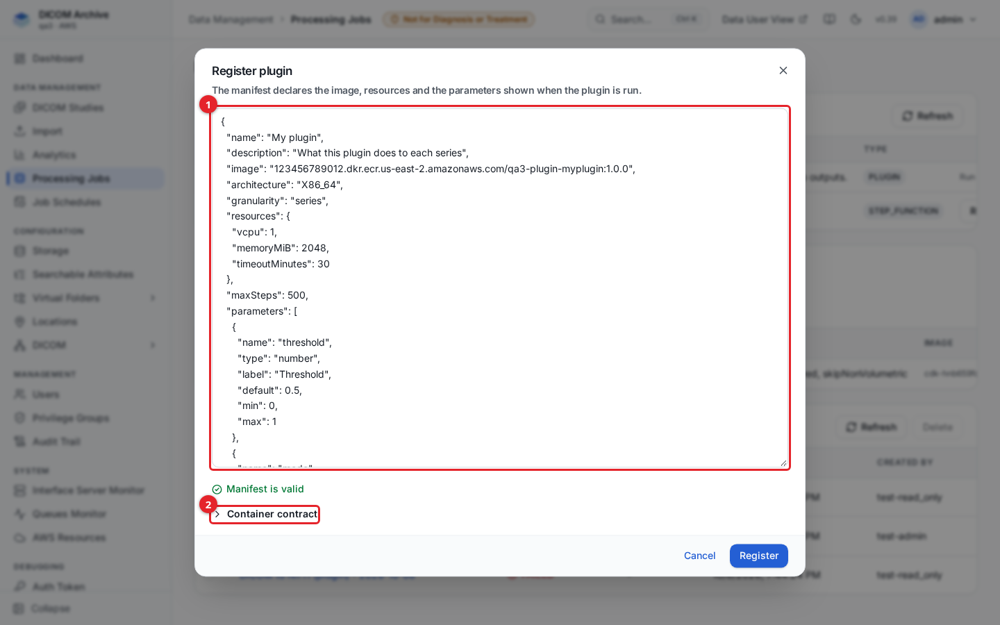
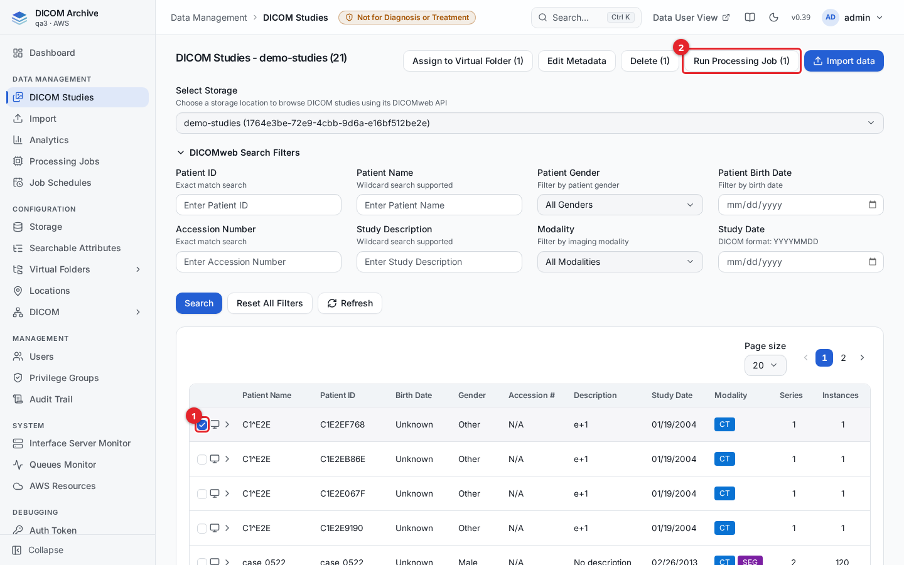
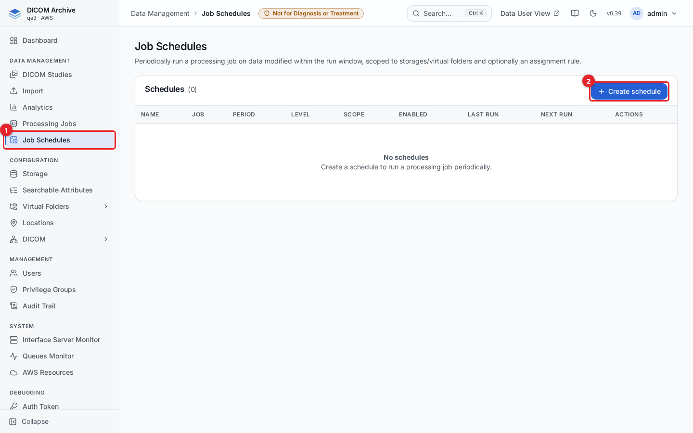
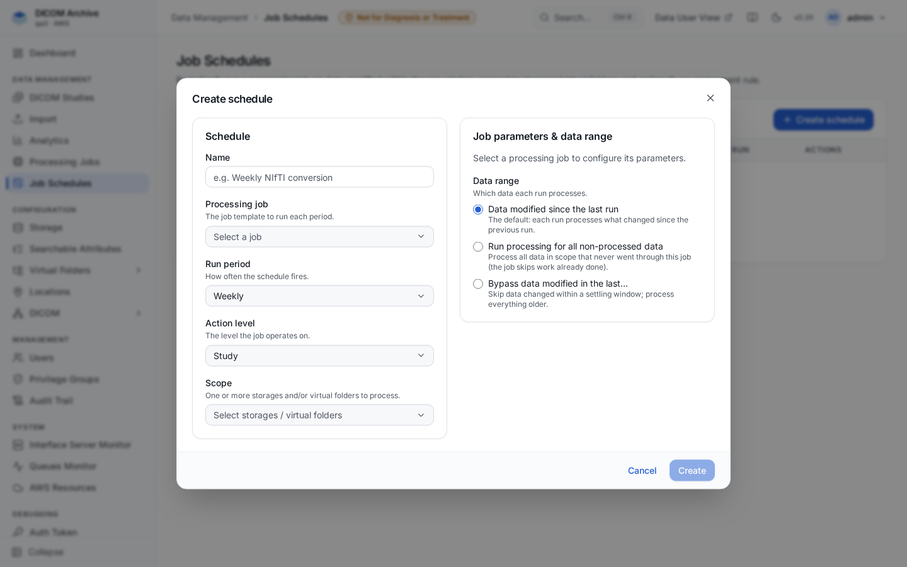

# Processing Jobs and Plug-ins

A processing job runs code over a selection of DICOM studies or series: it reads the images, does something with them, and produces output files or writes new DICOM back into the archive. The archive ships with a DICOM-to-NIfTI conversion job and a virtual-folder export job, and you can add your own jobs as plug-ins (a container image plus a short manifest) without changing or redeploying the system.

You run a job over a selection you make on the **DICOM Studies** screen or in an **Analytics** query, watch its progress and read its outputs on the **Processing Jobs** screen, and optionally set up a schedule to run a job periodically.

## Before you start

- Processing Jobs is in the admin console sidebar under **Data Management > Processing Jobs**, and schedules under **Data Management > Job Schedules**.
- The relevant **Processing jobs** management privileges, granted through a privilege group (see [users-and-access.md](users-and-access.md)):

  | Privilege | Lets you |
  |---|---|
  | `canRead` | Open the Processing Jobs and Job Schedules screens and see jobs, runs and plug-ins. |
  | `canRun` | Start a job on a selection and run a schedule now. |
  | `canCreate` | Register, edit, enable or disable a plug-in; create or edit a schedule. |
  | `canDelete` | Delete runs, run output files, plug-ins and schedules. |

- To run a job that writes DICOM back into a storage, you also need store access on that storage.

## The Processing Jobs screen

1. **Processing Jobs** in the sidebar opens the screen.
2. **Available Jobs** lists the job templates you can run.
3. **Job Executions** lists the runs, with their status, progress, and who started them.

Between the two tables, the **Plugins** panel lists the plug-ins registered on this deployment.

### Available jobs

Two job templates ship with the archive:

| Job | Type | What it does |
|---|---|---|
| DICOM to NIfTI (plugin) | PLUGIN | Converts each series to NIfTI with dcm2niix. Outputs are the `.nii.gz` volumes, a BIDS JSON sidecar, and bval/bvec files for diffusion series. |
| DICOM Virtual Folder Export | STEP_FUNCTION | Exports a virtual folder's DICOM data to S3 as ZIP files with a CSV manifest. Run it from the Virtual Folders area; see [virtual-folders.md](virtual-folders.md). |

A job that works on a selection cannot be started from this screen, because there is no selection here. It shows **Run from a selection** and is started from the DICOM Studies or Analytics screen instead. A job that needs no selection shows a **Run** button here.

## The plug-in registry

A plug-in is a container image plus a manifest that describes its parameters, how much CPU, memory and time it needs, and whether it runs per series or per study. Once registered it appears in **Available Jobs** next to the built-in jobs and is run the same way.

1. **Register plugin** opens the manifest editor.
2. Each registered plug-in shows its enable toggle, how it runs (per series or per study), its resources, its parameters and its image.

Use the **Status** toggle to enable or disable a plug-in. A disabled plug-in stays registered but cannot be run. Click a plug-in's name to edit its manifest; select plug-ins and click **Delete** to remove them. Managing plug-ins needs the `canCreate` privilege (enable, disable, register, edit) or `canDelete` (delete).

### Register a plug-in

Click **Register plugin**, paste the manifest, and the editor validates it live as you type.

1. Paste or edit the manifest. Problems are listed under the editor; **Register** is enabled only when the manifest is valid.
2. **Container contract** describes what the container must read and write for each step.

The manifest declares the image, the resources, the input granularity (`series` or `study`), and the parameters shown on the run form. Key rules:

- The image must live in an Amazon ECR repository in this account whose name starts with `<stackPrefix>-plugin-`. Images from any other registry are refused, so a plug-in cannot pull arbitrary code from the internet.
- `resources` must be a valid AWS Fargate CPU/memory combination, with `timeoutMinutes` from 1 to 720.
- Set `architecture` to match your image (`X86_64` or `ARM64`).

The container itself never receives database credentials or any permission on the archive buckets. For each step the platform hands it only the instances in that step, through presigned URLs, and reads back the files the container writes. For how to build and push an image, the full manifest schema and the container contract, see the developer reference [PLUGINS.md](PLUGINS.md).

## Run a job on a selection

### From DICOM Studies

On the **DICOM Studies** screen, select a storage, tick the studies or series you want, and click **Run Processing Job**.

1. Tick the studies or series to process.
2. Click **Run Processing Job**.

The button shows the number of items selected. See [studies.md](studies.md) for browsing and selecting studies.

### From an Analytics query

Run an Analytics query that returns `datastore_id` plus a series or study identifier, then click **Run Processing Job**. The job runs over every series the query matched, gathered on the server. See [analytics.md](analytics.md).

### The run form

Either path opens the same **Run Processing Job** form:

1. Pick the processing job. Its parameters are generated from the job's manifest, with defaults filled in.
2. For a plug-in that can write DICOM back to the archive, choose where (see [Where outputs go](#where-outputs-go)).
3. Optionally add pipeline stages with **Add a pipeline stage**: each later stage runs on the series the previous stage completed, with that stage's outputs as its input (up to four more stages, all of the same granularity).
4. Click **Start**. Track the run under **Job Executions**.

What a run may read is fixed when you start it, from your storage read grants at that moment. A series you cannot read, a storage that is not active, or a series that is not online is skipped.

## Status, logs and outputs

**Job Executions** lists every run with its status and a progress bar of completed steps.

| Status | Meaning |
|---|---|
| DEFINED | A job template, not a run. |
| PENDING / RUNNING | The run is queued or in progress. |
| COMPLETED | Every step finished successfully. |
| PARTIAL | Some steps succeeded and others failed. |
| FAILED | The run failed. |

Click a run's name to open its detail. The detail lists each step with its status, input, output and duration. For a plug-in run, each output file is shown; files whose type is an image are shown inline, and others are download links. The download links are short-lived and refresh when you reopen the run.

### Where outputs go

- **Plug-in output files** are written to the plug-in I/O bucket and listed on the run detail. They are kept until someone deletes them: use **Delete files** on the run detail to remove a run's files, the small remove control next to a single file, or delete the run to remove it and its files. Deleting a run's files is permanent.
- **DICOM written back to the archive.** A plug-in that produces DICOM can write its output back into a storage. On the run form, the write-back choice is **no**, **source** (store each series' output in that series' own source storage), or a specific **destination storage**. Written-back DICOM is validated (correct DICOM file, new unique identifiers, not a copy of an input) and then ingested like any other upload, so it appears as new series in the archive. Deleting a run's output files does not affect DICOM that was written back.

Container logs for plug-in runs are in Amazon CloudWatch Logs under the log group `/aws/batch/<stackPrefix>-plugins`.

## Schedules

A schedule runs a processing job periodically over a scope of storages and/or virtual folders, processing the data that changed within the run window.

1. **Job Schedules** in the sidebar opens the screen.
2. **Create schedule** opens the schedule form. Creating a schedule needs the `canCreate` privilege.

Each schedule row shows its job, period, action level, scope, whether it is enabled, and its last and next run. The row actions let you run it now, enable or disable it, edit it, or delete it.

### Create a schedule

Fill in the schedule:

| Field | What it sets |
|---|---|
| **Name** | A label for the schedule. |
| **Processing job** | The job template to run each period. |
| **Run period** | How often it fires: hourly, daily, weekly or every 30 days. |
| **Action level** | The level the job operates on: patient, study, series or instance. |
| **Scope** | One or more storages and/or virtual folders to process. |
| **Assignment rule filter** | Optional. When the scope includes a virtual folder, limit the run to data matching one of that folder's assignment rules. |

On the right, set the job's own parameters and the **Data range** each run processes:

- **Data modified since the last run** (the default) processes only what changed since the previous run.
- **Run processing for all non-processed data** processes everything in scope that never went through this job; the job skips work already done.
- **Bypass data modified in the last...** skips data changed within a settling window you set, and processes everything older.

Click **Create**. Use **Run now** on a schedule row to trigger it immediately without waiting for the next period.

## GPU plug-ins

A plug-in whose manifest asks for a GPU (`resources.gpu`, 1 to 4) runs on a separate GPU queue of EC2 instances instead of Fargate. The GPU environment scales from zero: no instance runs, and nothing is billed, until a GPU step is queued, and idle instances are stopped. GPU images must be `X86_64`. See [PLUGINS.md](PLUGINS.md) for the resource rules.

## Failure handling

- A step that fails is marked FAILED with the reason on the run detail; a run with a mix of outcomes is PARTIAL.
- A plug-in container that exits without writing its result file is recorded as FAILED.
- A run that could process nothing (every selected item was outside your read grants, on an inactive storage, or not online) fails with "Nothing to process".
- A pipeline stage that completes no steps stops the pipeline and records why.
- A write-back destination that no longer exists, is not active, or is not writable by you when the run starts fails the run.

AWS Lambda concurrency on a shared or small deployment is limited; if a run or the Job Executions table does not appear immediately under load, wait and refresh.

## Related guides

- [getting-started.md](getting-started.md) - find your way around the admin console.
- [studies.md](studies.md) - browse studies and start a job from a selection.
- [analytics.md](analytics.md) - start a job over the results of a query.
- [virtual-folders.md](virtual-folders.md) - virtual folders, de-identification and the export job.
- [storage.md](storage.md) - storage locations output can be written back to.
- [users-and-access.md](users-and-access.md) - the privileges that control Processing Jobs access.
- [PLUGINS.md](PLUGINS.md) - developer reference for building and registering your own plug-in.
