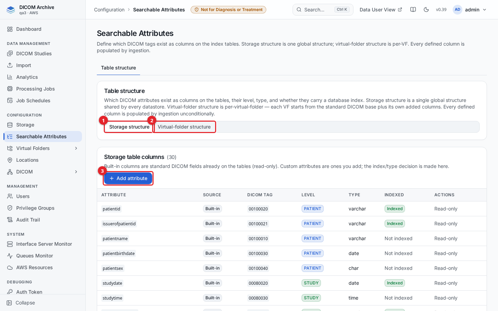
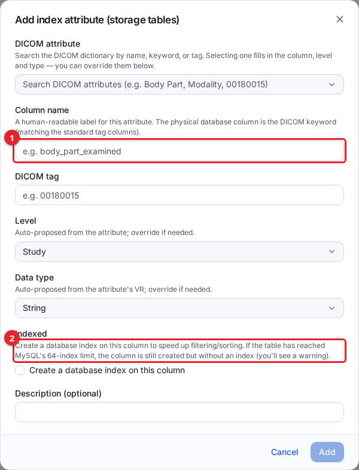
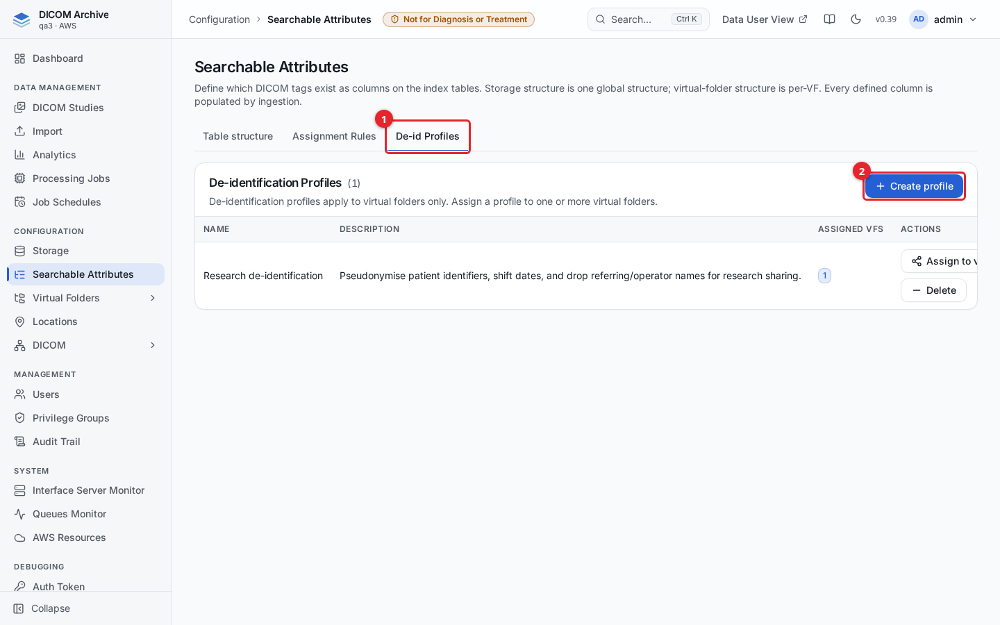

# Searchable attributes

Searchable attributes (also called index attributes) are the DICOM tags that exist as columns on the archive's index tables. The archive always indexes the standard DICOM identifiers, but you can add extra tags so they can be searched, filtered, and sorted. Administrators use the **Searchable Attributes** page to see which attributes are indexed and to add new ones.

Every attribute you define is populated by ingestion for every new object. When you add a storage attribute, the archive also back-fills it for data indexed before the attribute existed, from the DICOM headers it already stores. No Sync is needed. See "Effect on search and existing data" below.

## Before you start

- You need the `indexAttributes` management privilege (`canList` to view, `canEdit` to add, delete, or back-fill).
- Adding an attribute changes the shared index table structure. For storage attributes this applies to every storage at once (see "Storage vs. virtual-folder structure").

## The Searchable Attributes page

Open **Searchable Attributes** from the Configuration section of the sidebar. The **Table structure** tab lists the attributes defined for the selected structure.

1. **Storage structure** shows the single, global set of columns shared by every storage.
2. **Virtual-folder structure** shows the per-virtual-folder columns (you pick a virtual folder first).
3. **Add attribute** defines a new column.

Each row shows the attribute name, its **Source** (**Built-in** for standard DICOM fields, **Custom** for ones you add), its **DICOM tag**, its **Level** (Patient, Study, Series, or Instance), its data **Type**, and whether it is **Indexed** (carries a database index). Built-in columns are read-only; custom columns have a **Delete** action. In the storage structure, custom attributes also show their **Back-fill** status and have a **Back-fill** action (see "Back-fill existing studies").

## Storage vs. virtual-folder structure

- **Storage structure** is one global structure shared by every storage (datastore). A storage attribute you add is a column on the shared patient/study/series/instance tables, so it applies to all storages at once. The index and data type are decided once, here.
- **Virtual-folder structure** is per virtual folder. Choose a virtual folder from the selector, and the table shows that folder's columns: the standard DICOM base plus any columns you added for that folder.

Use the segmented control at the top of the Table structure tab to switch between the two.

## Add a searchable attribute

1. Click **Add attribute**.
2. Fill in the form and click **Add**.

1. **Column name** is a human-readable label. The physical database column is named from the DICOM keyword, matching the standard tag columns.
2. **Indexed** creates a database index on the column to speed up filtering and sorting. If the table has reached MySQL's 64-index limit, the column is still created but without an index, and you see a warning.

The dialog also has:

- **DICOM attribute**: a dictionary picker. Search by name, keyword, or tag (for example `Body Part`, `Modality`, or `00180015`). Selecting one fills in the column name, DICOM tag, level, and type for you.
- **DICOM tag**: the 8-hex-character tag (for example `00180015`). Filled in automatically when you pick from the dictionary; editable for a manual entry.
- **Level**: Patient, Study, Series, or Instance - the level the attribute belongs to. Auto-proposed from the attribute; override if needed.
- **Data type**: String, Integer, Decimal, or Date. Auto-proposed from the attribute's value representation; override if needed.
- **Description** (optional).

| Field | Required | Notes |
|-------|----------|-------|
| DICOM attribute (picker) | No | Fills the fields below from the DICOM dictionary |
| Column name | Yes | `^[a-z][a-z0-9_]{0,63}$` |
| DICOM tag | Yes | 8 hex characters, e.g. `00180015` |
| Level | Yes | Patient / Study / Series / Instance |
| Data type | Yes | String / Integer / Decimal / Date |
| Indexed | No (default off) | Adds a DB index; subject to the 64-index limit |
| Description | No | Free text |

## Effect on search and on existing data

- Adding an attribute adds a column to the index table for its level (patient, study, series, or instance). Deleting the attribute removes its definition but leaves the column, and any values already written, in place.
- **New data.** Objects ingested after you add the attribute are populated at every level.
- **Existing data.** Adding a storage attribute starts a back-fill that fills the new column for everything indexed before it, in every storage. It reads the DICOM headers the archive already keeps in its database, so it does not read S3 and does not need a Sync. See "Back-fill existing studies" below.
- The **Indexed** toggle controls only query performance (whether the column carries a database index), not whether the value is stored. An un-indexed column is still populated and searchable; it just is not optimised for filtering and sorting.

### Back-fill existing studies

A back-fill starts on its own when you add a storage attribute. It begins about 90 seconds after the add, once every ingest worker has picked up the new attribute (each caches the attribute list for up to 60 seconds). From then on, ingest covers new objects and the back-fill covers everything that was already indexed, so nothing falls between the two.

The **Back-fill** column shows the progress of each custom storage attribute:

| Status | Meaning |
|--------|---------|
| Starting | Queued; the back-fill has not started reading yet. |
| *n*% | Running. The percentage is an estimate based on how far through the table it is. |
| Done | Every row that existed when the back-fill started has been processed. |
| Failed | The back-fill stopped on an error, shown next to the status. |
| Stalled | The back-fill has made no progress for 15 minutes. |

To run it again, click **Back-fill** on the attribute's row. A failed or stalled back-fill resumes from where it stopped. A finished one starts again from the beginning, which is safe because it only rewrites the same values. While a back-fill is running, the button is disabled.

How values are filled:

- Values are read from the stored DICOM header of each instance and converted exactly as ingest converts them (same type conversion, same 255-character limit for strings, same first-value rule for multi-valued tags).
- **Instance** attributes come from each instance's own header. **Series** attributes come from the series' most recent instance. **Study** and **Patient** attributes come from the most recent instance of the most recent series of that study (or of that patient's most recent study). Deleted objects are skipped.
- An object whose header does not carry the tag gets an empty value, as with ingest.
- The back-fill works in small batches and gives way to ingest if they compete for the same rows, so it adds little load. On a very large archive it can still take a while; progress stays visible on the page.
- Back-fill applies to storage attributes. A virtual-folder attribute is filled from the storage columns when its folder is re-indexed.

A full Sync (see [Storage](storage.md)) is still the way to re-read objects from S3, for example after objects were changed outside the archive. It is no longer needed to populate a new searchable attribute.

### Where you can search on custom attributes

- **Analytics.** Custom attribute columns can be used in analytics queries (for example `WHERE s.manufacturer = 'ACME'` on the `series` table). See [Analytics](analytics.md).
- **QIDO-RS (DICOMweb search).** Not supported. A QIDO query that filters on a custom attribute returns `400 Bad Request` rather than ignoring the filter and returning unfiltered results.

## Limits

- A single MySQL table supports at most 64 indexes. When the limit is reached, a new **Indexed** attribute's column is still created but without an index, and the add returns a warning. Un-indexed attributes do not count against this limit.
- You can define a DICOM tag only once per level (once for storage, once per virtual folder). Adding the same tag at the same level again returns `409 Conflict`. On a database created from scratch, the database itself also enforces this, so two administrators adding the same attribute at the same moment get one `201` and one `409`.
- Adding a column, or its index, needs a short exclusive lock on the index table. If another database session is using the table (for example a long-running query or a busy ingest), the archive waits up to 8 seconds and then gives up rather than blocking the table. You then see *"The '<table>' table is in use by another database session, so the column could not be added without blocking the archive. Nothing was changed. Try again in a few minutes."* (`503`). Nothing was created: wait a few minutes, or until a running import, full Sync, or back-fill has finished, and add the attribute again. If only the index could not be created, the attribute is added without an index and the add returns a warning instead.
- The index and data type for a storage attribute are global: a tag is either indexed for every storage or for none. This is intentional, because the storage index tables are shared.

## De-identification profiles (virtual folders)

When you select a virtual folder in the Table-structure tab, two more tabs appear: **Assignment Rules** and **De-id Profiles**. De-identification applies to virtual folders only, never to storage.

1. **De-id Profiles** is the tab for creating and assigning de-identification profiles.
2. **Create profile** adds a new profile.

A de-identification profile defines how DICOM tags are transformed (for example hashed, removed, emptied, or date-shifted) when data is read through a virtual folder. The table shows each profile's name, description, and the number of virtual folders it is **assigned** to.

- To create a profile, click **Create profile**, give it a name and optional description, and save. Configure the profile's per-tag actions afterwards in the Virtual Folders profiles page.
- To assign a profile, click **Assign to virtual folders** on its row and select the folders. A virtual folder can use only one profile at a time, so selecting a folder here moves it to this profile; deselecting clears it.

For the full de-identification model (which tags are transformed and how it affects search versus retrieve), see [Virtual folders](virtual-folders.md).

## Related guides

- [Storage](storage.md) - storage locations and re-indexing
- [Virtual folders](virtual-folders.md) - grouped views and de-identification
- [Studies](studies.md) - search and browse indexed studies
- [Importing data](importing-data.md)
- [Analytics](analytics.md)
