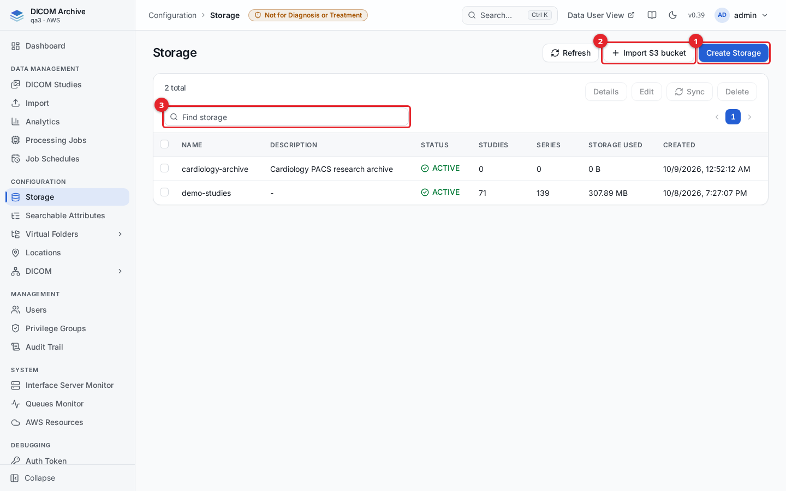
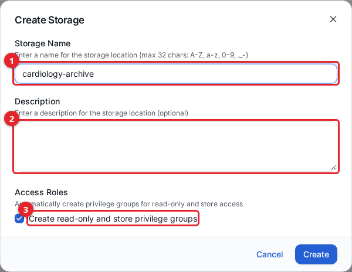
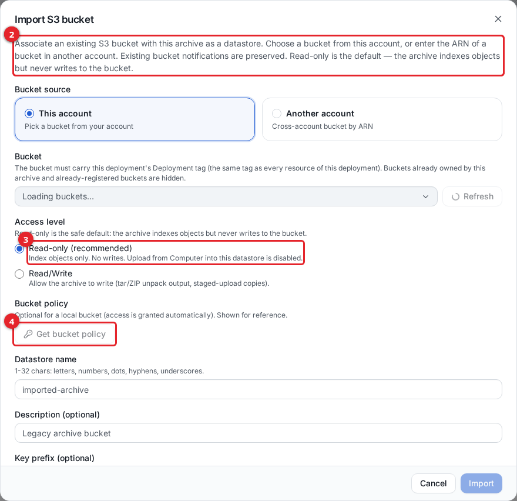
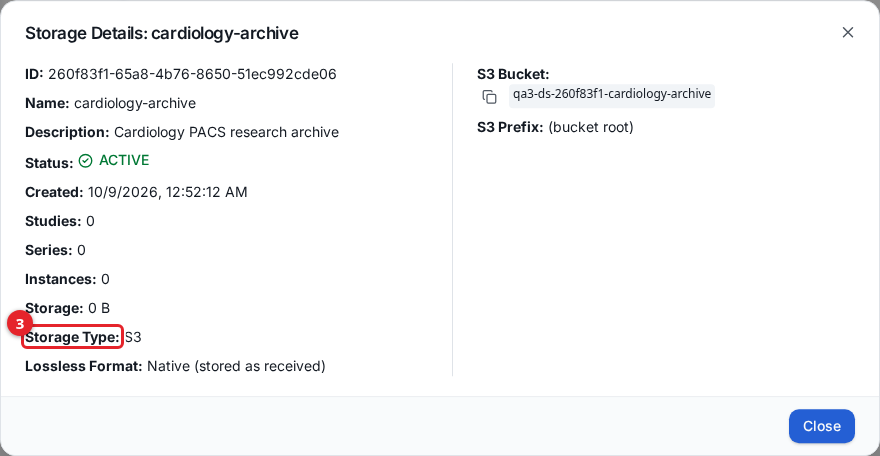
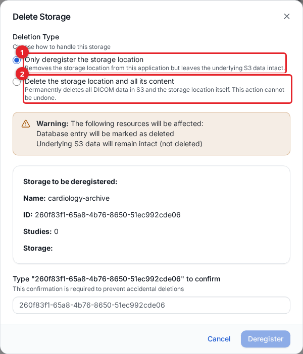

# Storage

A storage (also called a datastore) is an Amazon S3 bucket that the DICOM Archive indexes. Every DICOM object you upload, send over the network, or drop directly into the bucket is stored as a plain file in S3, and the archive keeps a searchable index of the studies, series, and instances those files contain. Administrators use the **Storage** page to create storage locations, register existing S3 buckets, inspect usage, and delete storage.

The archive is S3-only: a storage location is always backed by one S3 bucket (optionally scoped to a key prefix). Objects are stored in their native transfer syntax, exactly as received.

## Before you start

- You need the `datastores` management privilege (`canList` to see the page, `canCreate` to create, `canStore` to sync, `canDelete` to delete).
- Creating a storage provisions a new S3 bucket in the deployment's AWS account. Importing a storage reuses a bucket that already exists.

## The Storage page

Open **Storage** from the Configuration section of the sidebar. The table lists every storage location with its status, study and series counts, storage used, and creation date.

1. **Create Storage** provisions a new, archive-owned S3 bucket.
2. **Import S3 bucket** registers an S3 bucket that already exists (in this account or another).
3. The **Find storage** box filters the table by name.

Select a single row to enable **Details**, **Edit**, and **Sync**. Select one or more rows to enable **Delete**. The **Status** column shows `ACTIVE` once a storage is ready; a new storage passes through `CREATING` first, and a storage being deleted shows `DELETING`.

## Create a storage

1. Click **Create Storage**.
2. Fill in the form and click **Create**.

1. **Storage Name** (required). Maximum 32 characters, using letters, numbers, dots (`.`), hyphens (`-`), and underscores (`_`). This name is used to derive the S3 bucket name.
2. **Description** (optional). Free text shown in the table and details.
3. **Create read-only and store privilege groups** (checked by default). When checked, the archive creates two privilege groups for this storage: one granting read-only access and one granting store (write) access. These are the groups the DICOMweb and network services check on every request. Leave it checked unless you intend to manage access entirely by hand.

The new storage appears as `CREATING` and becomes `ACTIVE` once its bucket is provisioned.

| Field | Required | Notes |
|-------|----------|-------|
| Storage Name | Yes | 1-32 chars, `A-Z a-z 0-9 . _ -` |
| Description | No | Free text |
| Create read-only and store privilege groups | No (default on) | Creates the read-only and store privilege groups for this storage |

## Import an existing S3 bucket

Use **Import S3 bucket** to register a bucket that already holds DICOM data (for example a legacy archive, or a bucket another system writes to) instead of creating a new one.

An imported storage is always **read-only**. The archive indexes the bucket's objects but never writes to the bucket and never changes its settings: no tag, event notification, bucket policy or encryption change. The bucket owner prepares the bucket beforehand with commands the dialog provides, and the import checks that preparation.

1. **This account** lists the buckets in the deployment's own AWS account. Pick one from the list.
2. **Another account** registers a cross-account bucket by ARN. See [Cross-account buckets](#cross-account-buckets) for its current limits.
3. **Key prefix** (optional): restrict the storage to objects under this prefix (for example `dicom`). Fill it in before step 4, because the bucket's event rule is limited to it.
4. **Get setup instructions** shows the commands the bucket owner runs before importing, and the IAM permissions needed to run them.

Then fill in:

- **Datastore name** (required): 1-32 chars, same character rules as Create.
- **Description** (optional).
- **Index existing files now** (this-account only): queues every existing object under the prefix through the ingest pipeline so it becomes searchable. Progress appears as an import job (see [Importing data](importing-data.md)). Leave it unchecked to index only objects created from now on.

### Prepare the bucket (bucket owner, before importing)

**Get setup instructions** gives these steps for the chosen bucket and prefix, as AWS CLI commands that also need `jq`. Each command that writes a bucket setting keeps the settings already there: S3 replaces the whole tag set, notification configuration or policy on every write, so the commands read the current value first and add to it.

1. **Tag the bucket** with this deployment's `Deployment` tag (the same tag every resource of the deployment carries). This is the owner's opt-in: an untagged bucket is refused.
2. **Send the bucket's events to the archive's ingest queue.** The commands add one queue rule, `dicom-s3-ingest`, for object created, removed, restore and storage-class events, limited to the prefix when there is one. S3 does not allow two rules for the same event type on overlapping prefixes, so if another consumer already receives `ObjectCreated` or `ObjectRemoved` events for those keys, move it to EventBridge or fan the events out through an SNS topic first.
3. **Bucket policy** (only if your bucket policy denies principals it does not list): add the read-only statement for the archive's roles. A bucket in this account otherwise needs no bucket policy, because the import grants the archive's roles read access itself.
4. **KMS key policy** (only if the bucket's default encryption uses a customer-managed KMS key): add the `kms:Decrypt` statement for the archive's roles to that key's policy. SSE-S3 and the AWS-managed `aws/s3` key need nothing.

The person running the commands needs this IAM policy on the bucket (the dialog shows it with the bucket name filled in):

| Needed for | Actions |
|------------|---------|
| Steps 1 and 2 (always) | `s3:GetBucketTagging`, `s3:PutBucketTagging`, `s3:GetBucketNotification`, `s3:PutBucketNotification`, `s3:GetEncryptionConfiguration` |
| Step 3 | `s3:GetBucketPolicy`, `s3:PutBucketPolicy` |
| Step 4 | `kms:GetKeyPolicy`, `kms:PutKeyPolicy` on the key |

When you click **Import**, the archive checks the tag and the event rule and refuses the bucket until both are in place. The rule must point at the ingest queue, cover object created and removed events, carry the storage's prefix (and only that), and have no suffix filter. The import then grants the archive's own roles read-only access to the bucket. Deregistering the storage later leaves the bucket's tag and event rule in place; the owner removes them when they no longer want the archive to receive events.

### This-account buckets

The list hides buckets already owned by the archive and buckets already registered. A bucket without the `Deployment` tag can still appear in the list; importing it is refused until it is tagged.

### Cross-account buckets

A bucket in another account is registered read-only with status `ERROR`, and is not indexed yet: the ingest queue only accepts events from the deployment's own account, and the archive's roles get no read access to a bucket in another account. Use a bucket in the deployment's account to index data.

## Storage details and statistics

Select a storage and click **Details** to see its full record.

1. **Studies**, **Series**, **Instances**, and **Storage** (bytes used) are the indexed totals for this storage.
2. **S3 Bucket** is the backing bucket name (copy it with the icon).
3. **Storage Type** is always `S3`, and **Lossless Format** is `Native (stored as received)`.

The dialog also shows the storage ID, description, status, creation date, S3 prefix (or `(bucket root)`), and the read-only and store role ARNs when present. The study, series, and instance counts are maintained by a scheduled statistics job, so they can lag a few minutes behind a fresh upload.

To rename a storage or change its description, select it and click **Edit**.

## Sync (re-index) a storage

If objects were added to or changed in the bucket outside the normal ingest path, select the storage and click **Sync** to re-scan the bucket and bring the index up to date. The storage must be `ACTIVE`, and syncing requires store (`canStore`) privilege.

- **Mode**:
  - **Sync new & changed (recommended)** skips objects that are already indexed and unchanged (same S3 ETag), re-ingesting only new or modified objects.
  - **Force full re-index** re-ingests every object regardless. It is safe (idempotent) but does redundant work.
- **Prefixes** (optional): one key prefix per line to limit the scan (for example `incoming/`). Leave empty to scan the whole bucket. Each prefix runs as its own import job.

Progress is tracked in the Jobs view (see [Importing data](importing-data.md)). A large bucket can enqueue many objects and take a while to finish.

## How files get indexed automatically

You do not run an import for data that lands in the bucket. The storage bucket is wired to send S3 event notifications to the archive's ingest pipeline, so indexing is automatic:

- An **ObjectCreated** event (an upload, a network store, a direct `aws s3 cp`, or a sync) triggers the ingest function, which reads the object's DICOM header and writes the patient, study, series, and instance index rows plus the searchable attribute columns. The object stays in S3 in its native form; nothing is copied.
- An **ObjectRemoved** event soft-deletes the matching index rows (a grace period applies before they are purged, and re-adding the object before then restores them).
- A **storage-class or lifecycle transition** (for example to Glacier) updates the object's availability. Objects below Glacier Instant Retrieval are marked `OFFLINE`, a restore in progress is `NEARLINE`, and a restored or instantly retrievable object is `ONLINE`.

### Archives (tar and ZIP)

The ingest pipeline understands archive files dropped into the bucket:

- An **uncompressed tar** is indexed in place. Its members are byte-identical to standalone DICOM files, so the archive records each member's offset and length and serves it with a ranged read. There is no extraction step and no second copy.
- A **compressed tar** (`.tar.gz`, `.tar.bz2`, `.tar.xz`) or a **ZIP** is not randomly addressable, so it is unpacked on ingest: every member is written back to the bucket under `{originalKey}.extracted/`, the original archive object is kept, and each extracted member is then indexed through its own S3 event. Unpacking into the bucket requires the archive to have write access, so this applies to archive-owned storage and read/write imports, not read-only imported buckets.
- An unsupported or corrupt archive fails visibly as an import error rather than being silently skipped.

Overwrite detection on re-ingest relies on S3 object versioning plus the object's ETag: the ETag is recorded with each indexed object so a delta sync can skip keys that have not changed. For reliable detection of overwritten objects, enable versioning on the bucket.

## Storage classes, archiving, and availability

The archive does not manage its own tiering or retention rules. Lifecycle (moving objects to colder storage classes, or expiring them) is configured on the S3 bucket itself using standard S3 lifecycle rules and storage classes, and the archive reflects the result in each instance's availability:

| Object storage state | Availability in the archive |
|----------------------|-----------------------------|
| S3 Standard / Standard-IA / Glacier Instant Retrieval, or any ranged-GET-addressable tier | `ONLINE` |
| Restore in progress (from Glacier Flexible or Deep Archive) | `NEARLINE` |
| Glacier Flexible Retrieval / Deep Archive / Intelligent-Tiering archive tiers | `OFFLINE` |

A series rolls up to the best state of its instances, so a series is `ONLINE` if any of its instances is reachable. Set these transitions as S3 lifecycle rules on the bucket; the archive picks up the resulting transition events automatically and updates availability.

## Delete a storage

Select one or more storage locations and click **Delete**. You choose how far the deletion goes.

1. **Only deregister the storage location** removes the storage from the application and marks its database entry deleted, but leaves the underlying S3 data intact. The bucket and its objects are not touched.
2. **Delete the storage location and all its content** permanently deletes all DICOM data in S3 and the storage location itself.

Deleting all content cannot be undone. To confirm, type the storage ID (shown in the dialog) into the confirmation box, then click **Deregister** or **Delete All**. For multiple selections you type `N storages` instead.

Deregister is the safe choice when you only want to detach a bucket; use delete-all only when you are certain the S3 data should be destroyed.

## Related guides

- [Importing data](importing-data.md) - upload, network, and bucket ingest paths, and import jobs
- [Searchable attributes](searchable-attributes.md) - add DICOM tags as searchable index columns
- [Studies](studies.md) - browse and manage indexed studies
- [Virtual folders](virtual-folders.md) - grouped, de-identifiable views over storage
- [Users and access](users-and-access.md) - privilege groups and access control
- [Getting started](getting-started.md)
