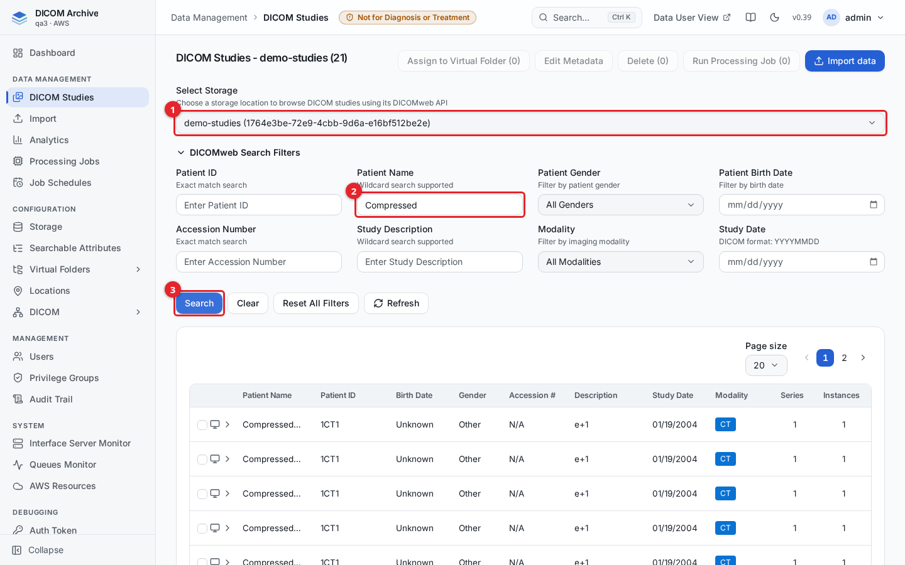
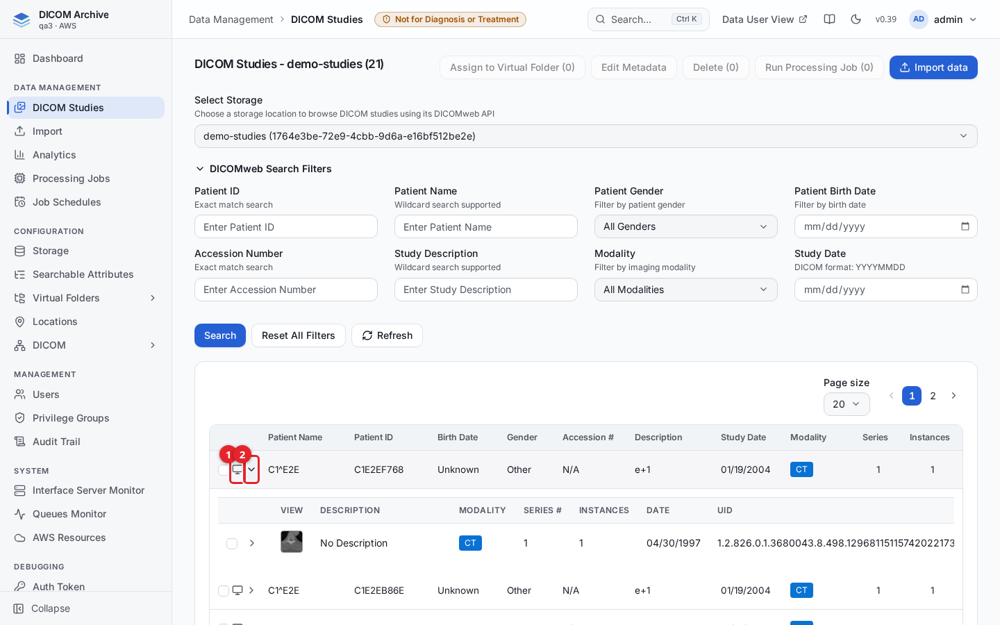
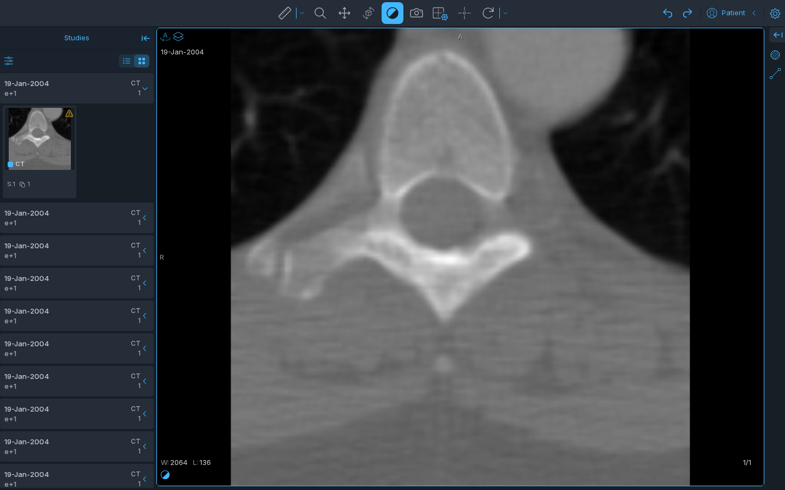
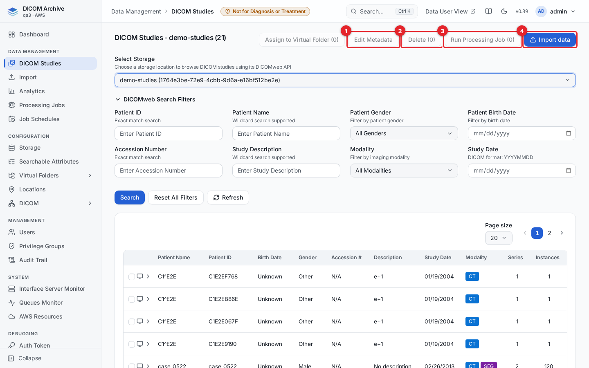
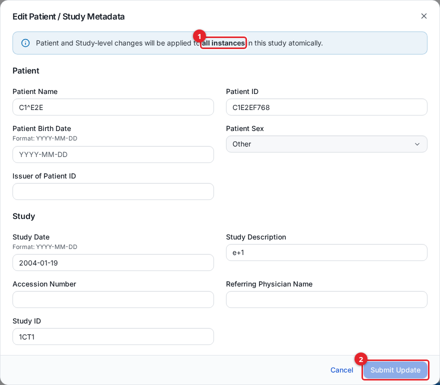
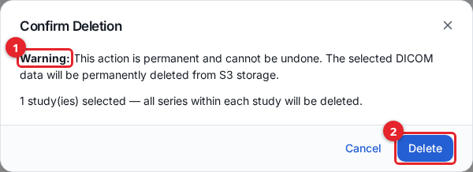

# Browsing DICOM Studies

The **DICOM Studies** screen in the admin console is where you find, inspect, and
manage the studies held in the archive. You choose a storage (or a virtual
folder), search for studies by patient and study attributes, expand a study to
see its series and instances, open a study in a viewer, and run bulk actions on
a selection: assign to a virtual folder, edit metadata, delete, run a processing
job, or jump to the import center.

This guide covers the admin **DICOM Studies** screen. Users who only browse data
they were granted use the separate data-user interface instead; see
[data-user-view.md](data-user-view.md).

## Before you start

- You need an administrator or data-access account. Each action is gated by the
  privileges in your privilege group: browsing a storage needs read
  (`canRead`), **Edit Metadata** needs update (`canUpdate`), **Delete** needs
  delete, **Run Processing Job** needs the processing-jobs run privilege, and
  **Assign to Virtual Folder** needs virtual-folder access. Buttons you lack the
  privilege for stay disabled. See
  [users-and-access.md](users-and-access.md).
- At least one storage must exist and be `ACTIVE`. See [storage.md](storage.md)
  to create one and [importing-data.md](importing-data.md) to load studies into
  it.

Open the screen by clicking **DICOM Studies** in the sidebar.

## Choose a storage

The screen browses one index at a time. Use the **Select Storage** dropdown at
the top to pick which index to read.

1. **Select Storage** chooses the index to browse. The dropdown lists two kinds
   of index: a **storage index** (one per storage) and a **VF index** (one per
   active virtual folder). Virtual-folder indexes are tagged `vf-index` and read
   the studies currently assigned to that folder.
2. Type into a filter field, for example **Patient Name**.
3. Click **Search** to apply the filters.

The heading shows the selected index name and the number of studies on the
current page, for example `DICOM Studies - demo-studies (21)`.

## Search filters

Enter one or more filters and click **Search**. Leave a field blank to ignore
it. Click **Clear** to empty the applied filters, **Reset All Filters** to clear
both the inputs and the applied filters, or **Refresh** to re-run the current
search.

| Filter | Matching | Notes |
| --- | --- | --- |
| Patient ID | Exact match | Must match the Patient ID exactly. |
| Patient Name | Wildcard | Matched as a contains search (the value is wrapped in `*...*`). |
| Patient Gender | Exact | **Male**, **Female**, or **Other**. Applied in the browser after results are fetched. |
| Patient Birth Date | Exact | `YYYY-MM-DD`. Applied in the browser after results are fetched. |
| Accession Number | Exact match | Must match exactly. |
| Study Description | Wildcard | Matched as a contains search. |
| Modality | Exact | Pick from the modality list; matches studies that include that modality. |
| Study Date | Exact day | Entered as `YYYY-MM-DD`; sent to the archive as `YYYYMMDD`. |

Patient Gender and Patient Birth Date are applied in the browser rather than by
the archive. When you use either of them, the screen fetches a larger batch and
filters it locally, so paging is limited while those two filters are active.

## Read the results table

Each row is one study. The table shows Patient Name, Patient ID, Birth Date,
Gender, Accession number, Description, Study Date, Modality, Series count, and
Instance count. The Modality column shows one coloured badge per modality in the
study (for example CT, or CT and SEG together).

Use the **Page size** control and the pager above the table to move through
pages. Because the archive returns one page at a time, the pager advances page
by page rather than showing an exact total.

## Expand a study to see series and instances

Click the expand arrow at the left of a study row to load its series. Click a
series row's arrow to load the instances in that series.

1. The **view** control (the screen icon) opens the study in the OHIF viewer.
2. The expand arrow collapses the study again.

Each series row shows a thumbnail of its first instance, the series description,
modality, series number, instance count, and the Series Instance UID. Click a
thumbnail to open a larger preview of that image inside the screen.

## Open a study in a viewer

Click the **view** control on a study row (the screen icon, shown when the study
is expanded) to open it in the viewer. The viewer opens in a new browser tab.

Standard imaging (CT, MR, US, and similar) opens in the **OHIF** viewer. The
data-user interface can also offer a whole-slide microscopy viewer (**SLIM**)
for slide-microscopy studies; see [data-user-view.md](data-user-view.md). The
viewer is a separate application and may take several seconds to load the first
image.

## Select studies and run bulk actions

Tick the checkbox on one or more study rows (or on individual series inside an
expanded study) to enable the action buttons at the top right.

1. **Edit Metadata** opens the metadata editor for a single selected study, or
   for a single selected series.
2. **Delete** opens the delete confirmation for the current selection.
3. **Run Processing Job** runs a processing job against the selected studies and
   series. Shown only when you have the run privilege. See
   [processing-jobs.md](processing-jobs.md).
4. **Import data** opens the import center, preselecting the current storage.
   See [importing-data.md](importing-data.md).

An **Assign to Virtual Folder** button also appears (to the left of **Edit
Metadata**) when virtual folders are enabled and the current index is a storage,
not a virtual folder.

### Assign to Virtual Folder

Select one or more studies, then click **Assign to Virtual Folder**, choose the
target folder, and confirm. This adds the studies to that folder's index without
copying or moving any files. See [virtual-folders.md](virtual-folders.md).

When the current index is itself a virtual folder, **Delete** means *unassign
from this folder*: it removes the selected studies or series from that folder
only and never touches the stored files.

### Edit Metadata

Select exactly one study (for patient and study fields) or one series (for
series fields), then click **Edit Metadata**.

1. Patient and study edits are applied to **all instances** in the study
   together.
2. Change only the fields you need; blank fields are left unchanged.
3. Click **Submit Update** to queue the change. Click **Cancel** to close
   without saving.

For a study you can change Patient Name, Patient ID, Patient Birth Date, Patient
Sex, Issuer of Patient ID, Study Date, Study Description, Accession Number,
Referring Physician Name, and Study ID. For a series you can change Series
Number, Series Description, and Series Date. Dates must be `YYYY-MM-DD` and
Series Number must be numeric. The update is queued and applied in the
background; the pending-operations badge next to the storage selector shows how
many changes are still in progress.

### Delete studies or series

Select the studies or series to remove and click **Delete**. A confirmation
dialog appears before anything is removed.

1. The dialog warns that the deletion is permanent.
2. Click **Delete** to confirm, or **Cancel** to stop.

Deleting from a storage index is permanent. For each deleted study or series the
archive soft-deletes the study, series, and instance records so they stop
appearing in searches immediately, unassigns the content from every virtual
folder it was in, permanently deletes the backing objects from S3, and
recomputes the storage's statistics. The deletion is recorded in the audit trail
(see [audit-trail.md](audit-trail.md)) and cannot be undone. Deletes run in the
background, so the pending-operations badge may show the work in progress for a
short time.

Deleting from a virtual-folder index is not a real deletion: it only unassigns
the selection from that folder, leaving the stored files untouched.

## Related guides

- [getting-started.md](getting-started.md)
- [storage.md](storage.md)
- [importing-data.md](importing-data.md)
- [virtual-folders.md](virtual-folders.md)
- [searchable-attributes.md](searchable-attributes.md)
- [processing-jobs.md](processing-jobs.md)
- [data-user-view.md](data-user-view.md)
- [audit-trail.md](audit-trail.md)
- [users-and-access.md](users-and-access.md)
- [dicomweb-api.md](dicomweb-api.md)
