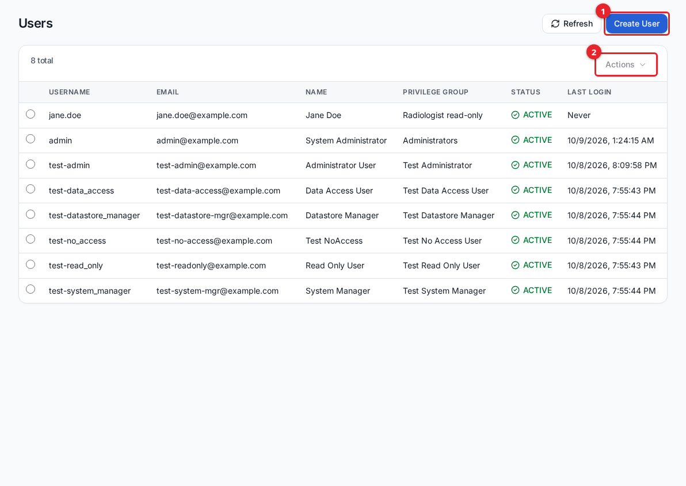
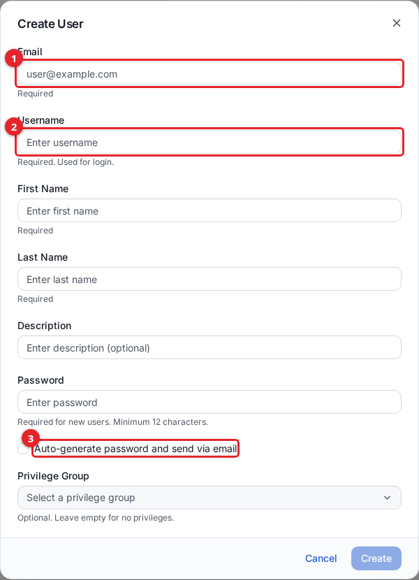
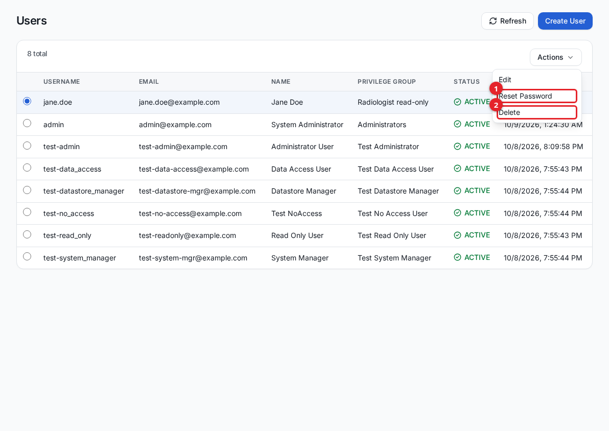
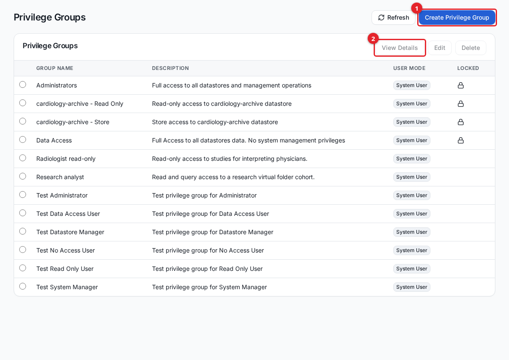
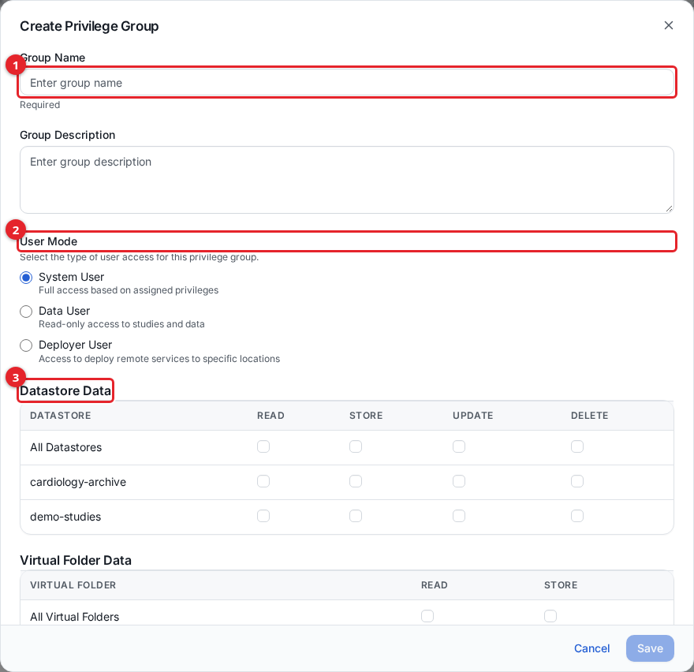
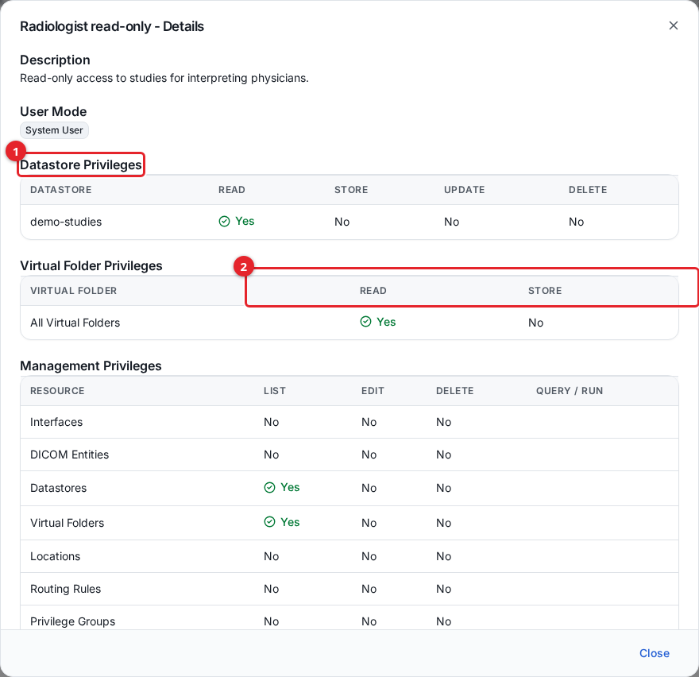

# Users and access control

The DICOM Archive controls who can sign in and what each person can do through two building blocks: **users** (people who sign in) and **privilege groups** (named sets of permissions you assign to users). This guide is for administrators who manage accounts and permissions in the admin UI.

Users sign in with Amazon Cognito. Every user is assigned to one privilege group, and that group decides which pages, data, and actions the user can reach. A user with no privilege group can sign in but sees nothing.

## Before you start

- You need an account whose privilege group grants **Users** management (list and edit) to create or change users, and **Privilege Groups** management to create or change groups. These live under the **Management** section of the sidebar.
- You cannot grant a privilege you do not hold yourself. When you assign a group that grants more than your own account has, the request is refused and the extra privileges are listed back to you.
- You cannot change your own privilege group.

## Users

Open **Users** from the **Management** section of the sidebar. The table lists each user's username, email, full name, privilege group, status, and last login.

1. **Create User** opens the create dialog.
2. **Actions** (enabled when one row is selected) holds Edit, Reset Password, and Delete.

### Create a user

Select **Create User** and complete the form.

1. **Email** is the address the invitation and password-reset messages are sent to. It cannot be changed after the user is created.
2. **Username** is what the person types to sign in. It may contain only letters, numbers, periods, hyphens, underscores, and the `@` symbol.
3. **Auto-generate password and send via email** lets Cognito create a temporary password and email it to the user. Leave it unchecked to set a password yourself (minimum 12 characters).
4. **Privilege Group** sets the user's permissions. It is required to save the form.

The fields and their rules:

| Field | Required | Notes |
|---|---|---|
| Email | Yes | Login notifications and resets go here. Fixed after creation. |
| Username | Yes | Letters, numbers, `. - _ @` only. Used to sign in. |
| First Name | Yes | |
| Last Name | Yes | |
| Description | No | Free text. |
| Password | Yes, unless auto-generating | Minimum 12 characters, with uppercase, lowercase, a number, and a symbol. |
| Auto-generate password | No | Emails a temporary password instead of setting one. |
| Privilege Group | Yes | The group whose permissions the user receives. |

Select **Create**. If you set the password yourself, the dialog shows a one-time **Temporary Password** you must copy and give to the user; they are required to change it on first login. If you chose auto-generate, the password is emailed instead.

#### The invitation email and its daily limit

When a user is created, Cognito sends an invitation email with the sign-in instructions. The account's email sender has a small daily quota. If the quota is reached, the user is not created and the UI reports:

> User could not be created: the invitation email sending limit was reached. Try again later.

This is an HTTP 429 response. Wait and try again later, or set a password yourself and hand it to the user through another channel instead of relying on the email.

If you assign a privilege group that does not exist, creation fails with a 400 response naming the missing group.

### Reset a password

Select a user, open **Actions**, and choose **Reset Password**.

1. **Reset Password** emails the user a link to set a new password.
2. **Delete** removes the user (see below).

Confirm the reset. The user receives an email with a link to the **Reset Password** page, where they set a new password (minimum 12 characters, with uppercase, lowercase, a number, and a symbol). The same daily email limit applies: if it is reached, the UI reports a 429 and you can retry later.

An administrator cannot type a new password directly for an existing user. To change their own password, a user signs out and uses **Forgot your password?** on the sign-in page.

### Edit, disable, or delete a user

- **Edit** changes the user's name, description, and privilege group. Email and username are fixed. To change a password, the user must reset it themselves.
- **Delete** removes the user. Select the user, open **Actions**, choose **Delete**, and type the user's email to confirm. Deletion cannot be undone.

## Privilege groups

A privilege group is a named, reusable set of permissions. You build the group once, then assign it to any number of users. Open **Privilege Groups** from the **Management** section.

1. **Create Privilege Group** opens the editor.
2. **View Details** shows a read-only summary of the selected group's privileges and its assigned users.

Some groups are **locked** (shown with a lock icon). Locked groups are built-in system groups and cannot be edited or deleted.

### User modes

Every group has one **user mode** that decides the shape of its permissions:

| User mode | What it is for |
|---|---|
| System User | Full access to the admin UI, limited by the specific privileges you grant. |
| Data User | Read-only access to studies and data, through the data-user view. See [data-user-view.md](data-user-view.md). |
| Deployer User | Access to deploy remote services to specific locations. See [dicom-networking.md](dicom-networking.md). |

### Create a privilege group

Select **Create Privilege Group**.

1. **Group Name** is required.
2. **User Mode** selects System, Data, or Deployer (see the table above).
3. **Datastore Data** grants per-storage data permissions.
4. **Management** (System User mode only) grants per-feature administrative permissions.

For a System User group you set three kinds of permission.

**Datastore privileges** apply per storage. The **All Datastores** row (`*`) applies to every storage at once; the rows below it target one storage each.

| Permission | Allows |
|---|---|
| Read | Query and retrieve studies in the storage (QIDO/WADO). |
| Store | Upload instances to the storage (STOW-RS). |
| Update | Modify study and series metadata. |
| Delete | Delete studies, series, and instances. |
| Download | Save whole studies as a `.zip` from the data-user website. Needs Read on the same storage as well. |

**Virtual folder privileges** apply per virtual folder, with the same **All Virtual Folders** (`*`) row.

| Permission | Allows |
|---|---|
| Read | Query and retrieve content assigned to the folder. |
| Store | Upload content into the folder. |
| Download | Save whole studies from the folder as a `.zip` from the data-user website. Needs Read on the same folder as well. In a de-identified folder the downloaded files are de-identified. |

**Download is separate from Read.** Read lets a user browse a storage or folder and
view its images; Download lets them take a copy of the files away. A group gets no
Download unless you tick it, including groups created before the privilege existed.
The one exception is the built-in **Administrators** group: it is locked against
edits and has no Download box ticked, but it can download from every storage and
folder it can read (its details view shows Download as Yes). An administrator can
grant Download to other groups; a user who lacks Download on a storage or folder
cannot grant it there. Every download, and every refused attempt, is recorded in
the audit trail as a `DOWNLOAD_STUDY` entry. See
[data-user-view.md](data-user-view.md#downloading).

**Management privileges** apply per feature. Most features expose **List**, **Edit**, and **Delete**. A few differ: Audit Trail, Statistics, and System Monitor are List-only; Analytics and Processing Jobs add a **Query / Run** column. Selecting Edit, Delete, or Query/Run also turns on List for that feature, because you cannot act on a list you cannot see.

The management features are: Interfaces, DICOM Entities, Datastores, Virtual Folders, Locations, Routing Rules, Privilege Groups, Users, Audit Trail, Statistics, Analytics, Searchable Attributes, Processing Jobs, and System Monitor.

Select **Save**.

### View a group's privileges

Select a group and choose **View Details** to see its datastore, virtual folder, and management privileges, plus the users assigned to it.

1. **Datastore Privileges** and **Virtual Folder Privileges** list the per-resource grants.
2. **Management Privileges** lists the per-feature grants.

### Examples

**Radiologist read-only.** A System User group for interpreting physicians who read but never change data:

- Datastore privileges: **Read** on the storage they review (Store, Update, Delete off). Tick **Download** too only if they should be able to take copies of studies away.
- Virtual folder privileges: **Read** on **All Virtual Folders**.
- Management privileges: **Datastores** List and **Virtual Folders** List, so the storages appear in the UI. Nothing else.

**Research analyst.** A System User group for a researcher working with a de-identified cohort:

- Virtual folder privileges: **Read** on the research folder (for example, a "Lung CT research cohort" folder).
- Management privileges: **Analytics** List and **Query**, and **Virtual Folders** List. No datastore privileges, so the analyst sees only the folder, not the raw storages behind it.

### Delete a group

Select a group and choose **Delete**, then type the group name to confirm. A group that is still assigned to users cannot be deleted; the error lists the users you must reassign first. Locked system groups cannot be deleted.

## Multi-factor authentication (MFA)

The user pool is configured to **require** MFA using a time-based one-time password (TOTP) authenticator app. SMS is not used. On first sign-in after the invitation, a user sets a permanent password and is prompted to register an authenticator app (for example Google Authenticator, Microsoft Authenticator, or 1Password) by scanning a QR code and entering the six-digit code it generates. On every later sign-in they enter the current code from that app.

If a user loses their authenticator device, an administrator with **Users** edit permission can select the user, open **Actions**, and choose **Reset MFA**. This clears the current MFA registration so the user sets up a new device on their next sign-in. The Reset MFA action appears only when MFA is enabled for the deployment.

## Signing in and recovering access

- **Sign in** at the admin UI (`/admin/`) with your username and password, then the current code from your authenticator app.
- **Forgot your password?** on the sign-in page emails a reset link to your account's email address. Open the link and set a new password.
- Account recovery is by email only. Keep each user's email address current, because it is the only self-service recovery channel.

## Related guides

- [getting-started.md](getting-started.md)
- [data-user-view.md](data-user-view.md)
- [audit-trail.md](audit-trail.md)
- [dicomweb-api.md](dicomweb-api.md)
- [importing-data.md](importing-data.md)
- [dicom-networking.md](dicom-networking.md)
- [virtual-folders.md](virtual-folders.md)
