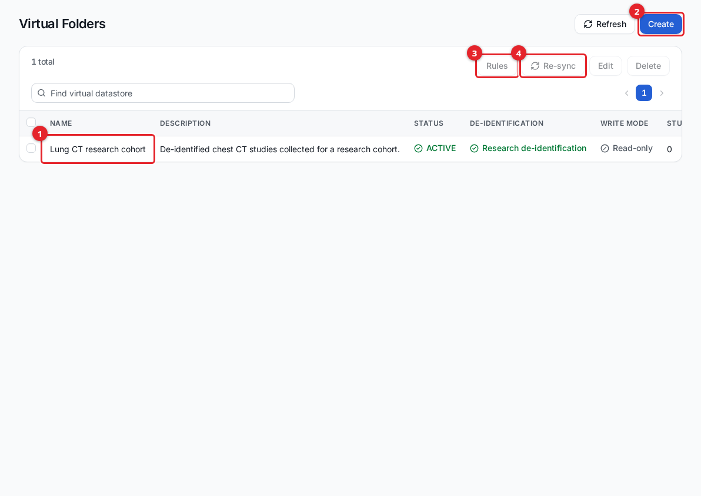
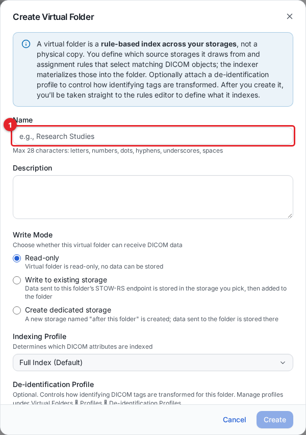
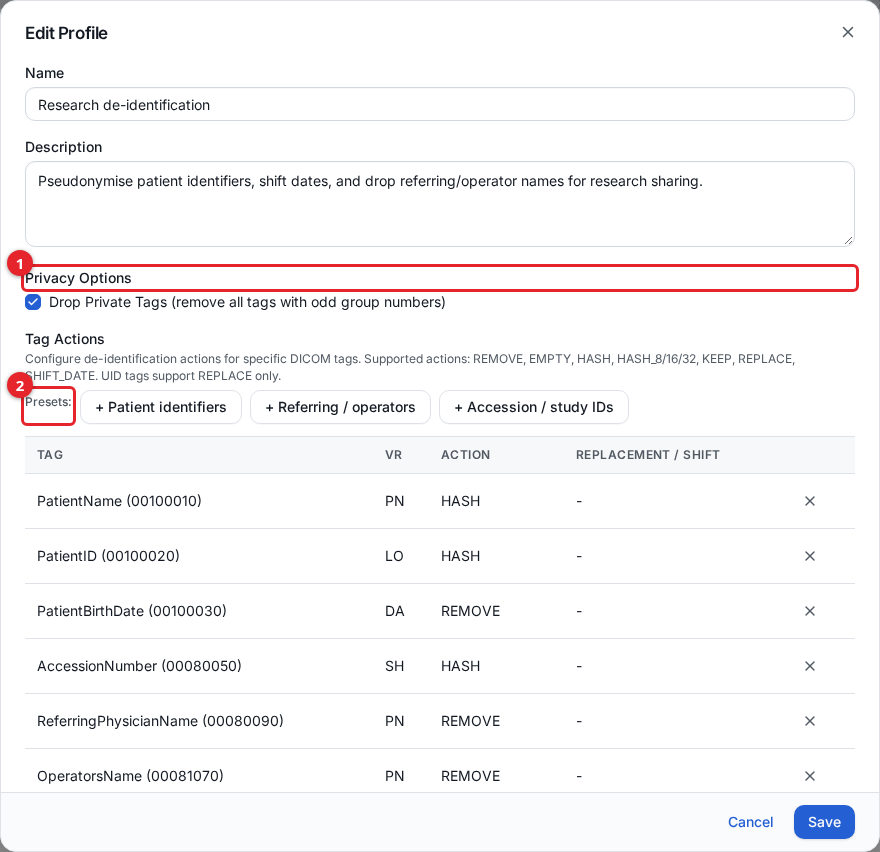
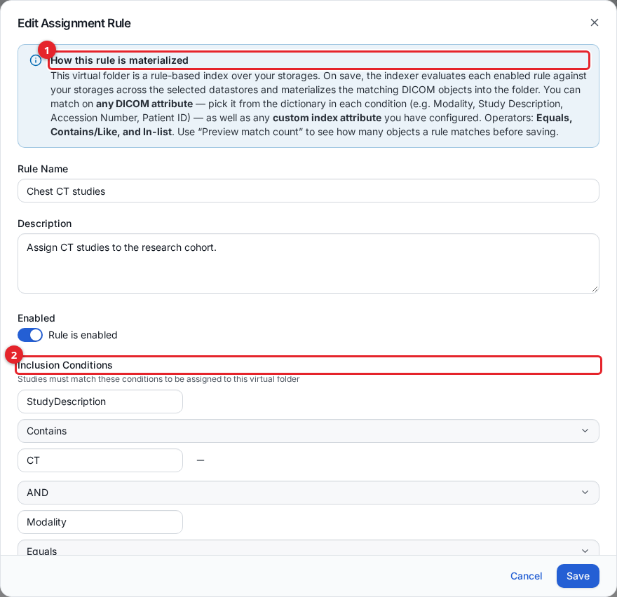

# Virtual folders

A virtual folder is a saved view across one or more of your storages. It does not copy any DICOM data. Instead it keeps a set of membership rows that point at studies, series, and instances already stored in your storages, and presents them as one collection. A folder can optionally apply a de-identification profile, so the patient names, identifiers, and dates it shows are pseudonymised copies while the originals stay untouched in the source storage.

Virtual folders are used to gather studies that belong together regardless of which storage they live in: a research cohort, a teaching set, or a de-identified collection to share with a downstream system over DICOMweb. Administrators and privileged users create and manage them in the admin UI; data users read the folders they have been granted access to in the data-user UI.

## How a virtual folder is built

A virtual folder has three moving parts:

- **Membership.** The folder tracks which instances belong to it. Membership rows are added when you assign a study or series by hand, or when an assignment rule matches content during ingest, import, or a re-sync. No pixel data or metadata is duplicated; the rows reference the physical objects in the source storage.
- **A de-identification profile (optional).** If the folder has a profile, every assigned series is run through it and the de-identified values are written into the folder's own index. Reads of the folder return only those de-identified values.
- **Assignment rules (optional).** Rules describe which DICOM objects should join the folder automatically, based on their DICOM attributes.

Assignment and de-identification are asynchronous. After you assign content or save a rule, the matching work is queued and processed in the background. Small assignments appear within seconds; large studies or a full re-sync of many studies take longer. If a folder looks empty right after you assign to it, wait and refresh.

## Before you start

- To create and manage virtual folders, de-identification profiles, and assignment rules, you need the **Virtual Folders** management privilege (list, edit, and delete control the corresponding actions). See [users-and-access.md](users-and-access.md).
- To assign a study or series to a folder, you need read access to the source storage and store access to the target folder.
- To let a data user open a folder, grant that user or their group **read** access to the specific folder. See [users-and-access.md](users-and-access.md).

The Virtual Folders area is in the admin UI left sidebar under **Configuration > Virtual Folders**, with three pages: **Folders**, **De-identification Profiles**, and **Assignment Rules**. Deep links land on the dashboard, so open the UI and click through the sidebar.

## The Folders page

**Configuration > Virtual Folders > Folders** lists every folder with its status, linked de-identification profile, write mode, and study and series counts.

1. A folder row. The **De-identification** column shows the linked profile name, or **Disabled** when none is set; the **Write Mode** column shows whether the folder can receive data.
2. **Create** opens the create dialog.
3. Select one folder and click **Rules** to manage its assignment rules.
4. Select one folder and click **Re-sync** to rebuild its rule-based membership from the current rules (see [Re-syncing a folder](#re-syncing-a-folder)).

Select a folder to enable **Edit** and **Delete**. Deleting a folder removes all of its study assignments and its de-identified index; it does not touch the source storages or their data.

## Create a folder

1. On the **Folders** page, click **Create**.
2. Fill in the fields described below.
3. Click **Create**. You are taken straight to the assignment rules editor for the new folder, so you can define what it indexes.

1. **Name** is required. Use 1 to 28 characters: letters, numbers, dots, hyphens, underscores, and spaces.
2. **Write Mode** controls whether the folder can receive DICOM data (see the table below).
3. **De-identification Profile** optionally links a profile that transforms identifying tags for this folder.

| Field | Required | What it does |
| --- | --- | --- |
| Name | Yes | Display name of the folder (1 to 28 characters). |
| Description | No | Free text shown in the folder list. |
| Write Mode | Yes | How the folder handles incoming DICOM data. One of **Read-only**, **Write to existing storage**, or **Create dedicated storage** (see below). |
| Target Storage | Only for **Write to existing storage** | The storage that data sent to this folder is written to. You can pick only storages you have store access to. |
| Indexing Profile | No | Which DICOM attributes are indexed for the folder. Defaults to **Full Index (Default)**. |
| De-identification Profile | No | The de-identification profile applied to content in this folder. Defaults to **None (no de-identification)**. |

### Write mode

The write mode decides whether a folder is purely a view or can also receive data through its own STOW-RS endpoint.

| Write mode | Behaviour |
| --- | --- |
| **Read-only** | The folder is a view only. No data can be stored to it. This is the usual choice for a research or teaching collection. |
| **Write to existing storage** | Data sent to the folder's STOW-RS endpoint is stored in the storage you choose in **Target Storage**, then added to the folder. You must have store access to that storage. |
| **Create dedicated storage** | A new storage, named after the folder, is created. Data sent to the folder is stored there. Requires the storage create privilege (Storage: Edit). |

For how DICOM data is sent to a writable folder over STOW-RS, see [dicomweb-api.md](dicomweb-api.md).

## De-identification profiles

A de-identification profile is a reusable set of tag actions. When a profile is linked to a folder, every series assigned to that folder is de-identified with the profile before it is indexed, so the folder shows pseudonymised values for the attributes the profile transforms. The originals in the source storage are never changed.

> **Important: DICOM UIDs are kept at their original values.** In this release a virtual folder does not pseudonymise UIDs. The Study Instance UID, Series Instance UID, SOP Instance UID and Frame of Reference UID that a folder returns (QIDO-RS, WADO-RS metadata, Part 10 retrieve and ZIP download, viewers and folder analytics) are the **original** UIDs of the source objects, and so is the Media Storage SOP Instance UID in the file meta header of retrieved files. The folder uses these UIDs to find the physical objects. Anyone who holds other data from the same source (an identified copy, a PACS export, a report or an order) can therefore match folder content back to it by UID. A de-identified folder is **not** de-identified to the HIPAA Safe Harbor or DICOM PS3.15 Annex E (Basic Application Confidentiality Profile) standard. See [Limits of folder de-identification](#limits-of-folder-de-identification) before sharing a folder outside your organisation.

Profiles are managed on **Configuration > Virtual Folders > De-identification Profiles**. One profile can be linked to many folders, but a folder can have at most one profile.

### Create or edit a profile

1. Go to **Configuration > Virtual Folders > De-identification Profiles**.
2. Click **Create Profile**, or select a profile and click **Edit**.
3. Set a name and description, choose whether to drop private tags, and add one tag action per DICOM tag you want to transform.
4. Click **Save**.

1. **Privacy Options.** The **Drop Private Tags** checkbox removes every private tag (any tag with an odd group number) in addition to the per-tag actions below.
2. **Presets** add common groups of patient-identifier, referring/operator, and accession/study-ID actions in one click. You can then adjust or remove individual rows.

Below the presets, the **Tag Actions** table lists each tag with its value representation (VR) and the action applied. Add a single action with the **DICOM Tag** and **Action** selectors under the table, then **Add Tag Action**. Adding an action for a tag that already has one replaces it.

### Tag actions

Each tag action names one DICOM tag and the action to apply to its value.

| Action | What it does |
| --- | --- |
| `KEEP` | Leave the value unchanged. |
| `REMOVE` | Blank the element (the tag is kept but its value is emptied). |
| `EMPTY` | Same effect as `REMOVE`: the value is emptied. |
| `HASH` | Replace the value with a keyed hash (a 64-character hex string). Not available for UID tags (VR UI); see the notes below. |
| `HASH_8` / `HASH_16` / `HASH_32` | A hash truncated to 8, 16, or 32 characters, for when a shorter pseudonym is enough. |
| `REPLACE` | Replace the value with a fixed replacement text you supply. |
| `SHIFT_DATE` | Shift a date by a consistent, per-patient number of days drawn from the range you set (**Min Days to Shift** and **Max Days to Shift**). The same patient is always shifted by the same offset, so date intervals within a patient are preserved. |

Notes on behaviour, taken from the de-identification engine:

- Hashing is keyed with a per-deployment secret combined with the folder's identity, so pseudonyms cannot be reversed by guessing and are stable for a given folder.
- UID tags (VR UI) accept only `REPLACE` with one fixed value, and `HASH` is refused for them. Do not add `REPLACE` for the Study, Series or SOP Instance UID: every instance would get the same UID. The folder's index and its read path keep the original Study, Series and SOP Instance UIDs whatever the profile says (see the note above).
- `SHIFT_DATE` uses the patient's identifier to pick the offset, so all dates for one patient move together.
- Private-tag removal (the **Drop Private Tags** option) applies at every level of the dataset header, including tags nested inside sequences. In a Part 10 retrieve, elements stored **after** the Pixel Data element (for example vendor private groups above 7FE0 or a Digital Signatures Sequence) are passed through unchanged; see the limits below.

### How de-identified data is produced and served

When a series is assigned to a folder that has a profile, a background worker reads the original patient, study, series, and instance values from the shared index, applies the profile, and writes only the de-identified values into the folder's own de-identification index. A series is written de-identified or not written at all, so an original value never appears in the folder while de-identification is in progress.

The folder's index stores no original values for the attributes the profile transforms. It does store the original Study, Series and SOP Instance UIDs, which it needs to find the physical objects. Because of this:

- Searching a folder works on the de-identified values. You cannot search a folder by the original patient name or ID; search the source storage for that.
- When the folder is read over DICOMweb (QIDO/WADO), the same engine is applied to retrieved metadata, so a tag reads the same whether it came from the folder's index or from an on-the-fly metadata retrieve. See [dicomweb-api.md](dicomweb-api.md).

### Limits of folder de-identification

A folder's profile pseudonymises the attribute values it names. It is not a complete de-identification, and in this release:

- **UIDs are original.** Study, Series, SOP Instance and Frame of Reference UIDs, and the Media Storage SOP Instance UID in the file meta header of retrieved files, keep their source values in every folder response. They can be used to link folder content back to identified copies of the same data.
- **The file meta header is not de-identified.** Retrieved Part 10 files carry the source file meta group (0002), including Media Storage SOP Instance UID and, when present, Source Application Entity Title.
- **Elements after Pixel Data are not filtered.** A Part 10 retrieve de-identifies the dataset header and streams the Pixel Data element and everything after it unchanged, even with **Drop Private Tags** set. Objects that store private groups or a Digital Signatures Sequence after Pixel Data keep them.
- **Burned-in text in the pixels is not removed.** Patient details drawn into the image (common on ultrasound, secondary-capture and scanned documents) are served as stored.
- **Only named tags change.** Tags the profile does not name are kept as stored.

Treat a de-identified folder as pseudonymised data for controlled sharing, not as anonymised data. Before giving a folder to recipients who may hold other data from the same site, review these limits with your privacy officer.

Changing a profile does **not** retroactively re-de-identify content that is already in a folder. New assignments use the current profile; existing folder content keeps the values written when it was assigned. To re-apply a changed profile to existing content, remove and re-assign that content (or re-sync, for rule-based membership).

## Add studies and series to a folder

You can add content by hand from the studies view, or automatically with assignment rules.

### Assign from the DICOM Studies page

1. Open **Data Management > DICOM Studies**.
2. Select a storage index and the studies or series you want to add.
3. Use the **Assign to virtual folder** action and pick the target folder.

Assigning a study adds every instance in it; assigning a series adds that series only. Assignment is idempotent, so assigning the same content twice does not create duplicates. After the assignment commits, the folder's de-identification runs in the background.

### Remove content from a folder

In the DICOM Studies virtual-folder view, select the studies you want to drop and remove them. Removing content unassigns it from that folder only. It never deletes anything from S3 or from the source storage, and it does not affect any other folder. The removed series are also purged from the folder's de-identification index.

## Assignment rules

An assignment rule describes which DICOM objects should join a folder automatically. Each rule has one or more conditions on DICOM attributes and a set of source storages it applies to.

Manage rules from **Configuration > Virtual Folders > Assignment Rules** (pick a folder from the selector), or from the **Rules** button on the Folders page.

### Create or edit a rule

1. Open the rules editor for a folder and click **Create Rule**, or **Edit** an existing rule.
2. Give the rule a name, and leave **Enabled** on so it is evaluated.
3. Add **Inclusion Conditions** that content must match, and optional **Exclusion Conditions** that keep matching content out even when the inclusion conditions pass.
4. Select the **Datastores** (source storages) the rule applies to. A rule with no storages selected matches nothing, so pick at least one.
5. Optionally click **Preview match count** to see how many objects match right now, without saving.
6. Click **Save**.

1. The information panel explains that the rule is materialized by the indexer on save.
2. **Inclusion Conditions**: content must match these to be assigned. Each condition is an attribute, an operator, and a value, joined by **AND** or **OR**.

Below the inclusion conditions are the **Exclusion Conditions**, the **Datastores** selector, and the **Preview match count** button.

### Conditions

A condition compares a DICOM attribute to a value. Pick the attribute from the dictionary in each condition, or choose **Custom Attribute...** to enter a raw tag (format `####,####` or `########`) for a custom index attribute you have configured.

The attributes evaluated by the ingest matcher and the preview count are:

`StudyInstanceUID`, `SeriesInstanceUID`, `SOPInstanceUID`, `SOPClassUID`, `ContentKind`, `Modality`, `SeriesDescription`, `StudyDescription`, `StudyDate`, `AccessionNumber`, `PatientID`, `PatientName`, plus any custom index attribute.

The operators honored during materialization are:

| Operator | Meaning |
| --- | --- |
| **Equals** | The attribute equals the value exactly. |
| **Contains / Like** | The value appears anywhere in the attribute (case-insensitive). |
| **In-list** | The attribute equals one of a comma-separated list of values. |

The editor lets you pick other operators, but only Equals, Contains/Like, and In-list are applied; a condition using any other operator is ignored during materialization, and the editor warns you when that happens. Use **Preview match count** to confirm a rule matches what you expect.

### When rules are evaluated

A rule changes a folder's membership at these points:

- **New ingest.** When new DICOM data is stored, each affected series is evaluated against the enabled rules of the storages it belongs to, and matching series are assigned.
- **Import.** Data brought in through the import pipeline is evaluated the same way. See [importing-data.md](importing-data.md).
- **Re-sync (re-evaluate existing content).** A re-sync re-applies the current rules across all existing content in the selected storages.

Saving or editing a rule does not retroactively scan content that was ingested earlier. To apply a new or changed rule to content that is already stored, re-sync the folder.

### Re-syncing a folder

On the Folders page, select a folder and click **Re-sync**. This rebuilds the folder's rule-based membership from the current rules by deleting and re-creating the rule-driven assignments, then re-de-identifying the matched series. Re-sync runs in the background and can take a while for a folder that spans many studies. Manually assigned content is managed separately from rule-driven content.

## Access to a folder

Who can see or write a folder is controlled by privilege groups:

- The **Virtual Folders** management privilege controls who can create, edit, and delete folders, profiles, and rules.
- Per-folder read and store privileges control who can read a folder's content and who can assign to or write to it.

Grant a data user or group read access to a specific folder so it appears in their data-user UI. For the full model and how to set it up, see [users-and-access.md](users-and-access.md).

## How a folder looks to a data user

A data user sees only the folders they have been granted read access to, and they see de-identified values when the folder has a profile. The data-user UI presents a folder like any other collection of studies, with viewing and DICOMweb access scoped to that folder. See [data-user-view.md](data-user-view.md).

## DICOMweb access to a folder

A virtual folder is addressable over DICOMweb at its own path, so QIDO-RS, WADO-RS, and (for a writable folder) STOW-RS all work against the folder. Reads return the folder's de-identified values. For endpoints, authentication, and examples, see [dicomweb-api.md](dicomweb-api.md).

## Caveats

- **Assignment and de-identification are asynchronous.** Content and de-identified values appear in the background after you assign or save a rule. Expect seconds for small assignments and longer for large studies or a full re-sync; refresh if a folder looks empty immediately after assigning.
- **A changed profile is not applied retroactively.** Only new assignments use the updated profile. Remove and re-assign (or re-sync rule-based content) to re-apply it.
- **Folders never duplicate data.** Membership points at the objects in the source storage. Deleting a folder, or removing content from it, affects only the folder, never the source storage or S3.
- **You cannot search a folder by original identifiers.** The folder index holds de-identified values only; search the source storage to find content by its original patient name or ID.
- **An editor operator that is not Equals, Contains/Like, or In-list is ignored** during materialization. Confirm a rule with **Preview match count**.

## Related guides

- [getting-started.md](getting-started.md)
- [storage.md](storage.md)
- [studies.md](studies.md)
- [searchable-attributes.md](searchable-attributes.md)
- [importing-data.md](importing-data.md)
- [data-user-view.md](data-user-view.md)
- [dicomweb-api.md](dicomweb-api.md)
- [users-and-access.md](users-and-access.md)
- [audit-trail.md](audit-trail.md)
